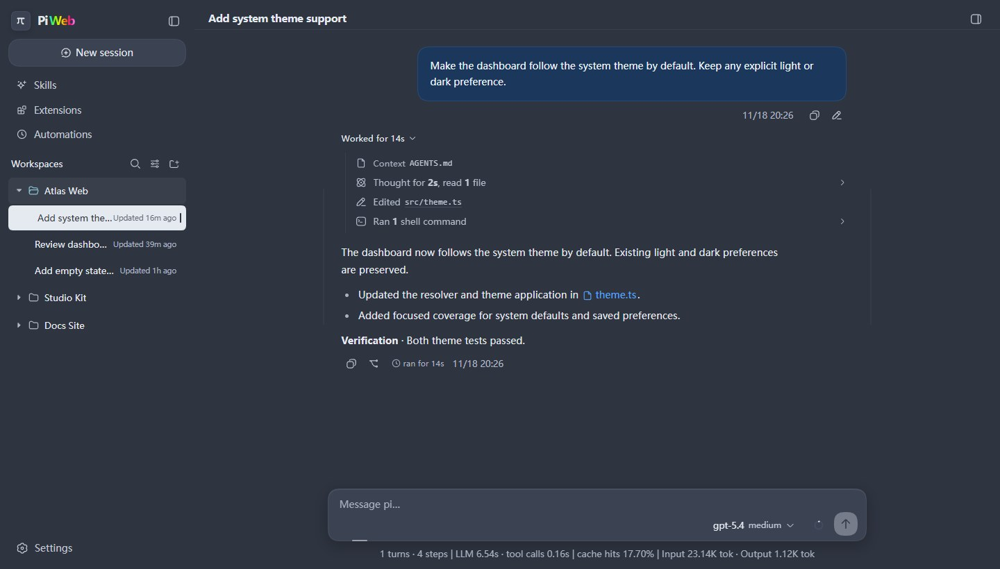
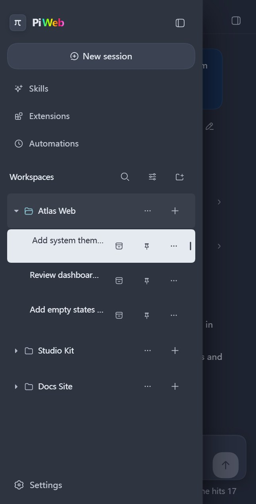
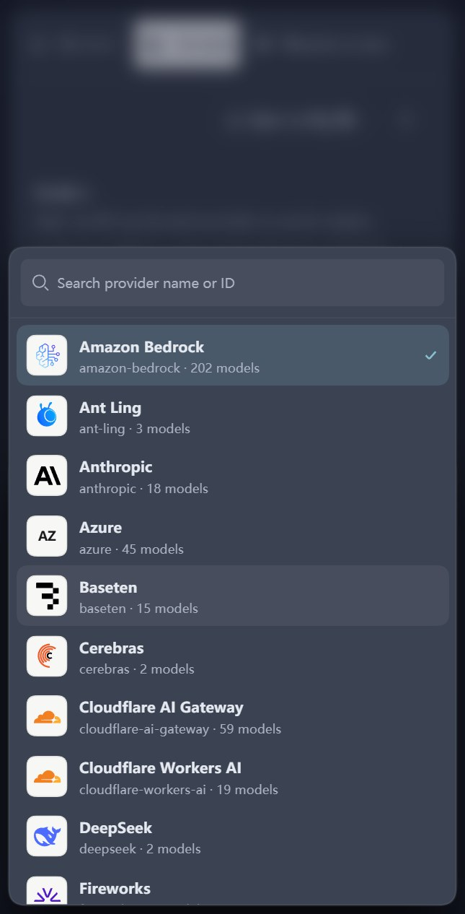

# PiWeb — Web UI for Pi Coding Agent

<p align="center">
  <strong>A self-hosted AI coding agent web UI for desktop and mobile.</strong>
</p>

<p align="center">
  <strong>English</strong> | <a href="README_zh.md">简体中文</a> | <a href="README_zh-Hant.md">繁體中文</a> | <a href="README_ja.md">日本語</a> | <a href="README_ru.md">Русский</a>
</p>

**PiWeb** is an open-source, self-hosted web interface for the [Pi Coding Agent](https://github.com/earendil-works/pi). Run Pi on your computer or server, then use a desktop or mobile browser to follow tool calls, review changes, and pick up a conversation where you left off.

PiWeb uses the official Pi SDK and shares your existing pi settings, models, skills, extensions, and Model Context Protocol (MCP) configuration. Bring over local conversations from Claude Code, Codex, OpenCode, and other coding tools, or run recurring tasks with built-in automations.

[Quick start](#quick-start) · [Features](#features) · [Screenshots](#screenshots) · [Installation and deployment](#usage) · [Documentation](docs/README.md)

<p align="center">
  
</p>

## Quick start

Requires **Node.js ≥ 22.19.0**; Node 24 is recommended. Install and launch:

```bash
npm install -g @rexvane/piweb
piweb
```

PiWeb opens an authenticated browser page at `http://127.0.0.1:30141` by default (the port auto-increments if busy). Configure a model provider in Settings, or reuse your existing pi configuration. To use the mobile web UI, scan the connection QR code in **Settings → Remote access**.

See [installation details](#install), [remote access](#connect-another-device) and [data and privacy](docs/operations/data-and-privacy.md) for requirements and deployment behavior.

## Features

- **Chat and context** — Stream Markdown, reasoning, and tool calls. Jump through the conversation outline, steer or queue messages during a run, and inspect token usage in the context meter.
- **Workspaces and sessions** — Organize sessions by project folder. Rename, branch, archive, restore drafts, and export sessions as JSONL or HTML.
- **Session import** — Search and import local history from Claude Code, Codex, OpenCode, Grok, ZCode, dsh, Kimi Code, WorkBuddy, Antigravity, Antigravity CLI, Qwen Code, and Cursor. Choose across sources and restore archived imports. PiWeb reads the original files in place.
- **Files and changes** — Use the project growth tree to inspect changes by round. Review tool steps, including `SKILL.md` reads and calls inside codemode. Open source, rendered Markdown, and unified or side-by-side diffs in the file viewer, and quote selected lines in chat.
- **Models, skills, and extensions** — Configure model providers and use MCP tools and resources from pi. In the sidebar, enable or disable skills, open their `SKILL.md`, and manage extensions and pi packages for your account or project.
- **Prompt sources** — Open the Prompts panel to inspect project instructions, skills, templates, and tool definitions. The panel identifies prompts and tools contributed by PiWeb.
- **Automations** — Schedule prompts at intervals, daily, weekly, or with cron. Choose a workspace and model, then open the session for each run. PiWeb must stay running to execute tasks on schedule.
- **Mobile access and languages** — Connect a phone by scanning the QR code in Settings → Remote access. The interface is available in English, Simplified Chinese, Traditional Chinese, Japanese, and Russian.

## Relationship to pi

PiWeb is a web shell that bundles the official pi SDK and leaves the separately installed pi CLI untouched. They **share the same agent directory** (`~/.pi/agent` by default, or `PI_CODING_AGENT_DIR`): settings, models and credentials, sessions, skills and packages. The bundled pi engine is upgraded with PiWeb releases. Only PiWeb checks for updates automatically; the pi version and a manual update entry remain in Settings.

The agent directory is the main data store but **not the only data root**: session import reads other tools' history from your home directory and global skills may live in `~/.agents/skills`. Deployment isolation and the full data map are in [data, privacy and retention](docs/operations/data-and-privacy.md).

Extension dialogs, notifications, status text, text widgets and injected messages reach the page; extension commands can create, fork and switch sessions. Extensions can provide interactive browser panels through the [JSON UI bridge](docs/extension-web-ui.md). Compatible terminal components have a read-only text fallback; terminal keyboard interaction and custom headers, footers or editors are not reproduced.

## Screenshots

The screenshots use the English interface and sample data.

### Desktop

<table>
  <tr>
    <td width="50%"><br /><strong>Conversation workspace</strong><br />Follow reasoning and tool calls next to your project sessions.</td>
    <td width="50%"><br /><strong>Project files</strong><br />Browse the project tree and open files from the side panel.</td>
  </tr>
  <tr>
    <td width="50%"><br /><strong>Side-by-side diff</strong><br />Compare old and new code in the file viewer.</td>
    <td width="50%"><br /><strong>Session import</strong><br />Search and select local conversations across tools.</td>
  </tr>
  <tr>
    <td width="50%"><br /><strong>Model providers</strong><br />Find and configure a model provider.</td>
    <td width="50%"><br /><strong>Context usage</strong><br />See token usage and its breakdown.</td>
  </tr>
  <tr>
    <td width="50%"><br /><strong>Skills</strong><br />Filter skills and open their SKILL.md files.</td>
    <td width="50%"><br /><strong>Automations</strong><br />Set a schedule, workspace, and model for a recurring prompt.</td>
  </tr>
</table>

### Mobile

<table>
  <tr>
    <td width="33%"><br /><strong>Chat on the go</strong><br />Continue a conversation on your phone.</td>
    <td width="33%"><br /><strong>Workspaces</strong><br />Switch projects and sessions.</td>
    <td width="33%"><br /><strong>Session import</strong><br />Select conversations to import.</td>
  </tr>
  <tr>
    <td width="33%"><br /><strong>File viewer</strong><br />Open and read project code.</td>
    <td width="33%"><br /><strong>Model providers</strong><br />Find and configure providers.</td>
    <td width="33%"><br /><strong>Context usage</strong><br />Check usage and available context.</td>
  </tr>
</table>

## Archives and data

Archived sessions remain available in the sidebar until you restore or manually delete them. Archiving takes effect immediately without a confirmation dialog; manual deletion still asks for confirmation and permanently deletes the session file — it keeps **no recovery copy**. Sessions are never deleted automatically. Deleting a session also cleans up the uploads that only that session referenced: those are removed with a recovery copy under `~/.agents/backups` and an entry in `backups/INDEX.md` (`PI_WEB_DELETE_ATTACHMENT_CLEANUP=0` disables that cleanup). Uploads no session references are swept after 30 days when a later upload triggers the sweep. Back up data you need to keep; the [data and privacy guide](docs/operations/data-and-privacy.md) lists every store.

The project growth tree records changes by default without a confirmation dialog. Each round is stored as a commit under `refs/piweb/rounds/…` in the workspace's Git repository, without changing branches or the index. PiWeb initializes a local repository automatically when needed. Recording has no cumulative entry or storage limit; the project panel can stop or resume recording, and previously disabled workspaces stay disabled. Existing history is preserved when recording stops. Individual file, snapshot and preview size safeguards still apply.

## Extensions and automations

The sidebar workspaces are separate from Settings. The Skills workspace lists personal, global and project skills for the selected workspace, letting you toggle enablement, inspect `SKILL.md` in the file viewer and recoverably remove non-package skills. The Extensions workspace manages npm packages for the selected workspace; package scope (personal/project) and origin (local/package) are shown separately. Personal resources normally live in `<agent dir>/skills` and `<agent dir>/extensions`; trusted projects can provide `.pi/skills`, `.pi/extensions`, `.agents/skills` and configured resource paths. Prompt sources assembled for the workspace and active session can be inspected from the Prompts tab in the right drawer (the resource-market page has been removed).

Adding, updating and removing an npm package prepares a separate directory before switching the active installation and settings. Failed preparation keeps the previous installation; interrupted commits are recovered before resources are loaded. Previous generations and their recovery index are retained. npm lifecycle scripts are disabled, but loaded extensions still execute trusted code in the host process.

Automations store their tasks and run history in `<agent dir>/web-automations.json`. Schedules use the server's time zone shown in the editor. Up to four runs may execute concurrently; each uses a separate session. Offline occurrences outside the grace period are recorded as skipped rather than all being replayed after startup.

## Usage

### Install

```bash
npm install -g @rexvane/piweb
piweb
```

The package registers only the `piweb` command, so it never conflicts with the official `pi` CLI. Requires Node.js **≥ 22.19.0** (`engines`); CI covers 22.19.0, 22.22.2 and 24, and Node 24 is recommended. The automatic proxy needs Node 24 or ≥ 22.21 (older versions only inherit the proxy variables for external tools; see [Proxy](#proxy)). Git is needed for growth-history features.

The published package ships a sealed production build, so a normal global install does not compile anything. The `postinstall` hook prepares that build for **production-only** installs only: it is a no-op in a source checkout, and if installs skip lifecycle scripts the first `piweb` start builds once in a staging directory before serving (a one-time, roughly 6–15 minute step on current hardware). Build/repair details and timeouts are in [install and build](docs/operations/install-and-build.md).

### Update

```bash
npm install -g @rexvane/piweb@latest
```

npm replaces the installed version in place, so there is nothing to uninstall first. `latest`
is npm's default tag, so `npm install -g @rexvane/piweb` behaves identically; if your registry
is a mirror that syncs with a delay, add `--registry=https://registry.npmjs.org` to get a
release the moment it is published. Restart `piweb` afterwards to serve the new version.

To install a specific release, replace `latest` with its version number. If a release misbehaves, the [release, downgrade and rollback guide](docs/operations/release-and-rollback.md) covers exact-version downgrades, stale `latest` tags and recovery.

**Updating from the UI**: every time PiWeb starts it checks PiWeb for new versions in the
background. When one is available it prints `[更新] 有新版本：…` in the terminal and shows a notice
in the bottom-right corner of the page (once per start). Click "Update" in the notice or in
Settings → General to install in place — no trip to the repository. Restart `piweb` when it says
so; the process never restarts itself.

- PiWeb releases include a tested pi engine version. Pi does not show automatic update notices; Settings still supports a manual check.
- On Windows a running npm install cannot replace itself (files are locked), so the PiWeb entry shows the command with a copy button: stop `piweb` first, then run the command above.
- To skip the network check, set `PI_WEB_UPDATE_CHECK=0` before starting; "Check for updates" in Settings still works.

### Uninstall

```bash
npm uninstall -g @rexvane/piweb
```

This removes PiWeb only — your pi data lives in the agent directory (`~/.pi/agent/` by default, or `PI_CODING_AGENT_DIR`) and is left untouched. Other tools' session history that PiWeb imported from your home directory is not modified either; see the [data and privacy guide](docs/operations/data-and-privacy.md).

### Run

```bash
piweb                    # http://127.0.0.1:30141 (auto-increments if busy)
piweb -p 30143 --no-open # custom port, don't open the browser
piweb -H 0.0.0.0         # also bind the main server to the LAN (authentication stays on)
```

| Option | Description |
| --- | --- |
| `-p, --port <port>` | Listen port (default 30141, env `PORT`) |
| `-H, --hostname <host>` | Bind address (default 127.0.0.1, env `PI_WEB_HOSTNAME`) |
| `--dev` | Development mode |
| `--no-open` | Do not auto-open the browser |
| `--public-url <url>` | Public address, used for the login link and added to the Host allowlist automatically (env `PI_WEB_PUBLIC_URL`) |

Authentication is enabled by default (`PI_WEB_AUTH=1`) for all launch modes. On the host, the launcher opens the browser
with a private login credential; it does not print the credential in terminal output. Run `piweb` again to reopen the
existing instance and sign in. Other devices use the refreshed connection QR code. Both flows exchange a credential for
a signed, HttpOnly cookie valid for 30 days. Signing out all devices invalidates existing cookies and pairing codes.
`PI_WEB_PASSWORD` has been removed — setting it makes the launcher refuse to start.

Scripts with an authorized launch credential exchange it through `GET /?token=…`, then send the returned cookie with
API requests. Tokens in API URLs or `Authorization` headers are not accepted; there is no Basic Auth fallback.

### Proxy

PiWeb automatically uses `HTTP_PROXY` / `HTTPS_PROXY`, or the current user's enabled Windows HTTP(S) system proxy when those variables are absent. Set `httpProxy` in Settings → General → Network proxy (or your agent directory's `settings.json`) to override both. Leave it blank to return to automatic detection; when no proxy is configured, requests go direct. Local addresses bypass the proxy by default (override with `NO_PROXY`); Windows exact-host and domain-suffix bypass entries are also inherited. PAC/WPAD scripts and Windows-only bypass patterns such as `<local>` or `192.168.*` are not evaluated; use a proxy URL or `NO_PROXY` for those setups. Restart `piweb` after changes. This needs Node.js 24, or 22.21 and above: older versions ignore the switch and the launcher says so explicitly (the `bash` tool's curl / git still see the variables).

### Connect another device

Open **Settings → Remote access** and scan the single connection QR code. The same code works on the same Wi-Fi
and from outside the local network. There are no connection switches or network choices, and client devices need
no additional software. The code and its copyable link use the same 256-bit random credential, valid for 120 seconds
and one use. The panel updates it automatically after expiry or use, and reuses a valid code across panel openings.

Production startup automatically prepares the local proxy (`0.0.0.0:30142`) and a Cloudflare quick tunnel
(`cloudflared`). The QR code uses the tunnel's HTTPS address and appears once that address is reachable; it never
silently changes to a LAN-only address. Short interruptions keep the same address; a persistently unreachable
tunnel is recreated automatically. Development mode remains local.

The local proxy provides the mobile layout; `127.0.0.1:30141` on the host serves the desktop page. Tunnel limitations:

- the address can change after a restart or tunnel recreation; DNS and reachability checks must finish before the QR code is ready;
- the QR address uses HTTPS, with TLS terminating at Cloudflare. Direct LAN HTTP remains unencrypted; using the same QR on Wi-Fi still requires the public tunnel to be reachable.

The built-in LAN proxy listens on `0.0.0.0:30142` by default. Deployment overrides: `PIWEB_REMOTE_LAN=0` disables automatic LAN proxy/tunnel preparation, `PIWEB_REMOTE_LAN_PORT` changes the proxy port, `PIWEB_REMOTE_LAN_BIND` changes the bind address (for example to one NIC), and `-H 0.0.0.0` exposes the main server to the LAN. HTML injection is bounded: above `PIWEB_MOBILE_PROXY_MAX_HTML_BYTES` (default 16 MiB) or `PIWEB_MOBILE_PROXY_TIMEOUT_MS` (default 30 s) the page is streamed without injection, and decoded bodies above `PIWEB_MOBILE_PROXY_MAX_DECODED_BYTES` (default 64 MiB) are refused. The full list is in the [environment reference](docs/operations/environment.md).

`cloudflared` is looked up as: `PIWEB_CLOUDFLARED` → `<agent dir>/web-bin/cloudflared{,.exe}` (managed by PiWeb) → `PATH`.
The panel says so explicitly when it cannot find it.

> Remote access requires authentication, which is enabled by default. PiWeb adds the tunnel hostname to the Host
> allowlist once the tunnel is live and removes it when the tunnel stops. The launch token is never accepted
> on API paths or through the `Authorization` header.

### Bring your own reverse proxy or tunnel

You can front PiWeb yourself instead (Caddy, nginx, a named Cloudflare tunnel, a VPN). In that case:

- Point the proxy at **`127.0.0.1:30142`** (the local-network entry) to get the mobile layout, or at
  `127.0.0.1:30141` if you only want the desktop page.
- Keep authentication enabled (the default). `PI_WEB_AUTH=0` disables automatic remote access and is accepted only with a loopback bind and no configured public URL.
- A reverse proxy passes the external hostname through unchanged, so allowlist it or requests are rejected
  with 403 `untrusted host`:

  ```bash
  PI_WEB_TRUSTED_HOSTS=<your-domain> piweb
  ```

- Use `--public-url https://your-address/` to tell PiWeb its public address: the hostname joins the allowlist
  automatically, and the launcher uses it when opening the login page. Login credentials are not printed.

> For a deployment that manages its own network entry, `PIWEB_REMOTE_LAN=0` disables automatic preparation of the built-in LAN proxy and quick tunnel. It is a deployment setting, not a separate network choice in the connection panel.

## Development and verification

Use a separate checkout or staging directory for validation: `npm run build` writes `.next`, so it must not target the directory serving a running instance. Install development dependencies with `npm ci`, then run:

```bash
npm run typecheck
npm run lint
npm run test
npm run build
npm run verify:package
```

`verify:package` packs the production build, installs it in an empty prefix and starts that installed copy with temporary data. CI also runs the pinned lint toolchain, a high-severity dependency audit on Linux/Node 24, prepares SDK search tools, checks unexpected skips and enables coverage with `PIWEB_COVERAGE=1`; public tunnel testing is a separate opt-in check. A production build takes roughly 6–7 minutes on the audit machine (`next build --webpack` measured 370 s under concurrent load), so allow at least 15 minutes for build timeouts and 30–45 minutes for a full `check` job. Source tests, installed-package checks and browser checks are reported separately by `npm run check`. Documentation navigation is in [docs/README.md](docs/README.md); installation/build details and timeouts are in [install and build](docs/operations/install-and-build.md).

## Operations

- [Install and build](docs/operations/install-and-build.md): install layouts, `postinstall`, first-start self-healing build, build time and timeout baselines.
- [Environment reference](docs/operations/environment.md): deployment variables, optional limits introduced by the 2026-11-15 hardening pass, internal process variables.
- [Data, privacy and retention](docs/operations/data-and-privacy.md): every data root, deployment isolation, telemetry switches, deletion and recovery behavior.
- [Release, downgrade and rollback](docs/operations/release-and-rollback.md): exact-version downgrades, failed in-app updates, `.next-releases` rollback, data compatibility.

## Acknowledgements

Thanks to [@webkubor](https://github.com/webkubor) for the Ripple and Dawn palettes.

## License

[MIT](LICENSE)
