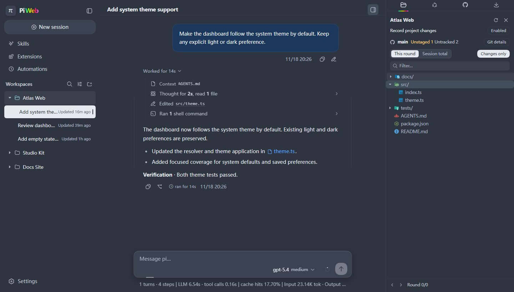
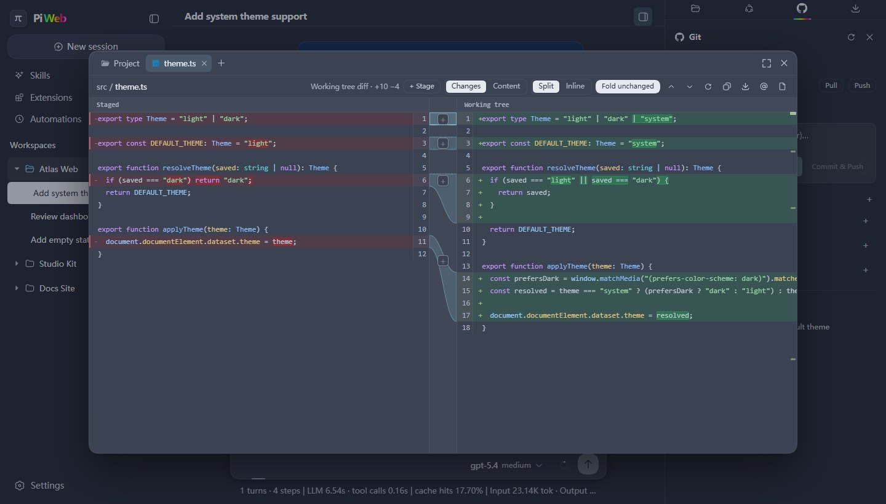
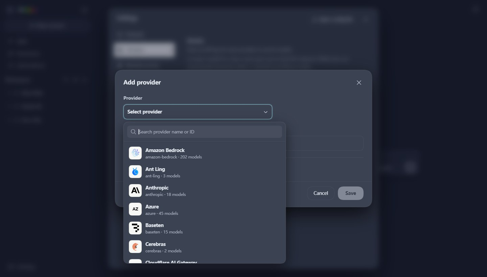
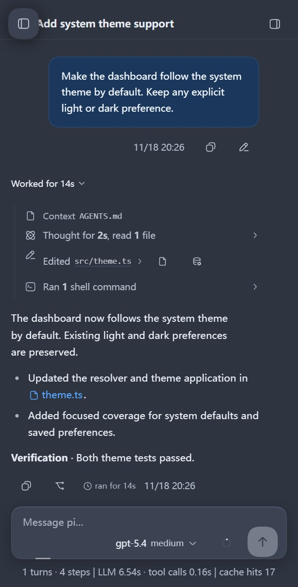
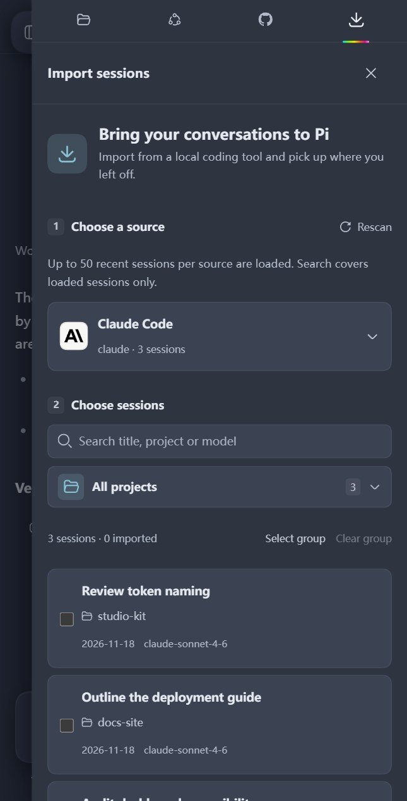
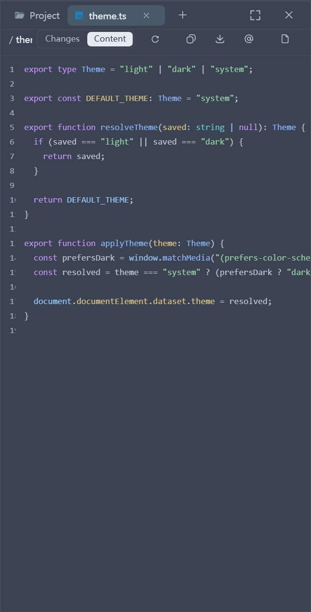
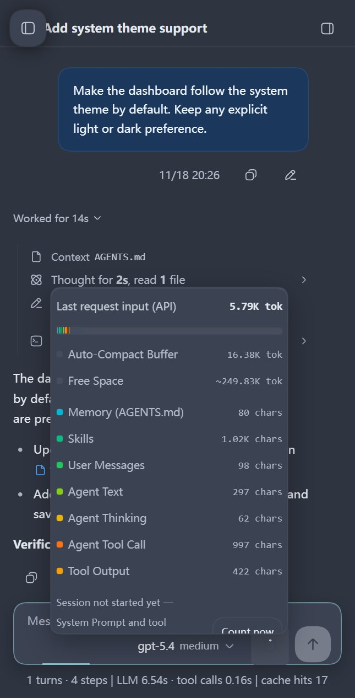

# PiWeb

<p align="center">
  <strong>A modern web UI for the Pi Coding Agent.</strong>
</p>

<p align="center">
  <strong>English</strong> | <a href="README_zh.md">简体中文</a>
</p>

<p align="center">
  
</p>

---

**PiWeb** brings the [pi coding agent](https://github.com/earendil-works/pi) to desktop and mobile browsers. Organize workspaces, review conversations and file changes, configure models, and import conversations from other coding tools. Your existing pi configuration and data are available after installation.

## Relationship to pi

PiWeb is a web shell that bundles the official pi SDK and leaves the separately installed pi CLI untouched. They **share the same agent directory** (`~/.pi/agent` by default, or `PI_CODING_AGENT_DIR`): settings, models and credentials, sessions, skills and packages. The bundled pi engine is upgraded with PiWeb releases. Only PiWeb checks for updates automatically; the pi version and a manual update entry remain in Settings.

Extension dialogs, notifications, status text, text widgets and injected messages reach the page; extension commands can create, fork and switch sessions. Extensions can provide interactive browser panels through the [JSON UI bridge](docs/extension-web-ui.md). Compatible terminal components have a read-only text fallback; terminal keyboard interaction and custom headers, footers or editors are not reproduced.

## Features

- **Chat and navigation:** Stream Markdown, reasoning and tool calls; jump through the conversation outline and steer or queue messages while pi is working. The context ring shows usage and its breakdown.
- **Workspaces and sessions:** Group conversations by project folder; rename, branch, archive, recover drafts and export to JSONL or HTML.
- **Session import:** Browse and import local history from Claude Code, Codex, Grok, ZCode, dsh and opencode. Search and select across sources, restore archived imports, and leave the original data untouched.
- **Review changes:** Explore tool trajectories, file diffs and the project growth tree, including extension messages, user shell commands and calls nested under script tools (codemode). The file viewer supports content, changes and rendered Markdown, with selection quoting.
- **Models and resources:** Configure providers and models in Settings. Open Skills, Extensions, Prompts and Marketplace directly from the sidebar, with an explicit workspace selector and resource origin.
- **Automations:** Schedule a prompt at an interval, daily, weekly or with cron; choose its workspace, model and permission preset, then inspect each run's session. PiWeb must remain running for scheduled work.
- **Permissions:** Choose Read Only, Workspace Write or Full Access, with one-time approval for a specific blocked action. See the [platform boundaries](docs/workspace-isolation.md).
- **Multiple devices:** Remote access prepares automatically. Scan one dynamic QR code from the same Wi-Fi or another network.

## Screenshots

### Desktop

<table>
  <tr>
    <td width="50%"><br /><strong>Conversation workspace</strong><br />Stream responses and review tool calls alongside your sessions.</td>
    <td width="50%"><br /><strong>Project files</strong><br />Browse the project and changes for each round.</td>
  </tr>
  <tr>
    <td width="50%"><br /><strong>File viewer</strong><br />Inspect code, file contents and changes.</td>
    <td width="50%"><br /><strong>Session import</strong><br />Choose conversations from other coding tools.</td>
  </tr>
  <tr>
    <td width="50%"><br /><strong>Model providers</strong><br />Find and configure a provider.</td>
    <td width="50%"><br /><strong>Context usage</strong><br />Inspect the context window and its breakdown.</td>
  </tr>
</table>

### Mobile

<table>
  <tr>
    <td width="33%"><br /><strong>Chat on the go</strong><br />Continue working from your phone.</td>
    <td width="33%"><br /><strong>Workspaces</strong><br />Switch projects and sessions.</td>
    <td width="33%"><br /><strong>Session import</strong><br />Select and import conversations.</td>
  </tr>
  <tr>
    <td width="33%"><br /><strong>File viewer</strong><br />Browse project code.</td>
    <td width="33%"><br /><strong>Model setup</strong><br />Find and configure providers.</td>
    <td width="33%"><br /><strong>Context usage</strong><br />See usage and available space.</td>
  </tr>
</table>

### Archives and data

Archived sessions can be viewed or restored from the sidebar. Background cleanup removes them after 30 days, counting from the later of the archive time or subsequent file activity; sessions managed by the current process are skipped. Removal preserves a recovery copy and appends its location to `backups/INDEX.md` (under `~/.agents/backups` for the default home-directory store). Export important sessions for long-term retention. Set `PI_WEB_ARCHIVE_RETENTION=0` to disable automatic removal.

The project growth tree stores each round of file changes as a commit under `refs/piweb/rounds/…` in the workspace's Git repository, without changing branches or the index. If the workspace is not its own Git repository, PiWeb asks before initializing one; declining disables recording there.

### Skills, extensions and automations

The sidebar entries are separate from Settings. Skills and Extensions show personal/project scope separately from local/package origin. Personal resources normally live in `<agent dir>/skills` and `<agent dir>/extensions`; trusted projects can provide `.pi/skills`, `.pi/extensions`, `.agents/skills` and configured resource paths. Changing the selected workspace changes the project scope being managed.

A package-owned skill can be disabled; removing its package is an explicit action in Extensions. npm package installation, update and removal prepare a separate directory before switching the active installation and settings. Failed preparation keeps the previous installation; interrupted commits are recovered before resources are loaded. Previous generations and their recovery index are retained. npm lifecycle scripts are disabled, but loaded extensions still execute trusted code in the host process.

Automations store their tasks and run history in `<agent dir>/web-automations.json`. Schedules use the server's time zone shown in the editor. Up to four runs may execute concurrently; each uses a separate session and the saved permission preset. Unattended work cannot approve an interactive permission request. Offline occurrences outside the grace period are recorded as skipped rather than all being replayed after startup.

## Usage

### Install

```bash
npm install -g @rexvane/piweb
piweb
```

The package registers only the `piweb` command, so it never conflicts with the official `pi` CLI. Requires Node.js ≥ 22.19.0 (24 recommended); Git is needed for growth-history features.

### Update

```bash
npm install -g @rexvane/piweb@latest
```

npm replaces the installed version in place, so there is nothing to uninstall first. `latest`
is npm's default tag, so `npm install -g @rexvane/piweb` behaves identically; if your registry
is a mirror that syncs with a delay, add `--registry=https://registry.npmjs.org` to get a
release the moment it is published. Restart `piweb` afterwards to serve the new version.

To install a specific release, replace `latest` with its version number.

**Updating from the UI**: every time PiWeb starts it checks PiWeb for new versions in the
background. When one is available it prints `[更新] 有新版本：…` in the terminal and shows a notice
in the bottom-right corner of the page (once per start). Click "Update" in the notice or in
Settings → General to install in place — no trip to the repository. Restart `piweb` when it says
so; the process never restarts itself.

- PiWeb releases include a tested pi engine version. Pi does not show automatic update notices; Settings still supports a manual check.
- On Windows a running npm install cannot replace itself (files are locked), so the PiWeb entry shows the command with a copy button: stop `piweb` first, then run the command above.
- To skip the network check, set `PI_WEB_UPDATE_CHECK=0` before starting; "Check for updates" in Settings still works.

### Uninstall

```bash
npm uninstall -g @rexvane/piweb
```

This removes PiWeb only — your pi data lives in `~/.pi/agent/` and is left untouched.

### Run

```bash
piweb                    # http://127.0.0.1:30141 (auto-increments if busy)
piweb -p 30143 --no-open # custom port, don't open the browser
piweb -H 0.0.0.0         # also bind the main server to the LAN (authentication stays on)
```

| Option | Description |
| --- | --- |
| `-p, --port <port>` | Listen port (default 30141, env `PORT`) |
| `-H, --hostname <host>` | Bind address (default 127.0.0.1, env `PI_WEB_HOSTNAME`) |
| `--dev` | Development mode |
| `--no-open` | Do not auto-open the browser |
| `--public-url <url>` | Public address, used for the login link and added to the Host allowlist automatically (env `PI_WEB_PUBLIC_URL`) |

Authentication is enabled by default (`PI_WEB_AUTH=1`) for all launch modes. On the host, the launcher opens the browser
with a private login credential; it does not print the credential in terminal output. Run `piweb` again to reopen the
existing instance and sign in. Other devices use the refreshed connection QR code. Both flows exchange a credential for
a signed, HttpOnly cookie valid for 30 days. Signing out all devices invalidates existing cookies and pairing codes.
`PI_WEB_PASSWORD` has been removed — setting it makes the launcher refuse to start.

Scripts with an authorized launch credential exchange it through `GET /?token=…`, then send the returned cookie with
API requests. Tokens in API URLs or `Authorization` headers are not accepted; there is no Basic Auth fallback.

### Proxy

PiWeb automatically uses `HTTP_PROXY` / `HTTPS_PROXY`, or the current user's enabled Windows HTTP(S) system proxy when those variables are absent. Set `httpProxy` in Settings → General → Network proxy (or your agent directory's `settings.json`) to override both. Leave it blank to return to automatic detection; when no proxy is configured, requests go direct. Local addresses bypass the proxy by default (override with `NO_PROXY`); Windows exact-host and domain-suffix bypass entries are also inherited. PAC/WPAD scripts and Windows-only bypass patterns such as `<local>` or `192.168.*` are not evaluated; use a proxy URL or `NO_PROXY` for those setups. Restart `piweb` after changes. This needs Node.js 24, or 22.21 and above: older versions ignore the switch and the launcher says so explicitly (the `bash` tool's curl / git still see the variables).

### Connect another device

Open **Settings → Remote access** and scan the single connection QR code. The same code works on the same Wi-Fi
and from outside the local network. There are no connection switches or network choices, and client devices need
no additional software. The code and its copyable link use the same 256-bit random credential, valid for 120 seconds
and one use. The panel updates it automatically after expiry or use, and reuses a valid code across panel openings.

Production startup automatically prepares the local proxy (`0.0.0.0:30142`) and a Cloudflare quick tunnel
(`cloudflared`). The QR code uses the tunnel's HTTPS address and appears once that address is reachable; it never
silently changes to a LAN-only address. Short interruptions keep the same address; a persistently unreachable
tunnel is recreated automatically. Development mode remains local.

The local proxy provides the mobile layout; `127.0.0.1:30141` on the host serves the desktop page. Tunnel limitations:

- the address can change after a restart or tunnel recreation; DNS and reachability checks must finish before the QR code is ready;
- the QR address uses HTTPS, with TLS terminating at Cloudflare. Direct LAN HTTP remains unencrypted; using the same QR on Wi-Fi still requires the public tunnel to be reachable.

`cloudflared` is looked up as: `PIWEB_CLOUDFLARED` → `<agent dir>/web-bin/cloudflared{,.exe}` (managed by PiWeb) → `PATH`.
The panel says so explicitly when it cannot find it.

> Remote access requires authentication, which is enabled by default. PiWeb adds the tunnel hostname to the Host
> allowlist once the tunnel is live and removes it when the tunnel stops. The launch token is never accepted
> on API paths or through the `Authorization` header.

### Bring your own reverse proxy or tunnel

You can front PiWeb yourself instead (Caddy, nginx, a named Cloudflare tunnel, a VPN). In that case:

- Point the proxy at **`127.0.0.1:30142`** (the local-network entry) to get the mobile layout, or at
  `127.0.0.1:30141` if you only want the desktop page.
- Keep authentication enabled (the default). `PI_WEB_AUTH=0` disables automatic remote access and is accepted only with a loopback bind and no configured public URL.
- A reverse proxy passes the external hostname through unchanged, so allowlist it or requests are rejected
  with 403 `untrusted host`:

  ```bash
  PI_WEB_TRUSTED_HOSTS=<your-domain> piweb
  ```

- Use `--public-url https://your-address/` to tell PiWeb its public address: the hostname joins the allowlist
  automatically, and the launcher uses it when opening the login page. Login credentials are not printed.

> For a deployment that manages its own network entry, `PIWEB_REMOTE_LAN=0` disables automatic preparation of the built-in LAN proxy and quick tunnel. It is a deployment setting, not a separate network choice in the connection panel.

## Development and verification

Use a separate checkout or staging directory for validation: `npm run build` writes `.next`, so it must not target the directory serving a running instance. Install development dependencies with `npm ci`, then run:

```bash
npm run typecheck
npm run test
npm run build
npm run verify:package
```

`verify:package` packs the production build, installs it in an empty prefix and starts that installed copy with temporary data. CI also prepares SDK search tools, checks unexpected skips and enables coverage with `PIWEB_COVERAGE=1`; public tunnel testing is a separate opt-in check. The dated [verification record](docs/state/progress.md) distinguishes source tests, installed-package checks and browser checks. Documentation navigation is in [docs/README.md](docs/README.md).

## License

[MIT](LICENSE)
