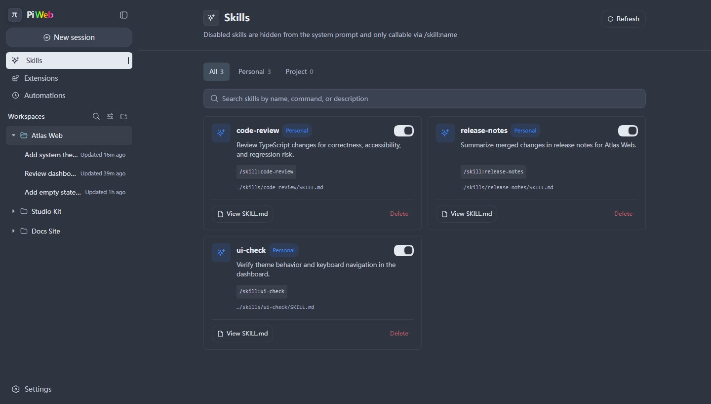
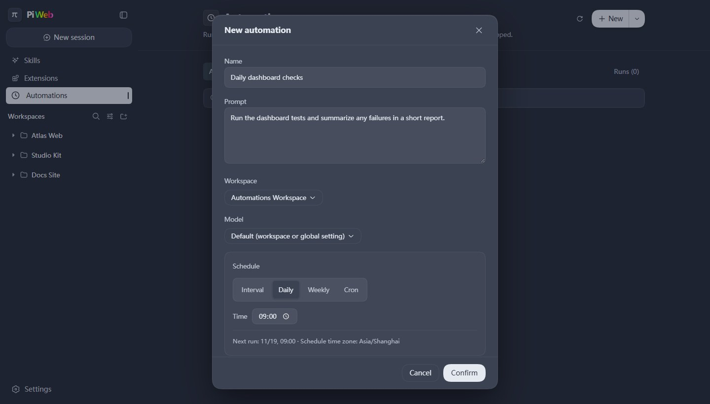

# PiWeb — Web UI for Pi Coding Agent

<p align="center">
  <a href="https://www.npmjs.com/package/@rexvane/piweb"></a>
  <a href="https://github.com/RexVane/PiWeb/actions/workflows/check.yml"></a>
  <a href="LICENSE"></a>
</p>

<p align="center">
  <strong>A self-hosted AI coding agent web UI for desktop and mobile.</strong>
</p>

<p align="center">
  <strong>English</strong> | <a href="README_zh.md">简体中文</a> | <a href="README_zh-Hant.md">繁體中文</a> | <a href="README_ja.md">日本語</a> | <a href="README_ru.md">Русский</a>
</p>

**PiWeb** is an open-source, self-hosted web interface for the [Pi Coding Agent](https://github.com/earendil-works/pi). Install it with npm, run it on your computer or server, and use a desktop or phone browser to follow tool calls, review diffs, and pick up a conversation where you left off.

It bundles the official `@earendil-works/pi-*` SDK and shares your existing pi settings, models, skills, extensions, and Model Context Protocol (MCP) configuration. You can import local conversations from other coding tools, or run recurring prompts with built-in automations.

[Quick start](#quick-start) · [Features](#features) · [Screenshots](#screenshots) · [How it works](#how-it-works) · [Configuration](#configuration) · [Remote access](#remote-access) · [Development](#development) · [Documentation](docs/README.md)

<p align="center">
  
</p>

## Quick start

Requires **Node.js ≥ 22.19.0** (`engines` in `package.json`); Node 24 is recommended. CI covers 22.19.0, 22.22.2, and 24. Git is needed for project growth-history features.

```bash
npm install -g @rexvane/piweb
piweb
```

PiWeb opens an authenticated browser page at `http://127.0.0.1:30141` by default (the port auto-increments if busy). Configure a model provider in Settings, or reuse your existing pi configuration. To use the mobile web UI, scan the connection QR code in **Settings → Remote access**.

The published package registers only the `piweb` command, so it never conflicts with the official `pi` CLI. It ships a sealed production build: a normal global install does not compile anything. If lifecycle scripts were skipped, the first `piweb` start builds once in a staging directory before serving. See [installation details](#install), [remote access](#remote-access), and [data and privacy](docs/operations/data-and-privacy.md).

## Features

- **Chat and context** — Stream Markdown, reasoning, and tool calls. Jump through the conversation outline, steer or queue messages during a run, and inspect token usage in the context meter.
- **Workspaces and sessions** — Organize sessions by project folder. Rename, branch, archive, restore drafts, and export sessions as JSONL or HTML.
- **Session import** — Search and import local history from Claude Code, Codex, OpenCode, Grok, ZCode, dsh, Kimi Code, WorkBuddy, Antigravity, Antigravity CLI, Qwen Code, and Cursor. Choose across sources and restore archived imports. PiWeb reads the original files in place.
- **Files and changes** — Use the project growth tree to inspect changes by round. Review tool steps, including `SKILL.md` reads and calls inside codemode. Open source, rendered Markdown, and unified or side-by-side diffs in the file viewer, and quote selected lines in chat.
- **Models, skills, and extensions** — Configure model providers and use MCP tools and resources from pi. In the sidebar, enable or disable skills, open their `SKILL.md`, and manage extensions and pi packages for your account or project. Extensions can also present interactive panels through the [JSON UI bridge](docs/extension-web-ui.md).
- **Prompt sources** — Open the Prompts panel to inspect project instructions, skills, templates, and tool definitions. The panel identifies prompts and tools contributed by PiWeb.
- **Automations** — Schedule prompts at intervals, daily, weekly, or with cron. Choose a workspace and model, then open the session for each run. Up to four runs may execute at once; PiWeb must stay running to fire on schedule.
- **Mobile access and languages** — Connect a phone by scanning the QR code in Settings → Remote access. The interface is available in English, Simplified Chinese, Traditional Chinese, Japanese, and Russian.

## Screenshots

The screenshots use the English interface and sample data.

### Desktop

<table>
  <tr>
    <td width="50%"><br /><strong>Conversation workspace</strong><br />Follow reasoning and tool calls next to your project sessions.</td>
    <td width="50%"><br /><strong>Project files</strong><br />Browse the project tree and open files from the side panel.</td>
  </tr>
  <tr>
    <td width="50%"><br /><strong>Side-by-side diff</strong><br />Compare old and new code in the file viewer.</td>
    <td width="50%"><br /><strong>Session import</strong><br />Search and select local conversations across tools.</td>
  </tr>
  <tr>
    <td width="50%"><br /><strong>Model providers</strong><br />Find and configure a model provider.</td>
    <td width="50%"><br /><strong>Context usage</strong><br />See token usage and its breakdown.</td>
  </tr>
  <tr>
    <td width="50%"><br /><strong>Skills</strong><br />Filter skills and open their SKILL.md files.</td>
    <td width="50%"><br /><strong>Automations</strong><br />Set a schedule, workspace, and model for a recurring prompt.</td>
  </tr>
</table>

### Mobile

<table>
  <tr>
    <td width="33%"><br /><strong>Chat on the go</strong><br />Continue a conversation on your phone.</td>
    <td width="33%"><br /><strong>Workspaces</strong><br />Switch projects and sessions.</td>
    <td width="33%"><br /><strong>Session import</strong><br />Select conversations to import.</td>
  </tr>
  <tr>
    <td width="33%"><br /><strong>File viewer</strong><br />Open and read project code.</td>
    <td width="33%"><br /><strong>Model providers</strong><br />Find and configure providers.</td>
    <td width="33%"><br /><strong>Context usage</strong><br />Check usage and available context.</td>
  </tr>
</table>

## How it works

PiWeb is a Next.js 16 + React 19 TypeScript app that wraps the official `@earendil-works/pi-*` SDK. The published CLI is `piweb` (`bin/piweb.js` → `scripts/launcher.mjs`). The launcher picks a free port, generates a one-time launch token, starts the Next.js server, and opens a local login URL. On startup the server publishes that token, prepares the LAN entry (in production, when auth is on), checks for PiWeb updates, and warms the first page.

Authentication is launch-token based. The host browser redeems `GET /?token=…` for an HMAC-signed, HttpOnly session cookie (30 days; `Secure` is set on HTTPS; `SameSite=Lax`). The cookie is bound to the request authority (`host:port`). Launch tokens are not accepted on API paths or in the `Authorization` header, and there is no Basic Auth or password login.

PiWeb is a web shell around the bundled SDK; it does not replace a separately installed `pi` CLI. They **share the same agent directory** (`~/.pi/agent` by default, or `PI_CODING_AGENT_DIR`): settings, models and credentials, sessions, skills, and packages. The bundled engine is upgraded with PiWeb releases. The agent directory is the main store but **not the only data root** — session import reads other tools' history from your home directory, and global skills may live in `~/.agents/skills`. See [data, privacy and retention](docs/operations/data-and-privacy.md).

Extension dialogs, notifications, status text, text widgets, and injected messages reach the page; extension commands can create, fork, and switch sessions. Compatible terminal components have a read-only text fallback; terminal keyboard interaction and custom headers, footers, or editors are not reproduced.

## Configuration

Values come from the process environment (shell, systemd, container, or Windows user/system variables). CLI flags override the equivalent variables. The tables below list every PiWeb-specific variable found in `src/`, `scripts/`, and `bin/`. Internal process variables are grouped at the end and should not be set in a deployment. A maintained reference, including OS path conventions, is in the [environment guide](docs/operations/environment.md).

### Service and network

| Variable | Default | Meaning |
| --- | --- | --- |
| `PORT` | `30141` | Main listen port. `piweb -p` takes precedence; the launcher retries with `+1` when the port is busy. |
| `PI_WEB_HOSTNAME` | `127.0.0.1` | Main bind address (same as `-H` / `--hostname`). A non-loopback bind keeps authentication on. |
| `PI_WEB_PUBLIC_URL` | unset | Public URL (same as `--public-url`). Its hostname is added to the Host allowlist and used when opening the login page. |
| `PI_WEB_TRUSTED_HOSTS` | empty | Comma-separated Host allowlist. A custom reverse proxy or named tunnel must be listed, or requests return 403 `untrusted host`. |
| `PI_WEB_ALLOWED_HOSTS` | empty | Legacy alias from upstream `agegr/pi-web`; merged with `PI_WEB_TRUSTED_HOSTS`. |
| `PI_WEB_AUTH` | `1` | Authentication switch. `0` is accepted only for a loopback bind with no public URL; remote LAN/tunnel entries are not prepared when auth is off. |
| `PI_WEB_UPDATE_CHECK` | `1` | `0` skips the one-shot update check at startup. **Settings → Check for updates** still works. |
| `PI_WEB_NO_OPEN` | unset | `1` does not auto-open a browser (same as `--no-open`). |
| `PI_WEB_DEV` | unset | `1` starts in development mode (same as `--dev`). Dev mode allows a loopback bind only. |
| `PI_WEB_ROOT` | install root / `cwd` | Application root override used by the launcher and release scripts. Do not change in a normal deploy. |
| `PIWEB_REMOTE_LAN` | enabled | `0` / `false` / `off` / `no` disables automatic preparation of the built-in LAN proxy and Cloudflare quick tunnel. |
| `PIWEB_REMOTE_LAN_PORT` | `30142` | Built-in LAN / mobile-proxy listen port. |
| `PIWEB_REMOTE_LAN_BIND` | `0.0.0.0` | Built-in LAN / mobile-proxy bind address, for example a single NIC. |
| `PIWEB_CLOUDFLARED` | unset | Path to the `cloudflared` executable. Lookup order: this variable → `<agent dir>/web-bin/cloudflared{,.exe}` → `PATH`. |
| `PIWEB_SKIP_WARMUP` | unset | `1` skips production first-page warmup (troubleshooting only; the first open will be slower). |

### Proxy

| Variable | Default | Meaning |
| --- | --- | --- |
| `HTTP_PROXY` / `HTTPS_PROXY` (and lowercase) | unset | Proxy for model requests. If unset, an enabled per-user Windows system proxy is used when present. |
| `NO_PROXY` / `no_proxy` | local addresses bypass | Proxy bypass list. Windows exact-host and domain-suffix exceptions are inherited; PAC/WPAD and Windows-only patterns such as `<local>` or `192.168.*` are not evaluated. |
| `NODE_USE_ENV_PROXY` | launcher sets `1` when supported | Makes Node `fetch` / `http` honor proxy variables. Supported on Node 24+ or 22.21+; an explicit user value is kept. |

A Settings → General → Network proxy value (`httpProxy` in `settings.json`) overrides environment and system proxies; leave it blank to return to automatic detection. Restart `piweb` after changes.

### Authentication and secrets

| Variable | Default | Meaning |
| --- | --- | --- |
| `PI_WEB_SECRET_FILE` | `<agent dir>/web-secret` | File that holds the HMAC signing key for cookies and pairing codes. |
| `PI_WEB_SECRET` | unset (read the secret file) | Signing key as **32 bytes, base64url-encoded**. When set, the file is not read. An invalid value is an error, not a silent key rotation. |
| `PI_WEB_PASSWORD` | removed | Password login was removed. If this variable is set, the launcher **refuses to start**. |

### Data, tools, and retention

| Variable | Default | Meaning |
| --- | --- | --- |
| `PI_CODING_AGENT_DIR` | `~/.pi/agent` | Shared Pi / PiWeb agent directory: settings, models and credentials, sessions, uploads, automations. It is not the only data root; see [data and privacy](docs/operations/data-and-privacy.md). |
| `PI_WEB_EDITOR` | `code` | Local editor command for “Open in editor”. Meaningful on the host only. |
| `PI_WEB_UPLOAD_RETENTION` | `30` (days) | Background sweep threshold for unused files in `web-uploads`. `0` disables that sweep. Sweeps copy to `~/.agents/backups/` first and record an entry in `INDEX.md`. |
| `PI_WEB_DELETE_ATTACHMENT_CLEANUP` | enabled | When a session is deleted, also clean uploads referenced only by that session (backup-then-remove). `0` leaves those uploads in place. |
| `PI_WEB_ALLOW_PRIVATE_MODEL_DISCOVERY` | off | `1` allows model discovery to probe private-network addresses (local inference). Default is off, to limit SSRF. |
| `PI_OFFLINE` | unset | `1` / `true` / `yes` skips PiWeb / SDK network actions such as update checks, gh identity lookups, and install telemetry. This is not an OS-level offline mode. |
| `PI_TELEMETRY` | unset | Pi SDK install-telemetry switch (`1` / `true` / `yes` on, `0` / `false` / `no` off). When unset, the SDK setting `enableInstallTelemetry` (default on) applies. PiWeb source does not read this variable itself; the bundled SDK does. |

### Build and release

| Variable | Default | Meaning |
| --- | --- | --- |
| `PIWEB_BUILD_DIR` | from `.next-releases/active.json` | Accepts only `.next` or `.next-releases/<safe id>`. Startup fails if it conflicts with the active release. |
| `PIWEB_MAX_RETAINED_RELEASES` | `10` (range 2–100) | Cap on successful retained release builds. The cap refuses a new build; old builds are not deleted automatically. |
| `PIWEB_MAX_FAILED_RELEASES` | `3` (range 1–100) | Cap on incomplete or failed release directories; same refusal behavior. |
| `PIWEB_SKIP_INSTALL_BUILD` | unset | `1` skips the first-start self-healing production build. Only for deploys that already ship a sealed build. |
| `PIWEB_BUILD_VERBOSE` | unset | `1` / `true` / `yes` prints full build output. |

### Optional limits

These default to off or to a loose cap and do not change historical behavior until you set them.

| Variable | Default | Meaning |
| --- | --- | --- |
| `PIWEB_FS_STRICT_WORKSPACES` | off | `1` / `true` / `yes` restricts authenticated file APIs to registered workspaces or `PIWEB_FS_ALLOWED_ROOTS`. |
| `PIWEB_FS_ALLOWED_ROOTS` | empty | Extra roots allowed in strict mode, separated by `;` on Windows and `:` on POSIX. |
| `PIWEB_MAX_SESSION_SUBSCRIBERS` | unlimited | Positive integer cap on SSE subscribers per session; further subscribers fall back to snapshot mode. |
| `PIWEB_SSE_MAX_BUFFERED_BYTES` | `4MiB` | Per-SSE-connection unread buffer cap; a slow client is disconnected and should reconnect with a snapshot. |
| `PIWEB_SHUTDOWN_TIMEOUT_MS` | `8000` | Budget for shutdown hooks after SIGINT / SIGTERM / SIGHUP. A second signal exits immediately. |
| `PIWEB_GRACEFUL_STOP_TIMEOUT_MS` | `10000` | How long the launcher waits for a child it spawned to exit before killing the process tree. |
| `PIWEB_AGENT_MAX_STEPS` | unlimited | Max model steps per turn. |
| `PIWEB_AGENT_MAX_DURATION_MS` | unlimited | Max wall time per turn, in milliseconds. |
| `PIWEB_AGENT_TOKEN_BUDGET` | unlimited | Max cumulative tokens (input + output + cache) per turn. |
| `PIWEB_MOBILE_PROXY_MAX_HTML_BYTES` | `16MiB` | Mobile-proxy HTML injection buffer cap; above this the response is streamed without injection. |
| `PIWEB_MOBILE_PROXY_MAX_DECODED_BYTES` | `64MiB` | Mobile-proxy decoded-body cap; larger bodies return 502. |
| `PIWEB_MOBILE_PROXY_TIMEOUT_MS` | `30000` | How long the mobile proxy waits for an upstream HTML response before streaming without injection. |
| `PIWEB_AGENT_CONFIG_CACHE_MAX` | `512` | Agent config cache entry cap. |
| `PIWEB_AGENT_CONFIG_CACHE_TTL_MS` | `1800000` (30 minutes) | TTL for failed or missing config-cache entries. |
| `PIWEB_PI_CACHE_MAX` | `512` | Cap for SettingsManager / resource-loader / package-manager cache entries. |

### Test, CI, and internal variables

Do not use these in a deployment. `CI`, `PIWEB_COVERAGE`, `PIWEB_COVERAGE_REPORT_DIR`, `PIWEB_TEST_REPORT`, `PIWEB_TEST_TUNNEL`, and `PIWEB_LINT_SKIP_INSTALL` are for tests and CI only.

The launcher, locks, and tests also inject: `PI_WEB_LAUNCH_TOKEN` (one-time local login token, regenerated each start), `PIWEB_PORT` (actual port mirrored into the child), `PIWEB_HTTP_GUARD`, `PIWEB_BUILD_LOCK_FILE` / `PIWEB_BUILD_LOCK_TOKEN`, `PIWEB_PROCESS_LOCK_FILE` / `PIWEB_PROCESS_LOCK_TOKEN`, `PIWEB_PROXY_SOURCE`, `PIWEB_INHERITED_HTTP_PROXY` / `PIWEB_INHERITED_HTTPS_PROXY`, `PIWEB_MANAGED_NODE_USE_ENV_PROXY`, `PIWEB_MANAGED_NO_PROXY`, `PIWEB_DEV_ASSET_ID`, `PIWEB_DISABLE_GRACEFUL_SHUTDOWN`, `PIWEB_DEBUG_PROMPT`, and `PIWEB_BROWSER_URL` (temporary URL when opening the host browser on Windows). `PYTHONUTF8` / `PYTHONIOENCODING`, `NODE_OPTIONS`, `NEXT_PHASE`, `NEXT_RUNTIME`, and `NEXT_TELEMETRY_DISABLED` are process or Next.js conventions (build scripts disable Next telemetry).

PiWeb also reads OS path variables such as `HOME`, `USERPROFILE`, `TEMP` / `TMP`, `APPDATA`, and `LOCALAPPDATA`, plus optional `WORKBUDDY_CONFIG_DIR` and `QWEN_HOME` for those import sources.

## Remote access

Open **Settings → Remote access** and scan the connection QR code. The same code works on the same Wi-Fi and from outside the local network. Client devices need no extra software. The code and its copyable link share a 256-bit one-time credential, valid for 120 seconds and a single use. The panel refreshes it after expiry or use, and reuses a still-valid code if you reopen the panel.

Production startup automatically prepares the local mobile-layout proxy (`0.0.0.0:30142`) and a Cloudflare quick tunnel (`cloudflared`). The QR code uses the tunnel's HTTPS address and appears only once that address is reachable; it never silently falls back to a LAN-only address. Short interruptions keep the same address; a persistently unreachable tunnel is recreated. Development mode stays local. `127.0.0.1:30141` on the host serves the desktop page; the LAN proxy provides the mobile layout.

Tunnel caveats:

- The address can change after a restart or tunnel recreation; DNS and reachability checks must finish before the QR code is ready.
- The QR address uses HTTPS, with TLS terminating at Cloudflare. Direct LAN HTTP remains unencrypted. Using the same QR on Wi-Fi still requires the public tunnel to be reachable.

### Security notes

- Authentication is on by default (`PI_WEB_AUTH=1`) in every launch mode the `piweb` launcher accepts.
- `PI_WEB_AUTH=0` is allowed only with a loopback bind and no `--public-url` / `PI_WEB_PUBLIC_URL`. The launcher refuses any other combination. With auth off, the built-in LAN proxy and Cloudflare tunnel are not prepared — those would otherwise be an unauthenticated shell.
- Development mode (`--dev` / `PI_WEB_DEV=1`) allows loopback only, because the Next.js dev endpoints are not protected by the launch-token scheme.
- The launch token is never accepted on API paths or through the `Authorization` header. `PI_WEB_PASSWORD` has been removed.
- Signing out all devices invalidates existing cookies and pairing codes.
- PiWeb adds the live tunnel hostname to the Host allowlist and removes it when the tunnel stops.

### Bring your own reverse proxy or tunnel

You can front PiWeb yourself (Caddy, nginx, a named Cloudflare tunnel, a VPN):

- Point the proxy at **`127.0.0.1:30142`** (the local-network entry) for the mobile layout, or at `127.0.0.1:30141` for the desktop page only.
- Keep authentication enabled (the default).
- Allowlist the external hostname, or requests are rejected with 403 `untrusted host`:

  ```bash
  PI_WEB_TRUSTED_HOSTS=<your-domain> piweb
  ```

- Use `--public-url https://your-address/` so the hostname joins the allowlist automatically and the launcher can open the correct login page. Login credentials are not printed to the terminal.
- For a deployment that manages its own network entry, `PIWEB_REMOTE_LAN=0` disables automatic preparation of the built-in LAN proxy and quick tunnel.

## Usage

### Install

```bash
npm install -g @rexvane/piweb
piweb
```

The published package ships a sealed production build, so a normal global install does not compile anything. The `postinstall` hook prepares that build for **production-only** installs: it is a no-op in a source checkout. If installs skip lifecycle scripts, the first `piweb` start builds once in a staging directory before serving. Details and timeouts are in [install and build](docs/operations/install-and-build.md).

### Update

```bash
npm install -g @rexvane/piweb@latest
```

Restart `piweb` afterwards to serve the new version. The process never restarts itself. If your registry mirror lags, add `--registry=https://registry.npmjs.org`. For a specific release, replace `latest` with the version number. Downgrades and recovery are in the [release and rollback guide](docs/operations/release-and-rollback.md).

Every start also checks for a new PiWeb version in the background (disable with `PI_WEB_UPDATE_CHECK=0`). When one is available, the terminal prints a notice and the page shows an update prompt; you can also update from Settings → General. PiWeb releases pin a tested pi engine version; pi itself does not show automatic update notices, but Settings still has a manual check. On Windows, a running npm install cannot replace itself, so stop `piweb` first, then run the command above.

### Uninstall

```bash
npm uninstall -g @rexvane/piweb
```

This removes PiWeb only. Your pi data in the agent directory and other tools' session history are left untouched.

### Run

```bash
piweb                    # http://127.0.0.1:30141 (auto-increments if busy)
piweb -p 30143 --no-open # custom port, don't open the browser
piweb -H 0.0.0.0         # also bind the main server to the LAN (authentication stays on)
```

| Option | Description |
| --- | --- |
| `-p, --port <port>` | Listen port (default 30141, env `PORT`) |
| `-H, --hostname <host>` | Bind address (default 127.0.0.1, env `PI_WEB_HOSTNAME`) |
| `--public-url <url>` | Public address for the login link; also added to the Host allowlist (env `PI_WEB_PUBLIC_URL`) |
| `--dev` | Development mode (loopback only) |
| `--no-open` | Do not auto-open the browser |
| `-h, --help` | Show usage |

On the host, the launcher opens the browser with a private login credential and does not print that credential. Running `piweb` again reopens the existing instance and signs in. Other devices use the refreshed connection QR code. Both flows exchange a credential for the signed cookie described above.

Archived sessions stay in the sidebar until you restore or delete them. Archiving is immediate; manual deletion asks for confirmation and permanently deletes the session file with **no recovery copy**. Sessions are never deleted automatically. The project growth tree records each round as a commit under `refs/piweb/rounds/…` in the workspace Git repository, without changing branches or the index. Automations store tasks and run history in `<agent dir>/web-automations.json` and use the server's time zone.

## Development

Use a separate checkout or staging directory for validation: `npm run build` writes `.next`, so it must not target the directory serving a running instance.

```bash
npm ci
npm run dev
npm run typecheck
npm run lint
npm run test
npm run build
npm run verify:package
```

`npm start` runs `node bin/piweb.js` (the same entry as the published `piweb` command). `verify:package` packs the production build, installs it in an empty prefix, and starts that installed copy with temporary data. Documentation navigation is in [docs/README.md](docs/README.md); build details and timeouts are in [install and build](docs/operations/install-and-build.md).

## Contributing

Issues and pull requests are welcome at [github.com/RexVane/PiWeb](https://github.com/RexVane/PiWeb). For a large change, open an issue first. Please run `npm run typecheck`, `npm run lint`, and `npm run test` before opening a PR, and use a separate checkout so a local `npm run build` cannot overwrite a running instance's `.next`.

## Operations

- [Install and build](docs/operations/install-and-build.md): install layouts, `postinstall`, first-start self-healing build, and timeout baselines.
- [Environment reference](docs/operations/environment.md): the same variables as above, plus OS path conventions and subprocess environment filtering.
- [Data, privacy and retention](docs/operations/data-and-privacy.md): every data root, deployment isolation, telemetry switches, deletion and recovery.
- [Release, downgrade and rollback](docs/operations/release-and-rollback.md): exact-version downgrades, failed in-app updates, `.next-releases` rollback, data compatibility.
- [Extension web UI](docs/extension-web-ui.md) and [extension examples](examples/piweb-extensions/README.md).

## Acknowledgements

Thanks to [@webkubor](https://github.com/webkubor) for the Ripple and Dawn palettes.

## License

[MIT](LICENSE)
