# PiWeb

<p align="center">
  <strong>A modern web UI for the Pi Coding Agent.</strong>
</p>

<p align="center">
  <strong>English</strong> | <a href="README_zh.md">简体中文</a>
</p>

<p align="center">
  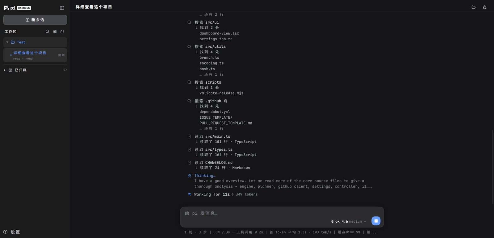
</p>

---

**PiWeb** brings a sleek, feature-rich browser interface to the [pi coding agent](https://github.com/earendil-works/pi) with zero modifications to the core Pi engine. Install with one command, and all your existing pi configuration, sessions, models, skills, and plugins work out of the box.

## Relationship to pi

PiWeb and pi are two separate programs, and PiWeb is not another build of pi: it is a web shell that drives the pi already installed on your machine through the official SDK, leaving pi itself untouched. The two **share one set of state** — the same agent directory (`~/.pi/agent`) holds your settings, models and credentials, sessions, skills and packages — so a conversation started in the pi CLI shows up in the browser right away, and the other way round. Updating is **two separate things**: the pi engine and PiWeb each carry their own version and their own update entry point (the two "Check for updates" rows in Settings), and upgrading one leaves the other alone. What runs underneath is native pi; plugin compatibility in the browser, interactive plugins especially, is not finished yet — for now plugins can be managed rather than fully driven from the page.

## Features

### Real-Time Streaming Chat

Markdown renders as it streams — headings, lists and code blocks take shape before the answer is finished, not after. Code blocks can be copied. The conversation column can be dragged wider, and the width is remembered in this browser. Thinking and tool calls appear inline as cards. The layout stays restrained: sessions on the left, outline on the right, both collapsible, leaving the screen to the conversation. The model picker follows `enabledModels` in pi settings; the settings page still shows the full catalog.

<p align="center"></p>

### Chat Navigation

The outline on the right of the transcript: **bold entries are messages you sent**, the rest are headings inside the assistant's answers. Collapsed it reads as a column of bars — longer for your messages, shorter the deeper a heading sits; hover to expand the list. It highlights where you are as you scroll, and a click scrolls smoothly to that spot.

<p align="center">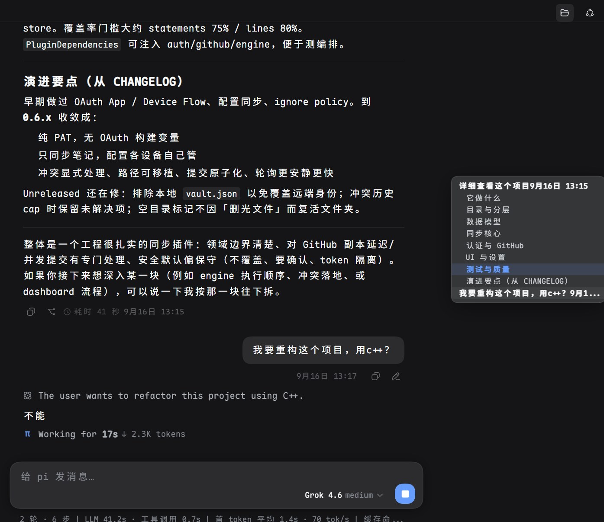</p>

### Trajectory and Files, In Place

Tool cards carry both entry points: **View in trajectory** drops that step into the trajectory panel — a timeline with input / model / tool lanes, laid out by sequence, wall-clock time or duration, searchable, with per-row tokens and timings and detail tabs for summary, preview, raw and source. **Open in editor** jumps straight to the local file that step touched. A card that changed a file also carries the whole diff inline (additions green, deletions red, with +N −M counts), folded to a preview for long changes and expanded on click.

<p align="center">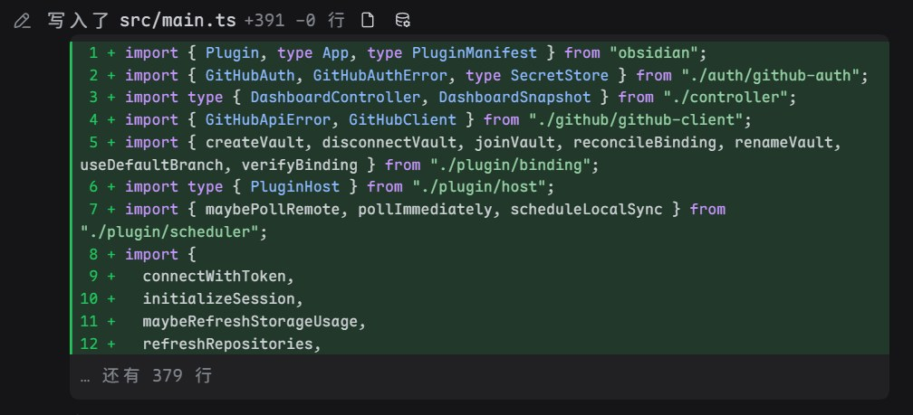</p>
<p align="center">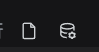 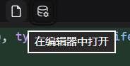 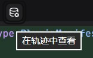</p>

### Workspaces & Sessions

Sessions grouped by project folder, with a native folder picker (Windows / macOS / Linux), rename and archive. Archived conversations live together under "Archived" in the sidebar, ready to reopen or unarchive, and **an archived session is deleted automatically after 30 days of inactivity** — no manual cleanup. Session tree branches, draft recovery, and JSONL / HTML export are there too.

<p align="center">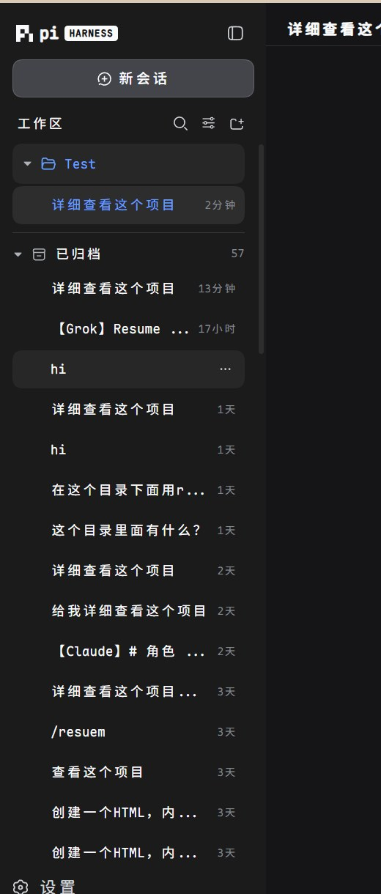</p>

### Project Growth Tree

Every file operation pi makes is snapshotted, grouped one round per message you send. Each round shows what changed **relative to the previous one** — files added, modified and deleted, with line-level diffs one click away — so you can review the work round by round, or drill into single steps inside a round. A round with no file changes says so instead of being skipped. Each round is stored as a commit in the workspace's own git repository on a private ref (`refs/piweb/rounds/…`), never touching your branches or index; if the folder is not a git repository yet (or is only a subfolder of another one), PiWeb asks before creating one there, remembers the answer per workspace, and records nothing if you decline.

<p align="center">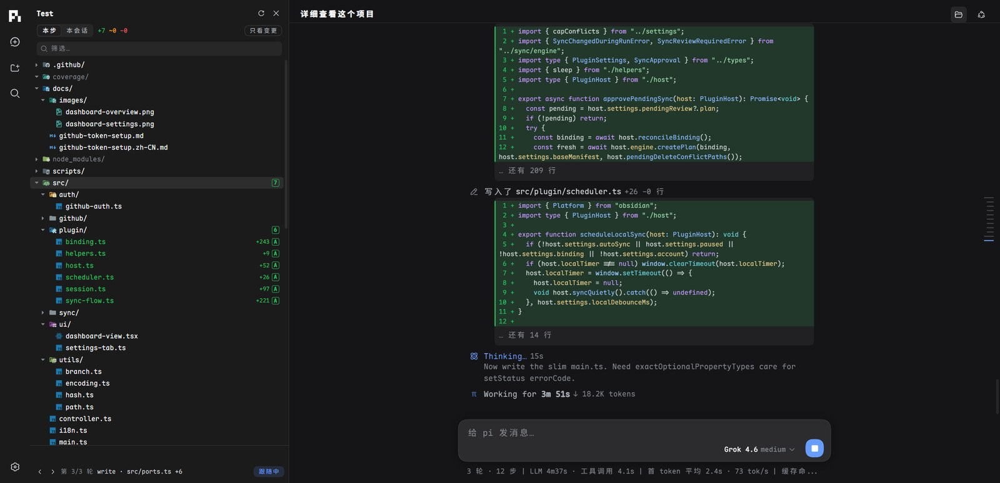</p>
<p align="center">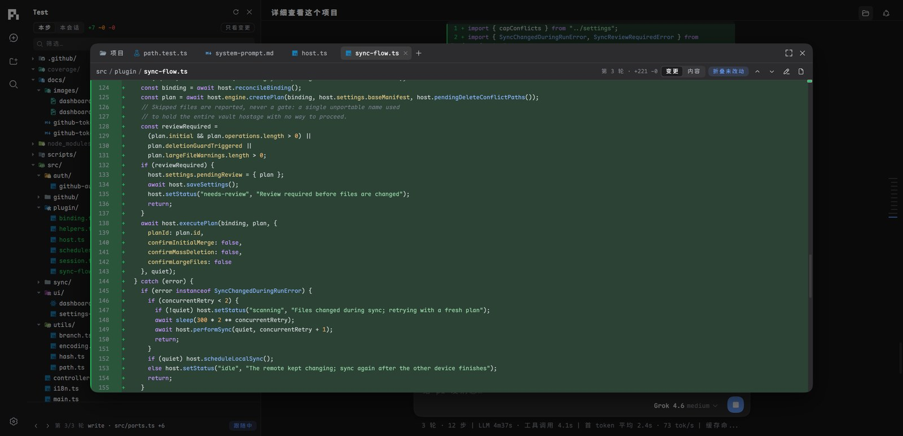</p>

### File Viewer

Open project files in the page instead of switching to an editor: a centered window with tabs, and fuzzy search behind the "+". Each file has three views — **Changes** (whole-file diff, additions green and deletions red, with one-click jumps between changes), **Content** (line numbers and syntax highlighting; deleted files show their last content), and **Rendered** (Markdown as a document). Quote a selection into the composer, or open the file in your local editor.

<p align="center">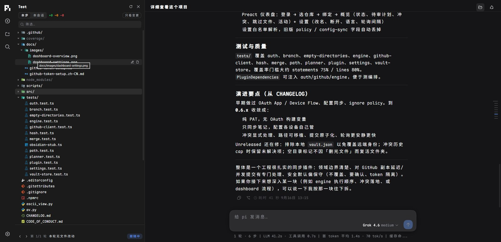</p>
<p align="center">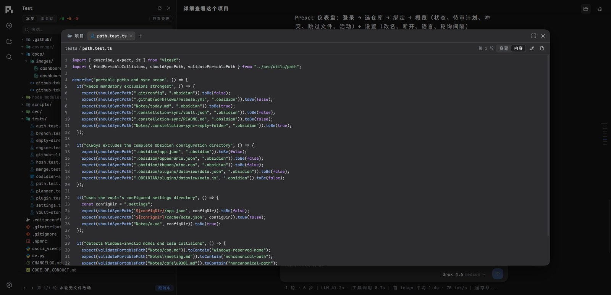</p>

### Context Meter

Click the ring next to the composer to see the context window broken down into 13 segments — System Prompt, System/Custom Tools, Memory (AGENTS.md), Skills, messages by type, Compacted Data, Auto-Compact Buffer, and Free Space.

### Prompt Sources

A header button opens a panel listing every prompt that reaches the model's context: the system prompt and its appended sections, project memory (`AGENTS.md`), each skill's `SKILL.md`, prompt templates, tool definitions, plus the assembled prompt actually sent and the compaction summary — each row labelled with where it came from (project / personal / package / extension). Click a row to read the original in the centre viewer. The list is enumerated live for the current workspace, so prompts that arrive with a plugin or package installed later show up on refresh.

<p align="center">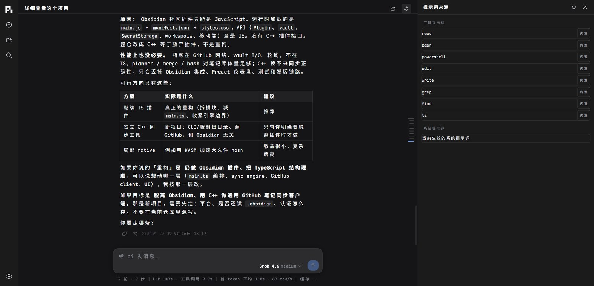</p>
<p align="center">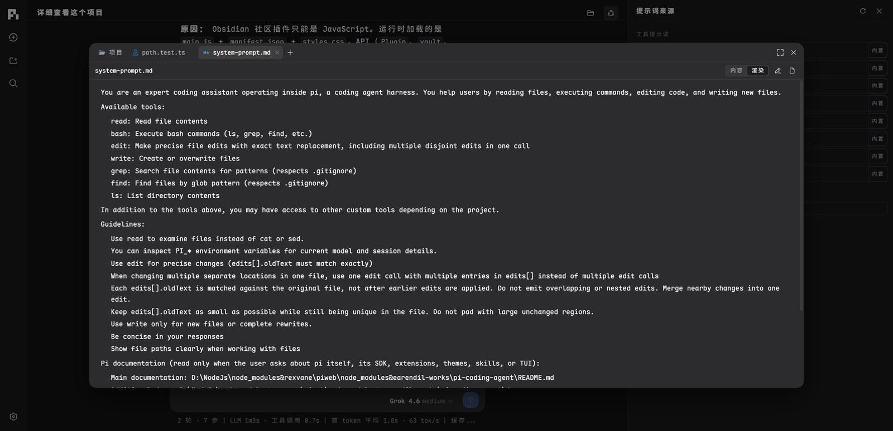</p>

### Model & Provider Management

40 built-in providers, signed in with an API key or OAuth — Anthropic, GitHub Copilot, OpenAI Codex, xAI, OpenRouter, Kimi and Radius support one-click OAuth. Anything else works just as well: give a custom provider its base URL, protocol and models, and it lands in `models.json`; local gateways such as Ollama get a placeholder key automatically. Pull the model catalog in one click, and quota or balance reads (Claude, Codex, xAI, DeepSeek and 7 more) sit right on the provider card.

<p align="center">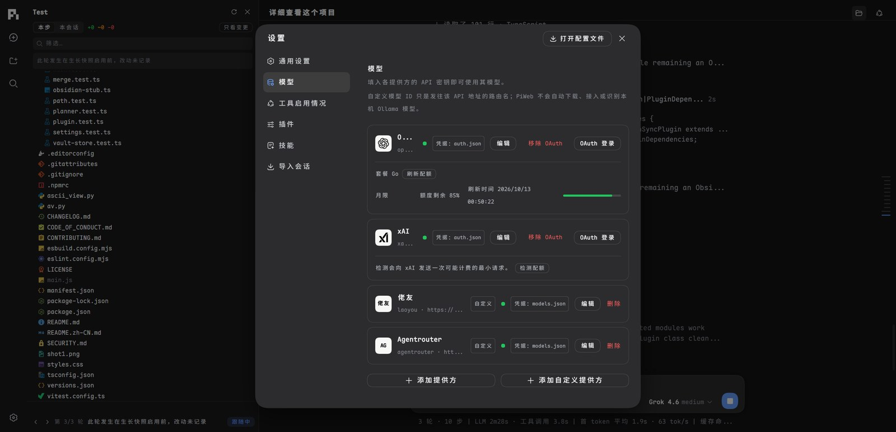</p>
<p align="center">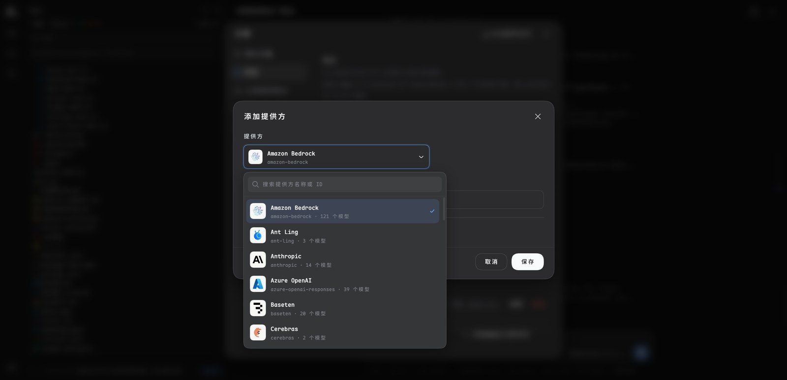</p>
<p align="center">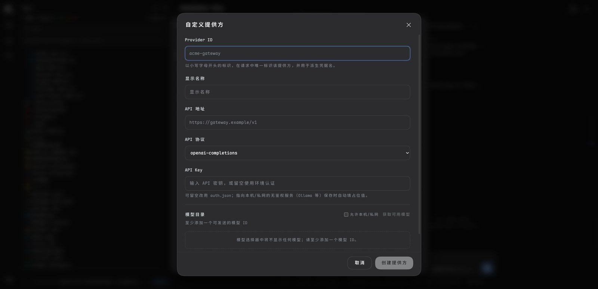</p>

### Plugins & Skills

Install, update, and uninstall pi packages directly from the UI. Enable/disable or delete skills; every change applies to running sessions immediately.

### Security

Launch-token login for anything reachable beyond this machine, origin validation on write actions, strict path boundary checks, and tool presets (Read Only / Workspace Write / Full Access).

## Usage

### Install

```bash
npm install -g @rexvane/piweb
piweb
```

The package registers only the `piweb` command, so it never conflicts with the official `pi` CLI. Requires Node.js ≥ 22.19.0 (24 recommended); Git is needed for growth-history features.

### Update

```bash
npm install -g @rexvane/piweb@latest
```

npm replaces the installed version in place, so there is nothing to uninstall first. `latest`
is npm's default tag, so `npm install -g @rexvane/piweb` behaves identically; if your registry
is a mirror that syncs with a delay, add `--registry=https://registry.npmjs.org` to get a
release the moment it is published. Restart `piweb` afterwards to serve the new version.

Or install a specific version: `npm install -g @rexvane/piweb@0.3.27`.

**Updating from the UI**: every time PiWeb starts it checks PiWeb and pi for new versions in the
background. When one is available it prints `[更新] 有新版本：…` in the terminal and shows a notice
in the bottom-right corner of the page (once per start). Click "Update" in the notice or in
Settings → General to install in place — no trip to the repository. Restart `piweb` when it says
so; the process never restarts itself.

- The pi engine can be updated on its own (npm installs swap only pi's two packages, no rebuild).
- On Windows a running npm install cannot replace itself (files are locked), so the PiWeb entry shows the command with a copy button: stop `piweb` first, then run the command above.
- To skip the network check, set `PI_WEB_UPDATE_CHECK=0` before starting; "Check for updates" in Settings still works.

### Uninstall

```bash
npm uninstall -g @rexvane/piweb
```

This removes PiWeb only — your pi data lives in `~/.pi/agent/` and is left untouched.

### Run

```bash
piweb                    # http://127.0.0.1:30141 (auto-increments if busy)
piweb -p 30143 --no-open # custom port, don't open the browser
piweb -H 0.0.0.0         # LAN access (launch-token login is enabled automatically)
```

| Option | Description |
| --- | --- |
| `-p, --port <port>` | Listen port (default 30141, env `PORT`) |
| `-H, --hostname <host>` | Bind address (default 127.0.0.1, env `PI_WEB_HOSTNAME`) |
| `--dev` | Development mode |
| `--no-open` | Do not auto-open the browser |
| `--public-url <url>` | Public address, used for the login link and added to the Host allowlist automatically (env `PI_WEB_PUBLIC_URL`) |

Authentication is opened by `PI_WEB_AUTH=1` (the launcher sets it by default whenever PiWeb may be reachable from
outside this machine). Login is **launch-token only**: open the printed `…/?token=…` link, which exchanges the token
for a signed cookie. `PI_WEB_PASSWORD` has been removed — setting it makes the launcher refuse to start. Do not
expose PiWeb over plain HTTP.

Scripts authenticate the same way: `GET /?token=…` once to receive the session cookie, then send that cookie with
every API request. There is no Basic Auth fallback.

### Use it on your phone: the built-in "Remote access" plugin

PiWeb ships a built-in plugin for this. Toggle it in **Settings → Remote access**; nothing is installed on the client.

It has two entry points:

**Local network (on by default)** — a reverse proxy that only adds the mobile layout, bound to `0.0.0.0:30142`.
Any device on the same Wi-Fi can open one of the addresses listed in the panel and gets the phone layout;
connecting to `127.0.0.1:30141` on this machine still serves the untouched desktop page.

**Public access (off by default)** — turning it on starts a Cloudflare quick tunnel (`cloudflared`).
Cloudflare assigns an `https://<random>.trycloudflare.com` address that any browser can open with
**nothing to install on any device**. Two costs:

- the address changes on every start, and takes about fifteen seconds to resolve worldwide
  (the panel shows "taking effect" meanwhile);
- TLS terminates at Cloudflare, so that hop sees plaintext. Use a trusted VPN if you need end-to-end encryption.

`cloudflared` is looked up as: `PIWEB_CLOUDFLARED` → `<agent dir>/web-bin/cloudflared{,.exe}` (managed by PiWeb) → `PATH`.
The panel says so explicitly when it cannot find it.

> Turning public access on makes authentication mandatory. The plugin adds the tunnel hostname to the Host
> allowlist once the tunnel is live and removes it when the tunnel stops. The launch token is never accepted
> on API paths or through the `Authorization` header.

### Bring your own reverse proxy or tunnel

You can front PiWeb yourself instead (Caddy, nginx, a named Cloudflare tunnel, a VPN). In that case:

- Point the proxy at **`127.0.0.1:30142`** (the local-network entry) to get the mobile layout, or at
  `127.0.0.1:30141` if you only want the desktop page.
- Set `PI_WEB_AUTH=1`. A loopback bind cannot tell PiWeb that it is exposed, so authentication must be explicit.
- A reverse proxy passes the external hostname through unchanged, so allowlist it or requests are rejected
  with 403 `untrusted host`:

  ```bash
  PI_WEB_TRUSTED_HOSTS=<your-domain> piweb
  ```

- Use `--public-url https://your-address/` to tell PiWeb its public address: the hostname joins the allowlist
  automatically, and the login link printed at startup uses it instead of the loopback address.

> Disable the local-network entry with `PIWEB_REMOTE_LAN=0`; disable authentication entirely with `PI_WEB_AUTH=0`
> (only safe when PiWeb is used strictly on this machine).

## License

[MIT](LICENSE)
