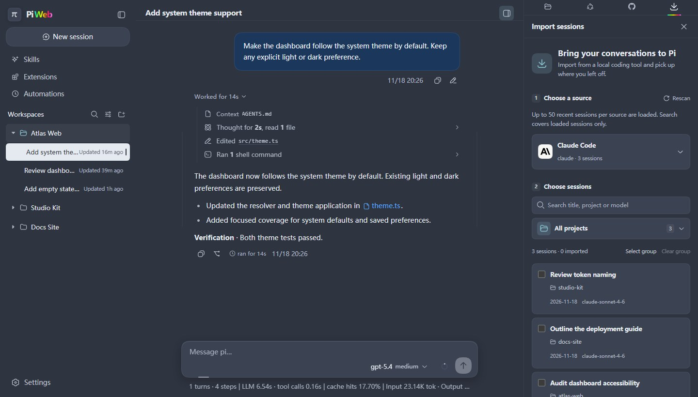
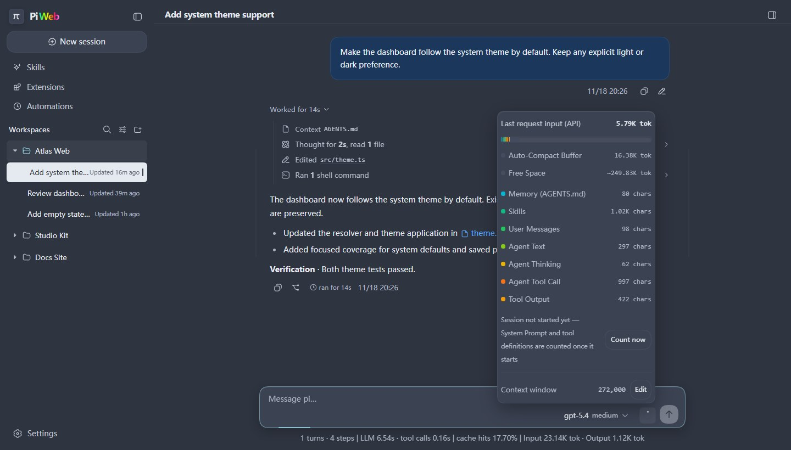

# PiWeb — Web UI for Pi Coding Agent

<p align="center">
  <a href="https://www.npmjs.com/package/@rexvane/piweb"></a>
  <a href="https://github.com/RexVane/PiWeb/actions/workflows/check.yml"></a>
  <a href="LICENSE"></a>
</p>

<p align="center">
  <strong>A self-hosted AI coding agent web UI for desktop and mobile.</strong>
</p>

<p align="center">
  <strong>English</strong> | <a href="README_zh.md">简体中文</a> | <a href="README_zh-Hant.md">繁體中文</a> | <a href="README_ja.md">日本語</a> | <a href="README_ru.md">Русский</a>
</p>

**PiWeb** is an open-source, self-hosted web interface for the [Pi Coding Agent](https://github.com/earendil-works/pi). Install it with npm, run it on your computer or server, and use a desktop or phone browser to follow tool calls, review diffs, and pick up a conversation where you left off.

It bundles the official `@earendil-works/pi-*` SDK and shares your existing pi settings, models, skills, extensions, and Model Context Protocol (MCP) configuration.

<p align="center">
  
</p>

## Contents

- [Features](#features)
- [Quick start](#quick-start)
- [Usage and remote access](#usage-and-remote-access)
- [Configuration](#configuration)
- [How it works](#how-it-works)
- [Documentation](#documentation)
- [Contributing](#contributing)
- [Acknowledgements](#acknowledgements)
- [License](#license)

## Features

- **Chat and context** — Stream Markdown, reasoning, and tool calls. Jump through the conversation outline, steer or queue messages during a run, and inspect token usage in the context meter.
- **Workspaces and sessions** — Organize sessions by project folder. Rename, branch, archive, restore drafts, and export sessions as JSONL or HTML.
- **Session import** — Search and import local history from Claude Code, Codex, OpenCode, Grok, ZCode, dsh, Kimi Code, WorkBuddy, Antigravity, Antigravity CLI, Qwen Code, and Cursor. PiWeb reads the original files in place.
- **Files and changes** — Inspect changes by round in the project growth tree, including `SKILL.md` reads and calls inside codemode. Open source, rendered Markdown, and unified or side-by-side diffs, and quote selected lines in chat.
- **Models, skills, and extensions** — Configure providers, use Pi's MCP tools, and manage Pi packages. [Add existing resources or design your own](docs/resources.md); optional views use JSON UI or independent browser assets without rebuilding PiWeb.
- **Prompt sources** — Inspect project instructions, skills, templates, and tool definitions with their resource origin.
- **Optional question resource** — Install [piweb-ask-user](https://github.com/RexVane/piweb-ask-user) separately. The resource API v1 in this source tree replaces the previously bundled question tool; it is not enabled by refreshing an older npm installation.
- **Mobile access and languages** — Scan the QR code in Settings → Remote access. The UI is available in English, Simplified Chinese, Traditional Chinese, Japanese, and Russian.

<details>
<summary>More screenshots (desktop and mobile)</summary>

The screenshots use the English interface and sample data from an earlier version. Question functionality is now provided by an optional resource.

<table>
  <tr>
    <td width="50%"><br /><strong>Project files</strong></td>
    <td width="50%"><br /><strong>Side-by-side diff</strong></td>
  </tr>
  <tr>
    <td width="50%"><br /><strong>Session import</strong></td>
    <td width="50%"><br /><strong>Model providers</strong></td>
  </tr>
  <tr>
    <td width="50%"><br /><strong>Context usage</strong></td>
    <td width="50%"><br /><strong>Skills</strong></td>
  </tr>
  <tr>
    <td colspan="2" align="center"><br /><strong>Mobile chat</strong></td>
  </tr>
  <tr>
    <td width="50%"><br /><strong>Workspaces</strong></td>
    <td width="50%"><br /><strong>Mobile import</strong></td>
  </tr>
  <tr>
    <td width="50%"><br /><strong>File viewer</strong></td>
    <td width="50%"><br /><strong>Providers</strong></td>
  </tr>
  <tr>
    <td width="50%"><br /><strong>Context usage</strong></td>
    <td></td>
  </tr>
</table>

</details>

## Quick start

Requires **Node.js ≥ 22.19.0** (`engines` in `package.json`); Node 24 is recommended. Git is needed for project growth-history features.

```bash
npm install -g @rexvane/piweb
piweb
```

PiWeb opens an authenticated page at `http://127.0.0.1:30141` by default (the port auto-increments if busy). Configure a model provider in Settings, or reuse your existing pi configuration. The package registers only the `piweb` command, so it does not conflict with the official `pi` CLI. It ships a sealed production build; if install lifecycle scripts were skipped, the first start builds once before serving. Details are in [install and build](docs/operations/install-and-build.md).

## Usage and remote access

```bash
piweb                    # http://127.0.0.1:30141
piweb -p 30143 --no-open # custom port, don't open the browser
piweb -H 0.0.0.0         # also bind the main server to the LAN (authentication stays on)
```

| Option | Description |
| --- | --- |
| `-p, --port <port>` | Listen port (default 30141, env `PORT`) |
| `-H, --hostname <host>` | Bind address (default 127.0.0.1, env `PI_WEB_HOSTNAME`) |
| `--public-url <url>` | Public address for the login link; also added to the Host allowlist (env `PI_WEB_PUBLIC_URL`) |
| `--dev` | Development mode (loopback only) |
| `--no-open` | Do not auto-open the browser |
| `-h, --help` | Show usage |

On the host, the launcher opens the browser with a private login credential and does not print it. Running `piweb` again reopens the existing instance and signs in.

Update with `npm install -g @rexvane/piweb@latest`, then restart `piweb`. Uninstall with `npm uninstall -g @rexvane/piweb` — agent data and imported tool history are left untouched. Downgrades are covered in [release and rollback](docs/operations/release-and-rollback.md).

To connect a phone or another device, open **Settings → Remote access** and scan the QR code (or copy the link). The same code works on the same Wi-Fi and from outside the local network; clients need no extra software. The code is a 256-bit one-time credential, valid for 120 seconds. Production startup prepares a mobile-layout proxy on `0.0.0.0:30142` and a Cloudflare quick tunnel (`cloudflared`). The QR code uses the tunnel's HTTPS address and appears only once that address is reachable. `127.0.0.1:30141` on the host serves the desktop page. Development mode stays local.

Direct LAN HTTP is unencrypted. TLS for the QR address terminates at Cloudflare. After a restart the tunnel address can change.

### Security notes

- Authentication is on by default (`PI_WEB_AUTH=1`) in every launch mode the `piweb` launcher accepts.
- `PI_WEB_AUTH=0` is allowed only with a loopback bind and no `--public-url` / `PI_WEB_PUBLIC_URL`. Otherwise the launcher refuses to start. With auth off, the built-in LAN proxy and Cloudflare tunnel are not prepared.
- Development mode (`--dev` / `PI_WEB_DEV=1`) allows loopback only; Next.js dev endpoints are not protected by the launch-token scheme.
- The launch token is redeemed at `GET /?token=…` for an HMAC-signed, HttpOnly session cookie (30 days; `Secure` on HTTPS). It is not accepted on API paths or in the `Authorization` header. There is no password login; `PI_WEB_PASSWORD` makes the launcher refuse to start.
- Signing out all devices invalidates existing cookies and pairing codes.
- For a reverse proxy or your own tunnel, point at `127.0.0.1:30142` (mobile layout) or `127.0.0.1:30141` (desktop), keep auth enabled, and allowlist the external hostname (`PI_WEB_TRUSTED_HOSTS=<your-domain>` or `--public-url`). Otherwise requests return 403 `untrusted host`. `PIWEB_REMOTE_LAN=0` disables automatic preparation of the built-in proxy and quick tunnel.

## Configuration

Values come from the process environment. CLI flags override the equivalent variables. A maintained reference, including OS path conventions, is in the [environment guide](docs/operations/environment.md).

| Variable | Default | Meaning |
| --- | --- | --- |
| `PORT` | `30141` | Main listen port. `piweb -p` takes precedence; the launcher retries with `+1` when the port is busy. |
| `PI_WEB_HOSTNAME` | `127.0.0.1` | Main bind address (same as `-H`). A non-loopback bind keeps authentication on. |
| `PI_WEB_AUTH` | `1` | Authentication switch. `0` is accepted only for a loopback bind with no public URL. |
| `PI_WEB_PUBLIC_URL` | unset | Public URL (same as `--public-url`). Its hostname is added to the Host allowlist. |
| `PI_WEB_TRUSTED_HOSTS` | empty | Comma-separated Host allowlist for a custom reverse proxy or named tunnel. |
| `PI_CODING_AGENT_DIR` | `~/.pi/agent` | Shared Pi / PiWeb agent directory. It is not the only data root; see [data and privacy](docs/operations/data-and-privacy.md). |
| `PIWEB_REMOTE_LAN` | enabled | `0` / `false` / `off` / `no` disables automatic LAN proxy and Cloudflare quick tunnel preparation. |
| `PIWEB_REMOTE_LAN_PORT` | `30142` | Built-in LAN / mobile-proxy listen port. |
| `HTTP_PROXY` / `HTTPS_PROXY` | unset | Proxy for model requests. Settings → General → Network proxy (`httpProxy`) overrides this. |
| `PI_WEB_UPDATE_CHECK` | `1` | `0` skips the startup update check. Settings → Check for updates still works. |
| `PI_OFFLINE` | unset | `1` / `true` / `yes` skips PiWeb / SDK network actions such as update checks. |

<details>
<summary>All environment variables</summary>

The tables below list every PiWeb-specific variable found in `src/`, `scripts/`, and `bin/`. Internal process variables should not be set in a deployment.

#### Service and network

| Variable | Default | Meaning |
| --- | --- | --- |
| `PORT` | `30141` | Main listen port. `piweb -p` takes precedence; the launcher retries with `+1` when the port is busy. |
| `PI_WEB_HOSTNAME` | `127.0.0.1` | Main bind address (same as `-H` / `--hostname`). A non-loopback bind keeps authentication on. |
| `PI_WEB_PUBLIC_URL` | unset | Public URL (same as `--public-url`). Its hostname is added to the Host allowlist and used when opening the login page. |
| `PI_WEB_TRUSTED_HOSTS` | empty | Comma-separated Host allowlist. A custom reverse proxy or named tunnel must be listed, or requests return 403 `untrusted host`. |
| `PI_WEB_ALLOWED_HOSTS` | empty | Legacy alias from upstream `agegr/pi-web`; merged with `PI_WEB_TRUSTED_HOSTS`. |
| `PI_WEB_AUTH` | `1` | Authentication switch. `0` is accepted only for a loopback bind with no public URL; remote LAN/tunnel entries are not prepared when auth is off. |
| `PI_WEB_UPDATE_CHECK` | `1` | `0` skips the one-shot update check at startup. **Settings → Check for updates** still works. |
| `PI_WEB_NO_OPEN` | unset | `1` does not auto-open a browser (same as `--no-open`). |
| `PI_WEB_DEV` | unset | `1` starts in development mode (same as `--dev`). Dev mode allows a loopback bind only. |
| `PI_WEB_ROOT` | install root / `cwd` | Application root override used by the launcher and release scripts. Do not change in a normal deploy. |
| `PIWEB_REMOTE_LAN` | enabled | `0` / `false` / `off` / `no` disables automatic preparation of the built-in LAN proxy and Cloudflare quick tunnel. |
| `PIWEB_REMOTE_LAN_PORT` | `30142` | Built-in LAN / mobile-proxy listen port. |
| `PIWEB_REMOTE_LAN_BIND` | `0.0.0.0` | Built-in LAN / mobile-proxy bind address, for example a single NIC. |
| `PIWEB_CLOUDFLARED` | unset | Path to the `cloudflared` executable. Lookup order: this variable → `<agent dir>/web-bin/cloudflared{,.exe}` → `PATH`. |
| `PIWEB_SKIP_WARMUP` | unset | `1` skips production first-page warmup (troubleshooting only; the first open will be slower). |

#### Proxy

| Variable | Default | Meaning |
| --- | --- | --- |
| `HTTP_PROXY` / `HTTPS_PROXY` (and lowercase) | unset | Proxy for model requests. If unset, an enabled per-user Windows system proxy is used when present. |
| `NO_PROXY` / `no_proxy` | local addresses bypass | Proxy bypass list. Windows exact-host and domain-suffix exceptions are inherited; PAC/WPAD and Windows-only patterns such as `<local>` or `192.168.*` are not evaluated. |
| `NODE_USE_ENV_PROXY` | launcher sets `1` when supported | Makes Node `fetch` / `http` honor proxy variables. Supported on Node 24+ or 22.21+; an explicit user value is kept. |

A Settings → General → Network proxy value (`httpProxy` in `settings.json`) overrides environment and system proxies; leave it blank to return to automatic detection. Restart `piweb` after changes.

#### Authentication and secrets

| Variable | Default | Meaning |
| --- | --- | --- |
| `PI_WEB_SECRET_FILE` | `<agent dir>/web-secret` | File that holds the HMAC signing key for cookies and pairing codes. |
| `PI_WEB_SECRET` | unset (read the secret file) | Signing key as **32 bytes, base64url-encoded**. When set, the file is not read. An invalid value is an error, not a silent key rotation. |
| `PI_WEB_PASSWORD` | removed | Password login was removed. If this variable is set, the launcher **refuses to start**. |

#### Data, tools, and retention

| Variable | Default | Meaning |
| --- | --- | --- |
| `PI_CODING_AGENT_DIR` | `~/.pi/agent` | Shared Pi / PiWeb agent directory: settings, models and credentials, sessions, uploads. It is not the only data root; see [data and privacy](docs/operations/data-and-privacy.md). |
| `PI_WEB_EDITOR` | `code` | Local editor command for “Open in editor”. Meaningful on the host only. |
| `PI_WEB_UPLOAD_RETENTION` | `30` (days) | Background sweep threshold for unused files in `web-uploads`. `0` disables that sweep. Sweeps copy to `~/.agents/backups/` first and record an entry in `INDEX.md`. |
| `PI_WEB_DELETE_ATTACHMENT_CLEANUP` | enabled | When a session is deleted, also clean uploads referenced only by that session (backup-then-remove). `0` leaves those uploads in place. |
| `PI_WEB_ALLOW_PRIVATE_MODEL_DISCOVERY` | off | `1` allows model discovery to probe private-network addresses (local inference). Default is off, to limit SSRF. |
| `PI_OFFLINE` | unset | `1` / `true` / `yes` skips PiWeb / SDK network actions such as update checks, gh identity lookups, and install telemetry. This is not an OS-level offline mode. |
| `PI_TELEMETRY` | unset | Pi SDK install-telemetry switch (`1` / `true` / `yes` on, `0` / `false` / `no` off). When unset, the SDK setting `enableInstallTelemetry` (default on) applies. PiWeb source does not read this variable itself; the bundled SDK does. |

#### Build and release

| Variable | Default | Meaning |
| --- | --- | --- |
| `PIWEB_BUILD_DIR` | from `.next-releases/active.json` | Accepts only `.next` or `.next-releases/<safe id>`. Startup fails if it conflicts with the active release. |
| `PIWEB_MAX_RETAINED_RELEASES` | `10` (range 2–100) | Cap on successful retained release builds. The cap refuses a new build; old builds are not deleted automatically. |
| `PIWEB_MAX_FAILED_RELEASES` | `3` (range 1–100) | Cap on incomplete or failed release directories; same refusal behavior. |
| `PIWEB_SKIP_INSTALL_BUILD` | unset | `1` skips the first-start self-healing production build. Only for deploys that already ship a sealed build. |
| `PIWEB_BUILD_VERBOSE` | unset | `1` / `true` / `yes` prints full build output. |

#### Optional limits

These default to off or to a loose cap and do not change historical behavior until you set them.

| Variable | Default | Meaning |
| --- | --- | --- |
| `PIWEB_FS_STRICT_WORKSPACES` | off | `1` / `true` / `yes` restricts authenticated file APIs to registered workspaces or `PIWEB_FS_ALLOWED_ROOTS`. |
| `PIWEB_FS_ALLOWED_ROOTS` | empty | Extra roots allowed in strict mode, separated by `;` on Windows and `:` on POSIX. |
| `PIWEB_MAX_SESSION_SUBSCRIBERS` | unlimited | Positive integer cap on SSE subscribers per session; further subscribers fall back to snapshot mode. |
| `PIWEB_SSE_MAX_BUFFERED_BYTES` | `4MiB` | Per-SSE-connection unread buffer cap; a slow client is disconnected and should reconnect with a snapshot. |
| `PIWEB_SHUTDOWN_TIMEOUT_MS` | `8000` | Budget for shutdown hooks after SIGINT / SIGTERM / SIGHUP. A second signal exits immediately. |
| `PIWEB_GRACEFUL_STOP_TIMEOUT_MS` | `10000` | How long the launcher waits for a child it spawned to exit before killing the process tree. |
| `PIWEB_AGENT_MAX_STEPS` | unlimited | Max model steps per turn. |
| `PIWEB_AGENT_MAX_DURATION_MS` | unlimited | Max wall time per turn, in milliseconds. |
| `PIWEB_AGENT_TOKEN_BUDGET` | unlimited | Max cumulative tokens (input + output + cache) per turn. |
| `PIWEB_MOBILE_PROXY_MAX_HTML_BYTES` | `16MiB` | Mobile-proxy HTML injection buffer cap; above this the response is streamed without injection. |
| `PIWEB_MOBILE_PROXY_MAX_DECODED_BYTES` | `64MiB` | Mobile-proxy decoded-body cap; larger bodies return 502. |
| `PIWEB_MOBILE_PROXY_TIMEOUT_MS` | `30000` | How long the mobile proxy waits for an upstream HTML response before streaming without injection. |
| `PIWEB_AGENT_CONFIG_CACHE_MAX` | `512` | Agent config cache entry cap. |
| `PIWEB_AGENT_CONFIG_CACHE_TTL_MS` | `1800000` (30 minutes) | TTL for failed or missing config-cache entries. |
| `PIWEB_PI_CACHE_MAX` | `512` | Cap for SettingsManager / resource-loader / package-manager cache entries. |

#### Test, CI, and internal variables

Do not use these in a deployment. `CI`, `PIWEB_COVERAGE`, `PIWEB_COVERAGE_REPORT_DIR`, `PIWEB_TEST_REPORT`, `PIWEB_TEST_TUNNEL`, and `PIWEB_LINT_SKIP_INSTALL` are for tests and CI only.

The launcher, locks, and tests also inject: `PI_WEB_LAUNCH_TOKEN` (one-time local login token, regenerated each start), `PIWEB_PORT` (actual port mirrored into the child), `PIWEB_HTTP_GUARD`, `PIWEB_BUILD_LOCK_FILE` / `PIWEB_BUILD_LOCK_TOKEN`, `PIWEB_PROCESS_LOCK_FILE` / `PIWEB_PROCESS_LOCK_TOKEN`, `PIWEB_PROXY_SOURCE`, `PIWEB_INHERITED_HTTP_PROXY` / `PIWEB_INHERITED_HTTPS_PROXY`, `PIWEB_MANAGED_NODE_USE_ENV_PROXY`, `PIWEB_MANAGED_NO_PROXY`, `PIWEB_DEV_ASSET_ID`, `PIWEB_DISABLE_GRACEFUL_SHUTDOWN`, `PIWEB_DEBUG_PROMPT`, and `PIWEB_BROWSER_URL` (temporary URL when opening the host browser on Windows). `PYTHONUTF8` / `PYTHONIOENCODING`, `NODE_OPTIONS`, `NEXT_PHASE`, `NEXT_RUNTIME`, and `NEXT_TELEMETRY_DISABLED` are process or Next.js conventions (build scripts disable Next telemetry).

PiWeb also reads OS path variables such as `HOME`, `USERPROFILE`, `TEMP` / `TMP`, `APPDATA`, and `LOCALAPPDATA`, plus optional `WORKBUDDY_CONFIG_DIR` and `QWEN_HOME` for those import sources.

</details>

## How it works

PiWeb is a Next.js 16 + React 19 TypeScript app around the official `@earendil-works/pi-*` SDK. The `piweb` command (`bin/piweb.js` → `scripts/launcher.mjs`) picks a free port, generates a one-time launch token, starts the Next.js server, and opens a local login URL. The server exchanges that token for an HMAC-signed session cookie, and in production (when auth is on) prepares the LAN entry and a Cloudflare quick tunnel.

PiWeb does not replace a separately installed `pi` CLI. They **share the same agent directory** (`~/.pi/agent` by default, or `PI_CODING_AGENT_DIR`). That directory is the main store but not the only data root — session import reads other tools' history from your home directory, and global skills may live in `~/.agents/skills`. See [data, privacy and retention](docs/operations/data-and-privacy.md).

## Documentation

- [Install and build](docs/operations/install-and-build.md)
- [Environment reference](docs/operations/environment.md)
- [Data, privacy and retention](docs/operations/data-and-privacy.md)
- [Release, downgrade and rollback](docs/operations/release-and-rollback.md)
- [Extension web UI](docs/extension-web-ui.md) and [extension examples](examples/piweb-extensions/README.md)
- Documentation index: [docs/README.md](docs/README.md)

## Contributing

Issues and pull requests are welcome at [github.com/RexVane/PiWeb](https://github.com/RexVane/PiWeb). See [CONTRIBUTING.md](CONTRIBUTING.md) for the development setup, project layout, checks to run before a PR, and how to report bugs.

## Acknowledgements

Thanks to [@webkubor](https://github.com/webkubor) for the Ripple and Dawn palettes. Credits for upstream projects and referenced work are in [ACKNOWLEDGEMENTS.md](ACKNOWLEDGEMENTS.md). Dependency licenses are listed in [THIRD-PARTY-NOTICES.md](THIRD-PARTY-NOTICES.md).

## License

[MIT](LICENSE)
