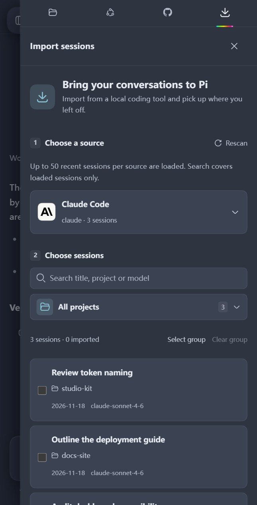

# PiWeb — Pi Coding Agent の Web UI

<p align="center">
  <a href="https://www.npmjs.com/package/@rexvane/piweb"></a>
  <a href="https://github.com/RexVane/PiWeb/actions/workflows/check.yml"></a>
  <a href="LICENSE"></a>
</p>

<p align="center">
  <strong>デスクトップとモバイルで使える、セルフホスト型 AI コーディングエージェントの Web UI。</strong>
</p>

<p align="center">
  <a href="README.md">English</a> | <a href="README_zh.md">简体中文</a> | <a href="README_zh-Hant.md">繁體中文</a> | <strong>日本語</strong> | <a href="README_ru.md">Русский</a>
</p>

**PiWeb** は、[Pi Coding Agent](https://github.com/earendil-works/pi) 向けのオープンソースのセルフホスト型 Web インターフェースです。npm でインストールし、自分の PC やサーバーで実行すれば、デスクトップやスマートフォンのブラウザーからツールの呼び出しを追ったり、差分を確認したり、会話の続きを進めたりできます。

公式の `@earendil-works/pi-*` SDK を同梱しており、既存の pi の設定、モデル、スキル、拡張機能、MCP（Model Context Protocol）をそのまま利用できます。

<p align="center">
  
</p>

## 目次

- [機能](#機能)
- [クイックスタート](#クイックスタート)
- [使い方とリモートアクセス](#使い方とリモートアクセス)
- [設定](#設定)
- [仕組み](#仕組み)
- [ドキュメント](#ドキュメント)
- [貢献](#貢献)
- [謝辞](#謝辞)
- [ライセンス](#ライセンス)

## 機能

- **チャットとコンテキスト** — Markdown、思考過程、ツール呼び出しをストリーミング表示します。会話のアウトラインから移動し、実行中に追加の指示を送ったり、メッセージをキューに入れたりできます。コンテキスト使用量も確認できます。
- **ワークスペースとセッション** — プロジェクトフォルダーごとに会話を整理します。名前変更、分岐、アーカイブ、下書きの復元、JSONL または HTML へのエクスポートが可能です。
- **会話のインポート** — Claude Code、Codex、OpenCode、Grok、ZCode、dsh、Kimi Code、WorkBuddy、Antigravity、Antigravity CLI、Qwen Code、Cursor のローカル履歴を検索して取り込みます。元のファイルはその場所のまま読み取ります。
- **ファイルと変更** — プロジェクトの変更履歴ツリーでターンごとの変更を確認し、`SKILL.md` の読み込みや codemode 内の呼び出しを追跡できます。ソース、Markdown プレビュー、統合または左右並列の差分を開き、選んだ行を会話に引用できます。
- **モデル、スキル、拡張機能** — プロバイダー、Pi の MCP ツールとパッケージを管理します。[既存リソースの追加や独自の設計](docs/resources.md)が可能で、JSON UI や独立した Web ビューに PiWeb の再ビルドは不要です。
- **プロンプトのソース** — 指示、スキル、テンプレート、ツール定義とその提供元を確認できます。
- **任意の質問リソース** — [piweb-ask-user](https://github.com/RexVane/piweb-ask-user) から個別に追加します。このソースのリソース API v1 は従来の内蔵質問ツールを置き換えます。古い npm インストールのページ更新だけでは有効になりません。
- **モバイルと表示言語** — 「設定 → リモートアクセス」の QR コードを読み取ります。英語、簡体字中国語、繁体字中国語、日本語、ロシア語に対応しています。

<details>
<summary>スクリーンショットをさらに見る（デスクトップとモバイル）</summary>

スクリーンショットは旧版の英語インターフェースとサンプルデータを使用しています。質問機能は現在、任意リソースとして提供されます。

<table>
  <tr>
    <td width="50%"><br /><strong>プロジェクトファイル</strong></td>
    <td width="50%"><br /><strong>左右並列の差分</strong></td>
  </tr>
  <tr>
    <td width="50%"><br /><strong>会話のインポート</strong></td>
    <td width="50%"><br /><strong>モデルプロバイダー</strong></td>
  </tr>
  <tr>
    <td width="50%"><br /><strong>コンテキスト使用量</strong></td>
    <td width="50%"><br /><strong>スキル</strong></td>
  </tr>
  <tr>
    <td colspan="2" align="center"><br /><strong>モバイルのチャット</strong></td>
  </tr>
  <tr>
    <td width="50%"><br /><strong>ワークスペース</strong></td>
    <td width="50%"><br /><strong>モバイルのインポート</strong></td>
  </tr>
  <tr>
    <td width="50%"><br /><strong>ファイルビューアー</strong></td>
    <td width="50%"><br /><strong>プロバイダー</strong></td>
  </tr>
  <tr>
    <td width="50%"><br /><strong>コンテキスト使用量</strong></td>
    <td></td>
  </tr>
</table>

</details>

## クイックスタート

**Node.js ≥ 22.19.0** が必要です（`package.json` の `engines`）。Node 24 を推奨します。プロジェクトの変更履歴機能には Git が必要です。

```bash
npm install -g @rexvane/piweb
piweb
```

既定では認証付きのページが `http://127.0.0.1:30141` で開きます。ポートが使用中の場合は番号が自動的に増えます。設定でモデルプロバイダーを登録するか、既存の pi 設定を利用してください。公開パッケージが登録するのは `piweb` コマンドだけなので、公式の `pi` CLI と衝突しません。封入済みの本番ビルドが同梱されます。インストール時にライフサイクルスクリプトをスキップした場合、初回起動時に一度だけビルドしてから提供します。詳細は[インストールとビルド](docs/operations/install-and-build.md)を参照してください。

## 使い方とリモートアクセス

```bash
piweb                    # http://127.0.0.1:30141
piweb -p 30143 --no-open # ポートを指定し、ブラウザーを自動で開かない
piweb -H 0.0.0.0         # メインサーバーも LAN にバインドする（認証は有効のまま）
```

| オプション | 説明 |
| --- | --- |
| `-p, --port <port>` | 待ち受けポート（既定 30141、環境変数 `PORT`） |
| `-H, --hostname <host>` | バインドアドレス（既定 127.0.0.1、環境変数 `PI_WEB_HOSTNAME`） |
| `--public-url <url>` | ログインリンク用の公開アドレス。Host 許可リストにも追加されます（環境変数 `PI_WEB_PUBLIC_URL`） |
| `--dev` | 開発モード（ループバックのみ） |
| `--no-open` | ブラウザーを自動で開かない |
| `-h, --help` | 使い方を表示 |

ホスト上では、ランチャーが非公開のログイン資格情報でブラウザーを開き、その値を端末に出力しません。もう一度 `piweb` を実行すると、既存のインスタンスを開いてサインインします。

更新は `npm install -g @rexvane/piweb@latest` のあと、`piweb` を再起動してください。アンインストールは `npm uninstall -g @rexvane/piweb` です。agent のデータと取り込んだツールの履歴はそのまま残ります。ダウングレードは[リリースとロールバック](docs/operations/release-and-rollback.md)を参照してください。

スマートフォンや別のデバイスから接続するには、**設定 → リモートアクセス** を開き、QR コードを読み取るかリンクをコピーします。同じコードは同一 Wi-Fi でも、ローカルネットワークの外からでも使えます。クライアント側に追加のソフトは不要です。コードは 256 ビットのワンタイム資格情報で、有効期限は 120 秒です。本番起動では `0.0.0.0:30142` のモバイルレイアウト用プロキシと、Cloudflare のクイックトンネル（`cloudflared`）を準備します。QR コードはトンネルの HTTPS アドレスを使い、そのアドレスに到達できるようになってから表示されます。ホストの `127.0.0.1:30141` はデスクトップページを提供します。開発モードはローカルのままです。

LAN への直接 HTTP は暗号化されません。QR アドレスの TLS は Cloudflare で終端されます。再起動後はトンネルアドレスが変わることがあります。

### セキュリティに関する注意

- `piweb` ランチャーが受け入れるどの起動方法でも、認証は既定で有効です（`PI_WEB_AUTH=1`）。
- `PI_WEB_AUTH=0` は、ループバックへのバインドで、かつ `--public-url` / `PI_WEB_PUBLIC_URL` がない場合にだけ許可されます。それ以外はランチャーが起動を拒否します。認証を切ると、組み込みの LAN プロキシと Cloudflare トンネルは準備されません。
- 開発モード（`--dev` / `PI_WEB_DEV=1`）はループバックのみです。Next.js の開発用エンドポイントは起動トークンでは保護されません。
- 起動トークンは `GET /?token=…` で HMAC 署名付きの HttpOnly セッション Cookie（30 日、HTTPS では `Secure`）に交換されます。API パスや `Authorization` ヘッダーでは受け付けられません。パスワードログインはありません。`PI_WEB_PASSWORD` を設定するとランチャーは起動を拒否します。
- すべてのデバイスからサインアウトすると、既存の Cookie とペアリングコードは無効になります。
- 独自のリバースプロキシやトンネルを使う場合は、`127.0.0.1:30142`（モバイルレイアウト）または `127.0.0.1:30141`（デスクトップ）を向き先にし、認証を有効のまま、外部ホスト名を許可リストに追加してください（`PI_WEB_TRUSTED_HOSTS=<your-domain>` または `--public-url`）。追加しないと 403 `untrusted host` が返ります。`PIWEB_REMOTE_LAN=0` は、組み込みプロキシとクイックトンネルの自動準備を無効にします。

## 設定

値はプロセスの環境変数から読みます。CLI のフラグは対応する変数より優先されます。OS のパス規約を含む保守用の一覧は[環境変数リファレンス](docs/operations/environment.md)にあります。

| 変数 | 既定値 | 意味 |
| --- | --- | --- |
| `PORT` | `30141` | メインの待ち受けポート。`piweb -p` が優先され、使用中ならランチャーが `+1` して再試行します。 |
| `PI_WEB_HOSTNAME` | `127.0.0.1` | メインのバインドアドレス（`-H` と同じ）。ループバック以外でも認証は有効のままです。 |
| `PI_WEB_AUTH` | `1` | 認証スイッチ。`0` はループバックバインドかつ公開 URL がない場合にだけ受け付けられます。 |
| `PI_WEB_PUBLIC_URL` | 未設定 | 公開 URL（`--public-url` と同じ）。ホスト名は Host 許可リストに追加されます。 |
| `PI_WEB_TRUSTED_HOSTS` | 空 | 独自のリバースプロキシやネームドトンネル用の Host 許可リスト（カンマ区切り）。 |
| `PI_CODING_AGENT_DIR` | `~/.pi/agent` | Pi / PiWeb が共有する agent ディレクトリ。唯一のデータルートではありません。[データとプライバシー](docs/operations/data-and-privacy.md) を参照してください。 |
| `PIWEB_REMOTE_LAN` | 有効 | `0` / `false` / `off` / `no` で、LAN プロキシと Cloudflare クイックトンネルの自動準備を無効にします。 |
| `PIWEB_REMOTE_LAN_PORT` | `30142` | 組み込み LAN / モバイルプロキシの待ち受けポート。 |
| `HTTP_PROXY` / `HTTPS_PROXY` | 未設定 | モデルリクエスト用のプロキシ。設定 → 一般 → ネットワークプロキシ（`httpProxy`）がこれを上書きします。 |
| `PI_WEB_UPDATE_CHECK` | `1` | `0` で起動時の更新確認をスキップします。設定の「更新を確認」は引き続き使えます。 |
| `PI_OFFLINE` | 未設定 | `1` / `true` / `yes` で、更新確認など PiWeb / SDK のネットワーク動作をスキップします。 |

<details>
<summary>すべての環境変数</summary>

以下は `src/`、`scripts/`、`bin/` で見つかった PiWeb 固有の変数です。内部用のプロセス変数はデプロイで設定しないでください。

#### サービスとネットワーク

| 変数 | 既定値 | 意味 |
| --- | --- | --- |
| `PORT` | `30141` | メインの待ち受けポート。`piweb -p` が優先され、使用中ならランチャーが `+1` して再試行します。 |
| `PI_WEB_HOSTNAME` | `127.0.0.1` | メインのバインドアドレス（`-H` / `--hostname` と同じ）。ループバック以外でも認証は有効のままです。 |
| `PI_WEB_PUBLIC_URL` | 未設定 | 公開 URL（`--public-url` と同じ）。ホスト名は Host 許可リストに追加され、ログインページを開くときにも使われます。 |
| `PI_WEB_TRUSTED_HOSTS` | 空 | カンマ区切りの Host 許可リスト。独自のリバースプロキシやネームドトンネルは必ず列挙してください。でないと 403 `untrusted host` が返ります。 |
| `PI_WEB_ALLOWED_HOSTS` | 空 | 上流の `agegr/pi-web` の旧変数名。`PI_WEB_TRUSTED_HOSTS` と結合されます。 |
| `PI_WEB_AUTH` | `1` | 認証スイッチ。`0` はループバックバインドかつ公開 URL がない場合にだけ受け付けられます。認証を切ると LAN / トンネル入口は準備されません。 |
| `PI_WEB_UPDATE_CHECK` | `1` | `0` で起動時の一回限りの更新確認をスキップします。**設定 → 更新を確認** は引き続き使えます。 |
| `PI_WEB_NO_OPEN` | 未設定 | `1` でブラウザーを自動で開きません（`--no-open` と同じ）。 |
| `PI_WEB_DEV` | 未設定 | `1` で開発モードで起動します（`--dev` と同じ）。開発モードはループバックのみです。 |
| `PI_WEB_ROOT` | インストールルート / `cwd` | ランチャーとリリーススクリプトが使うアプリケーションルートの上書き。通常のデプロイでは変更しないでください。 |
| `PIWEB_REMOTE_LAN` | 有効 | `0` / `false` / `off` / `no` で、組み込み LAN プロキシと Cloudflare クイックトンネルの自動準備を無効にします。 |
| `PIWEB_REMOTE_LAN_PORT` | `30142` | 組み込み LAN / モバイルプロキシの待ち受けポート。 |
| `PIWEB_REMOTE_LAN_BIND` | `0.0.0.0` | 組み込み LAN / モバイルプロキシのバインドアドレス。特定の NIC だけに縛る場合など。 |
| `PIWEB_CLOUDFLARED` | 未設定 | `cloudflared` 実行ファイルのパス。検索順：この変数 → `<agent ディレクトリ>/web-bin/cloudflared{,.exe}` → `PATH`。 |
| `PIWEB_SKIP_WARMUP` | 未設定 | `1` で本番の初回ページウォームアップをスキップします（障害切り分け用。初回表示は遅くなります）。 |

#### プロキシ

| 変数 | 既定値 | 意味 |
| --- | --- | --- |
| `HTTP_PROXY` / `HTTPS_PROXY`（小文字も可） | 未設定 | モデルリクエスト用のプロキシ。未設定なら、有効になっているユーザー単位の Windows システムプロキシを使います。 |
| `NO_PROXY` / `no_proxy` | ローカルアドレスは迂回 | プロキシの迂回リスト。Windows の完全一致ホストとドメインサフィックス例外は継承されます。PAC/WPAD や `<local>`、`192.168.*` などの Windows 固有パターンは評価されません。 |
| `NODE_USE_ENV_PROXY` | 対応していればランチャーが `1` を設定 | Node の `fetch` / `http` にプロキシ変数を認識させます。Node 24+ または 22.21+ で対応。ユーザーが明示した値は保持されます。 |

設定 → 一般 → ネットワークプロキシの値（`settings.json` の `httpProxy`）は環境変数とシステムプロキシより優先されます。空にすると自動検出に戻ります。変更後は `piweb` を再起動してください。

#### 認証とシークレット

| 変数 | 既定値 | 意味 |
| --- | --- | --- |
| `PI_WEB_SECRET_FILE` | `<agent ディレクトリ>/web-secret` | Cookie とペアリングコードの HMAC 署名鍵ファイル。 |
| `PI_WEB_SECRET` | 未設定（鍵ファイルを読む） | 署名鍵（**32 バイトの base64url エンコード**）。設定するとファイルは読みません。不正な値はエラーになり、黙って鍵を回すことはありません。 |
| `PI_WEB_PASSWORD` | 削除済み | パスワードログインは廃止されました。この変数が設定されていると、ランチャーは**起動を拒否**します。 |

#### データ、ツール、保持期間

| 変数 | 既定値 | 意味 |
| --- | --- | --- |
| `PI_CODING_AGENT_DIR` | `~/.pi/agent` | Pi / PiWeb が共有する agent ディレクトリ：設定、モデルと認証情報、セッション、アップロード。唯一のデータルートではありません。[データとプライバシー](docs/operations/data-and-privacy.md) を参照してください。 |
| `PI_WEB_EDITOR` | `code` | 「エディターで開く」に使うローカルのエディターコマンド。ホスト上の操作者にだけ意味があります。 |
| `PI_WEB_UPLOAD_RETENTION` | `30`（日） | `web-uploads` 内の未参照ファイルを掃除する閾値。`0` で掃除を無効にします。掃除の前に `~/.agents/backups/` へコピーし、`INDEX.md` に記録します。 |
| `PI_WEB_DELETE_ATTACHMENT_CLEANUP` | 有効 | セッション削除時に、そのセッションだけが参照するアップロードも掃除します（先にバックアップしてから削除）。`0` で残します。 |
| `PI_WEB_ALLOW_PRIVATE_MODEL_DISCOVERY` | オフ | `1` でモデル検出がプライベートネットワークアドレスを調べることを許可します（ローカル推論向け）。既定はオフで、SSRF を抑えます。 |
| `PI_OFFLINE` | 未設定 | `1` / `true` / `yes` で、更新確認、gh の識別情報照会、インストールテレメトリなど PiWeb / SDK のネットワーク動作をスキップします。OS レベルのオフラインモードではありません。 |
| `PI_TELEMETRY` | 未設定 | Pi SDK のインストールテレメトリ（`1` / `true` / `yes` でオン、`0` / `false` / `no` でオフ）。未設定時は SDK の `enableInstallTelemetry`（既定はオン）に従います。PiWeb のソース自体はこの変数を読まず、同梱 SDK が消費します。 |

#### ビルドとリリース

| 変数 | 既定値 | 意味 |
| --- | --- | --- |
| `PIWEB_BUILD_DIR` | `.next-releases/active.json` から決定 | `.next` または `.next-releases/<安全な id>` のみ受け付けます。現在のアクティブなリリースと衝突すると起動しません。 |
| `PIWEB_MAX_RETAINED_RELEASES` | `10`（範囲 2–100） | 成功したリリースビルドの保持上限。上限に達すると新しいビルドを拒否し、古いビルドは自動削除しません。 |
| `PIWEB_MAX_FAILED_RELEASES` | `3`（範囲 1–100） | 未完了または失敗したリリースディレクトリの上限。同様に新しいビルドを拒否します。 |
| `PIWEB_SKIP_INSTALL_BUILD` | 未設定 | `1` で本番インストール時の初回自己修復ビルドをスキップします。封入済みビルドを既に用意しているデプロイ向けです。 |
| `PIWEB_BUILD_VERBOSE` | 未設定 | `1` / `true` / `yes` でビルド出力をすべて表示します。 |

#### 任意の制限

既定ではオフ、または緩い上限です。設定するまで従来の動作は変わりません。

| 変数 | 既定値 | 意味 |
| --- | --- | --- |
| `PIWEB_FS_STRICT_WORKSPACES` | オフ | `1` / `true` / `yes` で、認証済みファイル API を登録済みワークスペースまたは `PIWEB_FS_ALLOWED_ROOTS` に制限します。 |
| `PIWEB_FS_ALLOWED_ROOTS` | 空 | 厳格モードで追加許可するルート。Windows は `;`、POSIX は `:` で区切ります。 |
| `PIWEB_MAX_SESSION_SUBSCRIBERS` | 無制限 | セッションあたりの SSE 購読者の上限（正の整数）。超過分はスナップショットモードになります。 |
| `PIWEB_SSE_MAX_BUFFERED_BYTES` | `4MiB` | SSE 接続ごとの未読バッファ上限。遅いクライアントは切断され、再接続してスナップショットを取る想定です。 |
| `PIWEB_SHUTDOWN_TIMEOUT_MS` | `8000` | SIGINT / SIGTERM / SIGHUP 後にシャットダウンフックを待つ予算。2 回目のシグナルですぐ終了します。 |
| `PIWEB_GRACEFUL_STOP_TIMEOUT_MS` | `10000` | ランチャーが起動した子プロセスの終了を待つ時間。タイムアウト後にプロセスツリーを終了します。 |
| `PIWEB_AGENT_MAX_STEPS` | 無制限 | 1 ターンあたりの最大モデルステップ数。 |
| `PIWEB_AGENT_MAX_DURATION_MS` | 無制限 | 1 ターンの最大実行時間（ミリ秒）。 |
| `PIWEB_AGENT_TOKEN_BUDGET` | 無制限 | 1 ターンの累計トークン上限（input + output + cache）。 |
| `PIWEB_MOBILE_PROXY_MAX_HTML_BYTES` | `16MiB` | モバイルプロキシの HTML 注入バッファ上限。超えると注入せずストリーム転送します。 |
| `PIWEB_MOBILE_PROXY_MAX_DECODED_BYTES` | `64MiB` | モバイルプロキシの展開後ボディ上限。これを超えると 502 を返します。 |
| `PIWEB_MOBILE_PROXY_TIMEOUT_MS` | `30000` | モバイルプロキシが上流の HTML 応答を待つ時間。タイムアウトすると注入せずストリーム転送します。 |
| `PIWEB_AGENT_CONFIG_CACHE_MAX` | `512` | agent 設定キャッシュの件数上限。 |
| `PIWEB_AGENT_CONFIG_CACHE_TTL_MS` | `1800000`（30 分） | 失敗または欠落したキャッシュ項目の TTL。 |
| `PIWEB_PI_CACHE_MAX` | `512` | SettingsManager / リソースローダー / パッケージマネージャーのキャッシュ件数上限。 |

#### テスト、CI、内部変数

デプロイでは使わないでください。`CI`、`PIWEB_COVERAGE`、`PIWEB_COVERAGE_REPORT_DIR`、`PIWEB_TEST_REPORT`、`PIWEB_TEST_TUNNEL`、`PIWEB_LINT_SKIP_INSTALL` はテストと CI 専用です。

ランチャー、ロック、テストは次も注入します：`PI_WEB_LAUNCH_TOKEN`（起動のたびに作り直す、本機用ワンタイムログイントークン）、`PIWEB_PORT`（子プロセスに渡す実際のポート）、`PIWEB_HTTP_GUARD`、`PIWEB_BUILD_LOCK_FILE` / `PIWEB_BUILD_LOCK_TOKEN`、`PIWEB_PROCESS_LOCK_FILE` / `PIWEB_PROCESS_LOCK_TOKEN`、`PIWEB_PROXY_SOURCE`、`PIWEB_INHERITED_HTTP_PROXY` / `PIWEB_INHERITED_HTTPS_PROXY`、`PIWEB_MANAGED_NODE_USE_ENV_PROXY`、`PIWEB_MANAGED_NO_PROXY`、`PIWEB_DEV_ASSET_ID`、`PIWEB_DISABLE_GRACEFUL_SHUTDOWN`、`PIWEB_DEBUG_PROMPT`、`PIWEB_BROWSER_URL`（Windows でホストのブラウザーを開くときの一時 URL）。`PYTHONUTF8` / `PYTHONIOENCODING`、`NODE_OPTIONS`、`NEXT_PHASE`、`NEXT_RUNTIME`、`NEXT_TELEMETRY_DISABLED` はプロセスまたは Next.js の規約です（ビルドスクリプトは Next のテレメトリを無効にします）。

PiWeb は `HOME`、`USERPROFILE`、`TEMP` / `TMP`、`APPDATA`、`LOCALAPPDATA` などの OS パス変数と、該当するインポート元のための任意の `WORKBUDDY_CONFIG_DIR` と `QWEN_HOME` も読みます。

</details>

## 仕組み

PiWeb は、公式の `@earendil-works/pi-*` SDK を包む Next.js 16 + React 19 の TypeScript アプリです。`piweb` コマンド（`bin/piweb.js` → `scripts/launcher.mjs`）は空きポートを選び、ワンタイムの起動トークンを生成し、Next.js サーバーを起動して、ローカルのログイン URL を開きます。サーバーはそのトークンを HMAC 署名付きセッション Cookie に交換し、本番（認証がオンのとき）では LAN 入口と Cloudflare クイックトンネルを準備します。

PiWeb は、別途インストールした `pi` CLI を置き換えません。両者は**同じ agent ディレクトリ**（既定は `~/.pi/agent`、または `PI_CODING_AGENT_DIR`）を共有します。このディレクトリが主な保存先ですが、唯一のデータルートではありません。セッションのインポートはホームディレクトリにある他ツールの履歴を読み、グローバルスキルは `~/.agents/skills` に置かれる場合があります。詳細は[データ、プライバシー、保持期間](docs/operations/data-and-privacy.md)を参照してください。

## ドキュメント

- [インストールとビルド](docs/operations/install-and-build.md)
- [環境変数リファレンス](docs/operations/environment.md)
- [データ、プライバシー、保持期間](docs/operations/data-and-privacy.md)
- [リリース、ダウングレード、ロールバック](docs/operations/release-and-rollback.md)
- [拡張機能の Web UI](docs/extension-web-ui.md) と[拡張機能の例](examples/piweb-extensions/README.md)
- ドキュメント案内：[docs/README.md](docs/README.md)

## 貢献

Issue とプルリクエストは [github.com/RexVane/PiWeb](https://github.com/RexVane/PiWeb) で受け付けています。開発環境、プロジェクト構成、PR 前の確認、不具合の報告方法は [CONTRIBUTING.md](CONTRIBUTING.md) を参照してください。

## 謝辞

Ripple と Dawn の配色を提供してくださった [@webkubor](https://github.com/webkubor) に感謝します。上流プロジェクトと参照元は [ACKNOWLEDGEMENTS.md](ACKNOWLEDGEMENTS.md) にまとめています。依存関係のライセンスは [THIRD-PARTY-NOTICES.md](THIRD-PARTY-NOTICES.md) を参照してください。

## ライセンス

[MIT](LICENSE)
