# PiWeb — Pi Coding Agent の Web UI

<p align="center">
  <strong>デスクトップとモバイルで使える、セルフホスト型 AI コーディングエージェントの Web UI。</strong>
</p>

<p align="center">
  <a href="README.md">English</a> | <a href="README_zh.md">简体中文</a> | <a href="README_zh-Hant.md">繁體中文</a> | <strong>日本語</strong> | <a href="README_ru.md">Русский</a>
</p>

**PiWeb** は、[Pi Coding Agent](https://github.com/earendil-works/pi) 向けのオープンソースのセルフホスト型 Web インターフェースです。自分の PC やサーバーで Pi を動かし、デスクトップやスマートフォンのブラウザーからツールの実行を追ったり、コードの変更を確認したり、会話の続きを進めたりできます。

公式 Pi SDK を使っているため、既存の pi の設定、モデル、スキル、拡張機能、MCP（Model Context Protocol）をそのまま利用できます。Claude Code、Codex、OpenCode などのローカルの会話を取り込み、組み込みの自動化で繰り返しタスクを実行できます。

[クイックスタート](#クイックスタート) · [機能](#機能) · [スクリーンショット](#スクリーンショット) · [インストールと運用](#使い方) · [ドキュメント](docs/README.md)

<p align="center">
  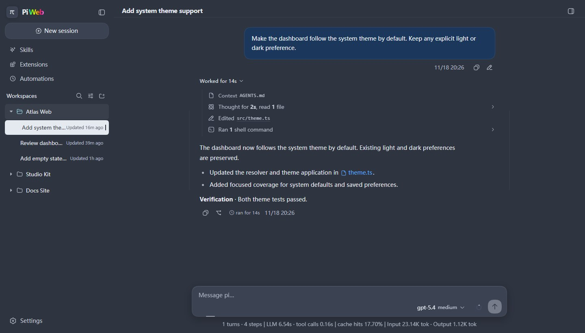
</p>

## クイックスタート

**Node.js ≥ 22.19.0** が必要です。Node 24 を推奨します。インストールして起動します。

```bash
npm install -g @rexvane/piweb
piweb
```

既定では認証付きのブラウザーページが `http://127.0.0.1:30141` で開きます。ポートが使用中の場合は番号が自動的に増えます。設定画面でモデルプロバイダーを登録するか、既存の pi 設定を利用してください。モバイル版は **設定 → リモートアクセス** の接続 QR コードから開けます。

環境要件とデプロイ時の動作については、[インストール](#インストール)、[別のデバイスから接続](#別のデバイスから接続)、[データとプライバシー](docs/operations/data-and-privacy.md)を参照してください。

## 機能

- **チャットとコンテキスト** · Markdown、思考過程、ツール呼び出しをストリーミング表示します。会話のアウトラインから移動し、実行中に追加の指示を送ったり、メッセージをキューに入れたりできます。コンテキストの使用量と内訳も確認できます。
- **ワークスペースとセッション** · プロジェクトフォルダーごとに会話を整理します。名前変更、分岐、アーカイブ、下書きの復元、JSONL または HTML へのエクスポートが可能です。
- **会話のインポート** · Claude Code、Codex、OpenCode、Grok、ZCode、dsh、Kimi Code、WorkBuddy、Antigravity、Antigravity CLI、Qwen Code、Cursor のローカル履歴を検索して取り込めます。複数のソースから選択でき、アーカイブしたインポート済みの会話も復元できます。元のファイルはそのまま保持されます。
- **ファイルと変更** · プロジェクトの変更履歴ツリーでターンごとの変更を確認し、`SKILL.md` の読み込みや codemode 内のツール呼び出しを追跡できます。ファイルビューアーではソースコード、Markdown プレビュー、統合または左右並列の差分を表示し、選んだ行を会話に引用できます。
- **モデル、スキル、拡張機能** · 設定でモデルプロバイダーを指定し、pi の MCP ツールとリソースを利用できます。サイドバーではスキルの有効・無効を切り替え、`SKILL.md` を開き、個人用またはプロジェクト用の拡張機能と pi パッケージを管理できます。
- **プロンプトのソース** · 右側のプロンプトパネルで、プロジェクトの指示、スキル、テンプレート、ツール定義を確認できます。PiWeb が追加したプロンプトとツールには出所が表示されます。
- **自動化** · 指定間隔、毎日、毎週、または cron でプロンプトを実行します。ワークスペースとモデルを指定でき、実行ごとのセッションを開けます。スケジュールどおりに実行するには PiWeb を起動したままにしてください。
- **モバイルと表示言語** · 「設定 → リモートアクセス」の QR コードを読み取ってスマートフォンを接続します。英語、中国語（簡体字・繁体字）、日本語、ロシア語に対応しています。

## pi との関係

PiWeb は公式 pi SDK を同梱する Web フロントエンドで、別途インストールした pi CLI は変更しません。両者は**同じ agent ディレクトリ**を共有します。既定は `~/.pi/agent` で、`PI_CODING_AGENT_DIR` で変更できます。設定、モデルと認証情報、セッション、スキル、パッケージが保存されます。同梱エンジンは PiWeb のリリースに合わせて更新します。起動時に自動確認するのは PiWeb の更新のみで、pi のバージョン表示と手動更新は設定画面に残ります。

agent ディレクトリは主な保存先ですが、**唯一のデータルートではありません**。セッションのインポートではホームディレクトリにある他ツールの履歴を読み取り、グローバルスキルは `~/.agents/skills` に置かれる場合があります。保存先の一覧とデプロイの分離については、[データ、プライバシー、保持期間](docs/operations/data-and-privacy.md)を参照してください。

拡張機能のダイアログ、通知、ステータステキスト、テキストウィジェット、挿入メッセージをページに表示します。拡張コマンドからセッションの作成、分岐、切り替えも可能です。[JSON UI ブリッジ](docs/extension-web-ui.md)を使えば、対話型のブラウザーパネルを提供できます。互換性のあるターミナルコンポーネントは読み取り専用テキストとして表示します。ターミナルのキーボード操作や、カスタムのヘッダー、フッター、エディターは再現しません。

## スクリーンショット

スクリーンショットは英語のインターフェースとサンプルデータを使用しています。

### デスクトップ

<table>
  <tr>
    <td width="50%"><br /><strong>会話ワークスペース</strong><br />プロジェクトのセッションと並べて思考過程やツール呼び出しを確認。</td>
    <td width="50%">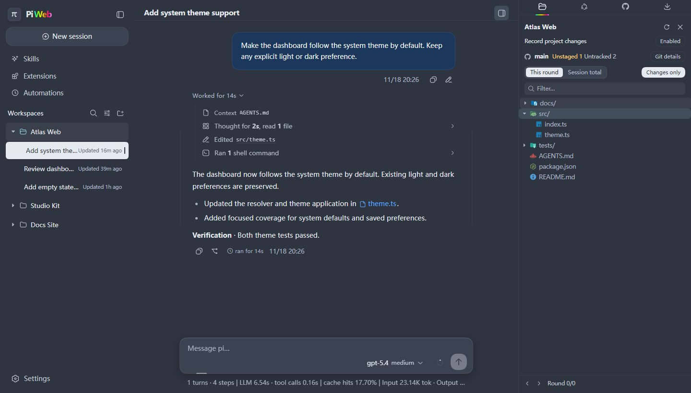<br /><strong>プロジェクトファイル</strong><br />サイドパネルでツリーをたどり、ファイルを開く。</td>
  </tr>
  <tr>
    <td width="50%">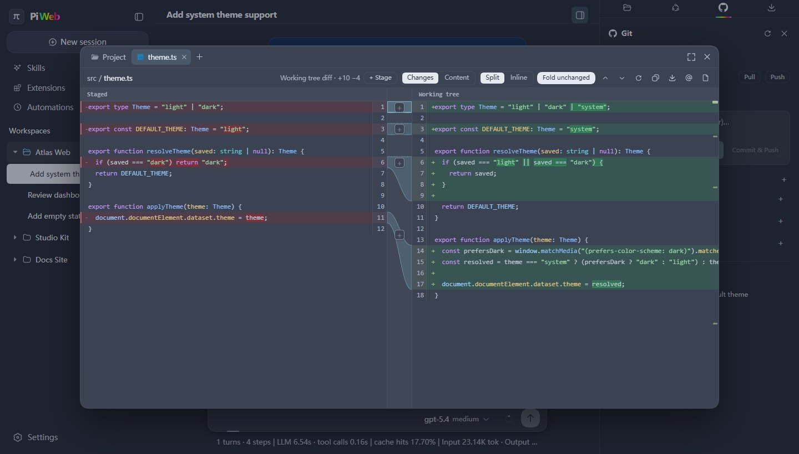<br /><strong>左右並列の差分</strong><br />ファイルビューアーで変更前後のコードを比較。</td>
    <td width="50%">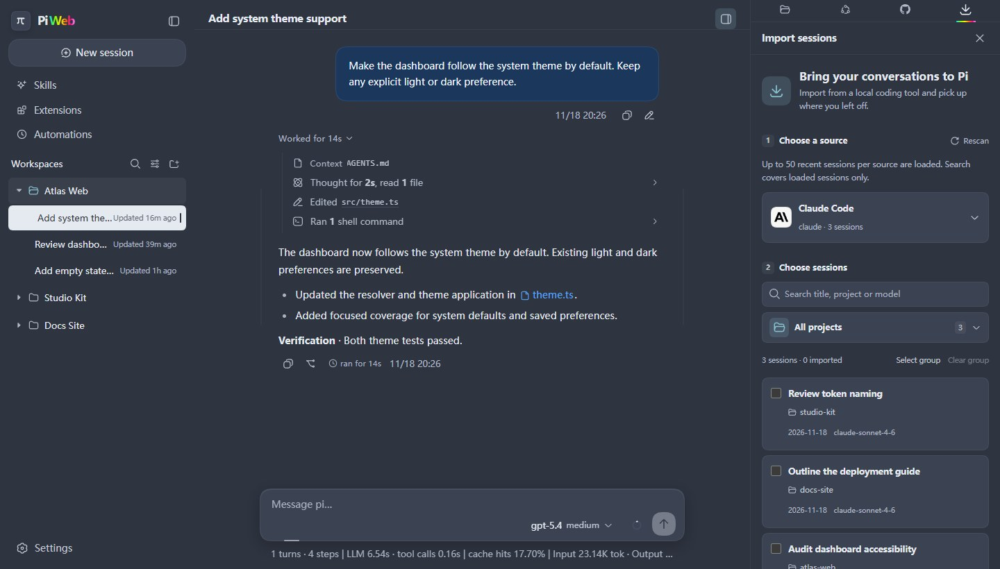<br /><strong>会話のインポート</strong><br />複数のツールからローカルの会話を検索して選択。</td>
  </tr>
  <tr>
    <td width="50%">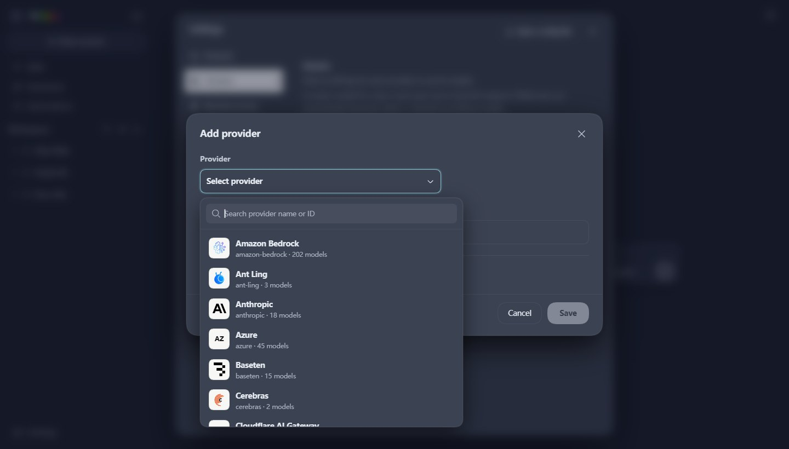<br /><strong>モデルプロバイダー</strong><br />モデルプロバイダーを探して設定。</td>
    <td width="50%">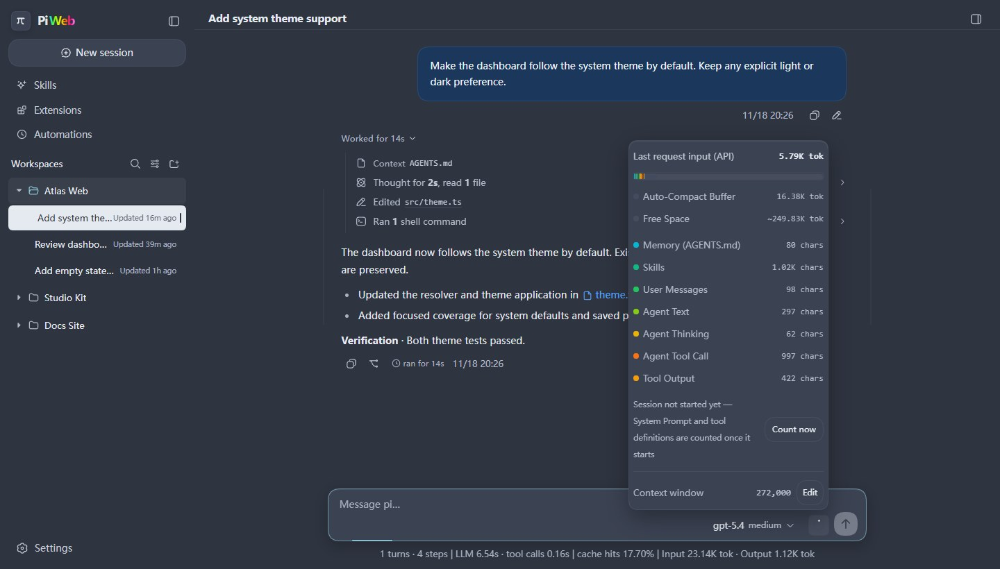<br /><strong>コンテキスト使用量</strong><br />トークンの使用量と内訳を確認。</td>
  </tr>
  <tr>
    <td width="50%">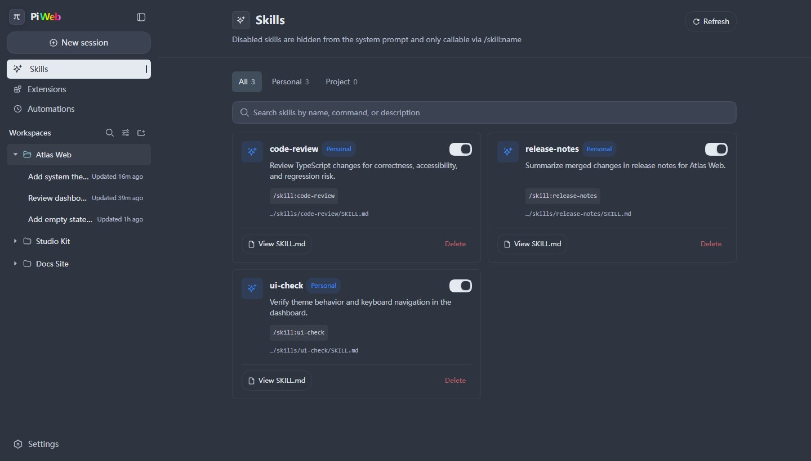<br /><strong>スキル</strong><br />スキルを絞り込み、対応する SKILL.md を開く。</td>
    <td width="50%">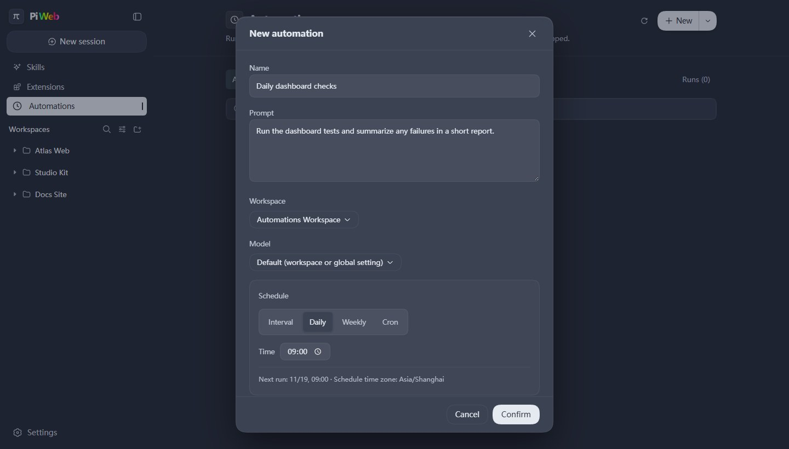<br /><strong>自動化</strong><br />タスクのスケジュール、ワークスペース、モデルを指定。</td>
  </tr>
</table>

### モバイル

<table>
  <tr>
    <td width="33%">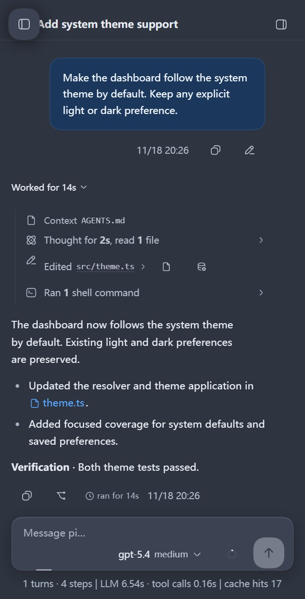<br /><strong>外出先でチャット</strong><br />スマートフォンで会話を再開。</td>
    <td width="33%">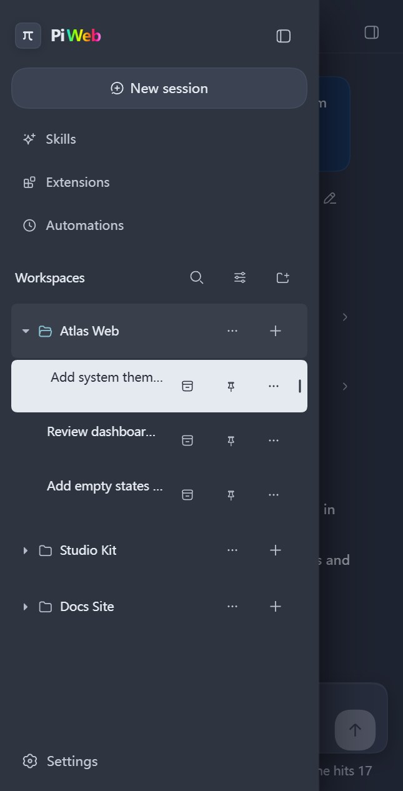<br /><strong>ワークスペース</strong><br />プロジェクトとセッションを切り替え。</td>
    <td width="33%"><br /><strong>会話のインポート</strong><br />取り込む会話を選択。</td>
  </tr>
  <tr>
    <td width="33%">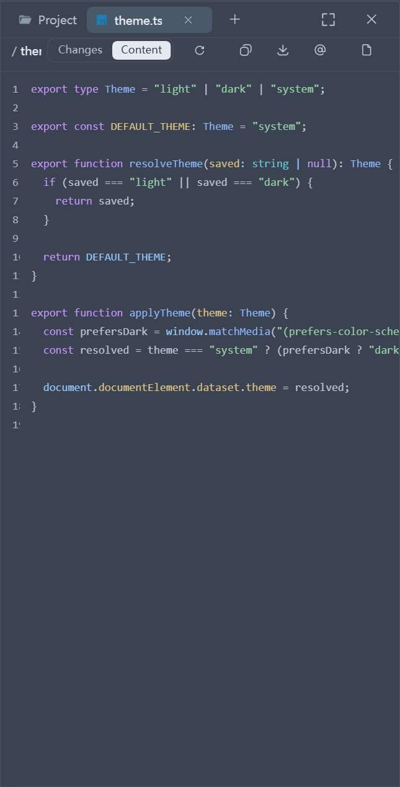<br /><strong>ファイルビューアー</strong><br />プロジェクトのコードを開いて閲覧。</td>
    <td width="33%">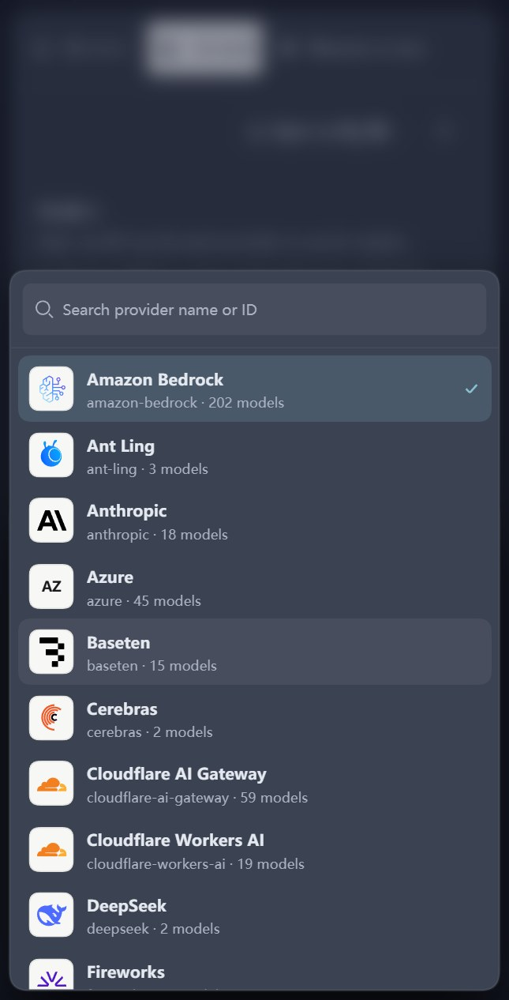<br /><strong>モデルプロバイダー</strong><br />モデルプロバイダーを探して設定。</td>
    <td width="33%">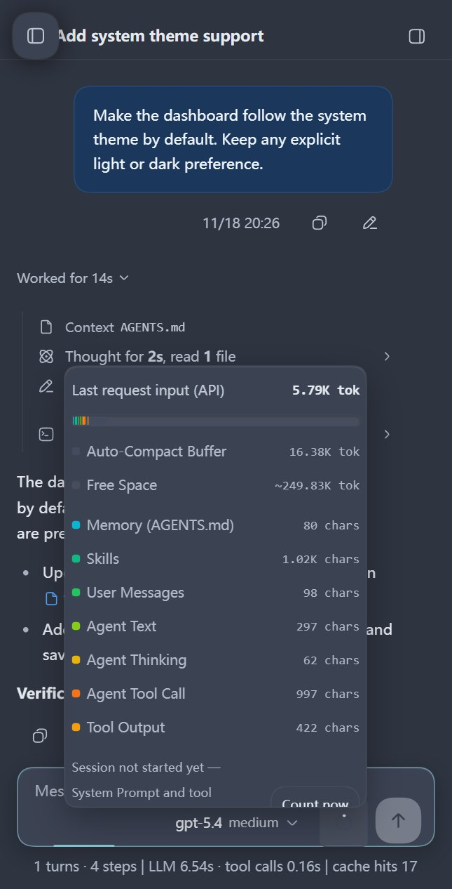<br /><strong>コンテキスト使用量</strong><br />使用量と残りのコンテキストを確認。</td>
  </tr>
</table>

## アーカイブとデータ

アーカイブしたセッションは保持され、サイドバーから表示、復元、手動削除ができます。アーカイブは確認ダイアログなしで即座に反映します。手動削除には確認が必要ですが、セッションファイルは**復元用コピーを残さず完全に削除**します。セッションの自動削除は行いません。削除したセッションだけが参照していたアップロード添付ファイルは、`~/.agents/backups` に復元用コピーを作成し、`backups/INDEX.md` に記録してから除去します。`PI_WEB_DELETE_ATTACHMENT_CLEANUP=0` でこの処理を無効にできます。どのセッションからも参照されていない添付ファイルは、30 日経過後、新しいアップロードによるクリーンアップ時に削除します。必要なデータはバックアップしてください。保存先の一覧は[データとプライバシー](docs/operations/data-and-privacy.md)にあります。

プロジェクトの変更履歴は既定で記録し、確認ダイアログは表示しません。各ラウンドをワークスペースの Git リポジトリの `refs/piweb/rounds/…` 以下にコミットし、ブランチとインデックスは変更しません。必要な場合はローカルリポジトリを自動初期化します。累積の履歴件数と保存容量に上限はありません。プロジェクトパネルから記録を停止・再開でき、以前に無効にしたワークスペースは無効のままです。停止しても過去の履歴は保持します。個別のファイル、スナップショット、プレビューのサイズ制限は引き続き適用します。

## 拡張機能と自動化

サイドバーのワークスペースは設定画面とは別に用意しています。スキルワークスペースでは選択中ワークスペース向けに個人／グローバル／プロジェクト範囲のスキルを一覧でき、有効・無効の切り替え、ファイルビューアーでの `SKILL.md` 閲覧、非パッケージスキルの復元可能な削除が行えます。拡張機能ワークスペースで対象ワークスペースの npm パッケージを管理し、個人／プロジェクトの適用範囲とローカル／パッケージのソースを表示します。個人のリソースは通常 `<agent dir>/skills` と `<agent dir>/extensions` にあります。信頼済みのプロジェクトは `.pi/skills`、`.pi/extensions`、`.agents/skills`、明示的に設定したリソースパスを利用できます。ワークスペースと現在のセッション向けに組み立てられたプロンプトソースは、右ドロワーのプロンプトパネルで確認できます（リソースマーケット画面は削除されています）。

npm パッケージの追加、更新、削除は別ディレクトリで準備した後、有効なインストールと設定を切り替えます。準備に失敗した場合は元のインストールを保持し、コミット中に中断した場合はリソースの読み込み前に復旧します。以前のインストール世代と復旧インデックスは保持します。npm のライフサイクルスクリプトは無効ですが、読み込まれた拡張機能自体はホストプロセス内で信頼済みコードとして実行されます。

自動化のタスクと実行履歴は `<agent dir>/web-automations.json` に保存します。スケジュールはエディターに表示するサーバーのタイムゾーンを使用します。同時実行は最大 4 件で、それぞれ独立したセッションを使用します。停止中に猶予期間を過ぎた予定はスキップとして記録し、起動後にまとめて再実行しません。

## 使い方

### インストール

```bash
npm install -g @rexvane/piweb
piweb
```

登録するコマンドは `piweb` のみで、公式の `pi` CLI と競合しません。Node.js **≥ 22.19.0** が必要です。CI は 22.19.0、22.22.2、24 を対象とし、Node 24 を推奨します。自動プロキシには Node 24 または 22.21 以上が必要です。古いバージョンでは外部ツールにのみプロキシ変数を引き継ぎます。[プロキシ](#プロキシ)も参照してください。変更履歴の機能には Git が必要です。

公開パッケージには封印済みの本番ビルドが含まれ、通常のグローバルインストールでコンパイルは不要です。`postinstall` がビルドを準備するのは**本番用依存のみをインストールする場合**です。ソースのチェックアウト内では何も行いません。ライフサイクルスクリプトを省略した場合、最初の `piweb` 起動時に別のステージングディレクトリで一度ビルドしてからサービスを開始します。現在のハードウェアでは約 6–15 分です。詳細とタイムアウトは[インストールとビルド](docs/operations/install-and-build.md)を参照してください。

### 更新

```bash
npm install -g @rexvane/piweb@latest
```

npm は既存バージョンをその場で置き換えます。事前のアンインストールは不要です。既定のタグは `latest` なので、`npm install -g @rexvane/piweb` でも同じ結果になります。ミラーの同期が遅れている場合は `--registry=https://registry.npmjs.org` を追加できます。完了後に `piweb` を再起動してください。

特定のバージョンを入れる場合は `latest` をバージョン番号に置き換えます。不具合時のバージョン指定によるダウングレード、古い `latest` タグへの対処、データの復旧は[リリースとロールバック](docs/operations/release-and-rollback.md)を参照してください。

**UI からの更新**：起動するたびに PiWeb 自身の更新をバックグラウンドで確認します。新しいバージョンがある場合はターミナルに `[更新] 有新版本：…` と表示し、ページ右下にも通知します。通知は起動ごとに 1 回です。通知または設定 → 一般の「更新」からその場でインストールできます。案内に従って `piweb` を再起動してください。プロセスは自動再起動しません。

- PiWeb のリリースには検証済みの pi エンジンを同梱します。pi の自動更新通知は表示せず、設定から手動確認できます。
- Windows では実行中の npm インストール先を置き換えられないため、コピー可能なコマンドを表示します。`piweb` を停止してから上記コマンドを実行してください。
- 起動時のネットワーク確認は `PI_WEB_UPDATE_CHECK=0` で省略できます。設定からの手動確認は利用可能です。

### アンインストール

```bash
npm uninstall -g @rexvane/piweb
```

削除するのは PiWeb 本体のみです。pi のデータは agent ディレクトリ（既定は `~/.pi/agent/`、または `PI_CODING_AGENT_DIR`）に保持します。ホームディレクトリからインポートした他ツールの履歴も変更しません。[データとプライバシー](docs/operations/data-and-privacy.md)を参照してください。

### 起動

```bash
piweb                    # http://127.0.0.1:30141（使用中ならポートを自動変更）
piweb -p 30143 --no-open # ポート指定、ブラウザーを自動で開かない
piweb -H 0.0.0.0         # メインサーバーも LAN に公開（認証は有効）
```

| オプション | 説明 |
| --- | --- |
| `-p, --port <port>` | 待受ポート。既定は 30141、環境変数は `PORT` |
| `-H, --hostname <host>` | バインド先。既定は 127.0.0.1、環境変数は `PI_WEB_HOSTNAME` |
| `--dev` | 開発モード |
| `--no-open` | ブラウザーを自動で開かない |
| `--public-url <url>` | ログインリンク用の外部アドレス。Host 許可リストにも自動追加。環境変数は `PI_WEB_PUBLIC_URL` |

すべての起動方法で認証が既定で有効です（`PI_WEB_AUTH=1`）。ホスト上では、ランチャーが非公開のログイン認証情報を使ってブラウザーを開きます。認証情報はターミナルに出力しません。再度 `piweb` を実行すると既存のインスタンスを開いてログインできます。別のデバイスでは更新される接続 QR コードを使います。いずれも認証情報を、有効期間 30 日の署名付き HttpOnly Cookie に交換します。全デバイスからログアウトすると、既存の Cookie とペアリングコードが無効になります。`PI_WEB_PASSWORD` は廃止されており、設定すると起動を拒否します。

有効な起動認証情報を持つスクリプトは、`GET /?token=…` で Cookie に交換し、その Cookie を API リクエストに送信します。API の URL や `Authorization` ヘッダーに起動トークンを指定する方法は利用できず、Basic Auth へのフォールバックもありません。

### プロキシ

`HTTP_PROXY` / `HTTPS_PROXY` を自動で利用します。未設定なら、現在のユーザーの Windows HTTP(S) システムプロキシを読み取ります。設定 → 一般 → ネットワークプロキシ、または agent ディレクトリの `settings.json` の `httpProxy` で上書きできます。空にすると自動検出へ戻り、プロキシ未設定なら直接接続します。ローカルアドレスは既定で迂回し、`NO_PROXY` で変更できます。Windows のホスト名完全一致とドメイン接尾辞の例外も引き継ぎます。PAC/WPAD スクリプトや、`<local>`、`192.168.*` などの Windows 専用パターンは評価しません。プロキシ URL または `NO_PROXY` を使用してください。変更後は再起動してください。Node.js 24 または 22.21 以上が必要で、古いバージョンではこの設定を無視し、ランチャーに理由を表示します。`bash` 内の curl / git はプロキシ変数を引き継ぎます。

### 別のデバイスから接続

**設定 → リモートアクセス** を開き、接続 QR コードをスキャンします。同じ Wi-Fi でも外部ネットワークでも同じコードを利用します。接続の手動切り替えやネットワーク選択は不要で、接続先デバイスへの追加ソフトウェアも必要ありません。QR コードとコピー用リンクは共通の 256 ビット乱数の認証情報を使い、有効期間は 120 秒、利用は 1 回限りです。期限切れまたは使用後に自動更新し、パネルを開き直しても有効なコードは再利用します。

本番起動時はローカルプロキシ（`0.0.0.0:30142`）と Cloudflare Quick Tunnel（`cloudflared`）を自動準備します。QR コードはトンネルの HTTPS アドレスを使い、疎通を確認してから表示します。LAN 専用アドレスへ自動で切り替えることはありません。短い中断では同じアドレスを維持し、接続不能が続く場合はトンネルを再作成します。開発モードはローカルのみです。

ローカルプロキシがモバイルレイアウトを提供し、ホストの `127.0.0.1:30141` はデスクトップ画面を提供します。トンネルには次の制約があります。

- 再起動や再作成でアドレスが変わる場合があります。DNS と疎通の確認が終わるまで QR コードは表示しません。
- QR アドレスは HTTPS を使用し、TLS は Cloudflare で終端します。LAN 内の HTTP 直接接続は暗号化されません。同じ Wi-Fi でコードを使う場合も公開トンネルへの接続が必要です。

組み込み LAN プロキシの既定の待受先は `0.0.0.0:30142` です。`PIWEB_REMOTE_LAN=0` で LAN プロキシとトンネルの自動準備を停止できます。`PIWEB_REMOTE_LAN_PORT` はポート、`PIWEB_REMOTE_LAN_BIND` はバインド先を変更します。`-H 0.0.0.0` はメインサーバーも LAN で待ち受けます。HTML への挿入には上限があり、`PIWEB_MOBILE_PROXY_MAX_HTML_BYTES`（既定 16 MiB）または `PIWEB_MOBILE_PROXY_TIMEOUT_MS`（30 秒）を超えると挿入せずに転送します。デコード後に `PIWEB_MOBILE_PROXY_MAX_DECODED_BYTES`（64 MiB）を超えるレスポンスは拒否します。詳細は[環境変数一覧](docs/operations/environment.md)を参照してください。

`cloudflared` は `PIWEB_CLOUDFLARED` → `<agent dir>/web-bin/cloudflared{,.exe}`（PiWeb が管理）→ `PATH` の順で探します。見つからない場合はパネルに表示します。

> リモートアクセスには認証が必要で、既定で有効です。トンネルのホスト名は稼働後に Host 許可リストへ追加し、停止時に削除します。API パスと `Authorization` ヘッダーでは起動トークンを受け付けません。

### 独自のリバースプロキシやトンネル

Caddy、nginx、名前付き Cloudflare Tunnel、VPN なども利用できます。

- モバイルレイアウトを使う場合は **`127.0.0.1:30142`** に転送してください。デスクトップのみなら `127.0.0.1:30141` を利用できます。
- 既定の認証を有効にしてください。`PI_WEB_AUTH=0` は自動リモートアクセスを無効にし、ループバックのみにバインドし、公開 URL を設定していない場合に限り許可します。
- 外部のホスト名がそのままバックエンドへ届くため、許可リストへの追加が必要です。未登録の場合は 403 `untrusted host` を返します。

  ```bash
  PI_WEB_TRUSTED_HOSTS=<your-domain> piweb
  ```

- `--public-url https://your-address/` で外部アドレスを指定できます。そのホスト名を許可リストへ自動追加し、ランチャーのログインページにも利用します。ログイン認証情報はログに出力しません。

> 独自のネットワーク入口を管理する場合は、`PIWEB_REMOTE_LAN=0` で組み込み LAN プロキシと Quick Tunnel の自動準備を停止できます。これはデプロイ設定で、接続パネルのネットワーク切り替えではありません。

## 開発と検証

検証には別のチェックアウトかステージングディレクトリを使用してください。`npm run build` は `.next` に書き込むため、稼働中のインスタンスのディレクトリでは実行しないでください。`npm ci` で開発依存を入れてから実行します。

```bash
npm run typecheck
npm run lint
npm run test
npm run build
npm run verify:package
```

`verify:package` は本番ビルドをパッケージ化し、空のインストール先に展開して、一時データで起動します。CI は固定された lint ツールチェーン、Linux/Node 24 での重大度 high 以上の依存脆弱性監査、SDK の検索ツール準備、想定外のスキップ確認、`PIWEB_COVERAGE=1` によるカバレッジ測定も行います。公開トンネルの実測は別途明示的に有効にします。本番ビルドは検証マシンで約 6–7 分、並行負荷時の `next build --webpack` は 370 秒でした。ビルドのタイムアウトには少なくとも 15 分、完全な `check` には 30–45 分を確保してください。`npm run check` はソーステスト、インストール済みパッケージ、ブラウザーの検証を分けて報告します。[ドキュメント一覧](docs/README.md)と[インストールとビルド](docs/operations/install-and-build.md)も参照してください。

## 運用とデプロイ

- [インストールとビルド](docs/operations/install-and-build.md)：インストール構成、`postinstall`、初回起動時の修復ビルド、ビルド時間、タイムアウト。
- [環境変数一覧](docs/operations/environment.md)：デプロイ設定、2026-11-15 の強化作業で追加した制限スイッチ、内部プロセス変数。
- [データ、プライバシー、保持期間](docs/operations/data-and-privacy.md)：すべてのデータルート、デプロイの分離、テレメトリー、削除と復元コピーの扱い。
- [リリースとロールバック](docs/operations/release-and-rollback.md)：特定バージョンへのダウングレード、UI 更新失敗時の対応、`.next-releases` の復旧、データの互換性。

## 謝辞

Ripple と Dawn の配色を提供してくださった [@webkubor](https://github.com/webkubor) に感謝します。

## ライセンス

[MIT](LICENSE)
