# PiWeb — веб-интерфейс для Pi Coding Agent

<p align="center">
  <a href="https://www.npmjs.com/package/@rexvane/piweb"></a>
  <a href="https://github.com/RexVane/PiWeb/actions/workflows/check.yml"></a>
  <a href="LICENSE"></a>
</p>

<p align="center">
  <strong>Веб-интерфейс для AI-агента программирования на вашем компьютере или сервере, доступный с ПК и телефона.</strong>
</p>

<p align="center">
  <a href="README.md">English</a> | <a href="README_zh.md">简体中文</a> | <a href="README_zh-Hant.md">繁體中文</a> | <a href="README_ja.md">日本語</a> | <strong>Русский</strong>
</p>

**PiWeb** — веб-интерфейс с открытым исходным кодом для [Pi Coding Agent](https://github.com/earendil-works/pi). Установите его через npm, запустите на своём компьютере или сервере и в браузере на компьютере или телефоне отслеживайте вызовы инструментов, просматривайте различия в коде и продолжайте разговор с того места, где остановились.

PiWeb включает официальный SDK `@earendil-works/pi-*` и использует ваши существующие настройки pi, модели, навыки, расширения и конфигурацию MCP (Model Context Protocol).

<p align="center">
  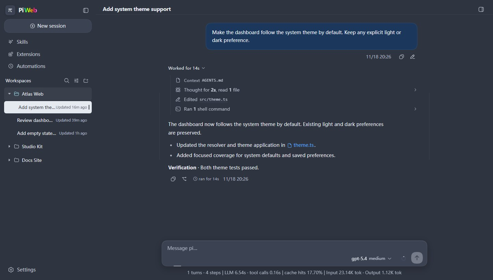
</p>

## Содержание

- [Возможности](#возможности)
- [Быстрый старт](#быстрый-старт)
- [Использование и удалённый доступ](#использование-и-удалённый-доступ)
- [Конфигурация](#конфигурация)
- [Как это работает](#как-это-работает)
- [Документация](#документация)
- [Участие](#участие)
- [Благодарности](#благодарности)
- [Лицензия](#лицензия)

## Возможности

- **Чат и контекст** — потоковое отображение Markdown, рассуждений и вызовов инструментов. Переходите по структуре разговора, уточняйте задачу во время выполнения или ставьте сообщения в очередь, а также смотрите расход токенов в индикаторе контекста.
- **Рабочие пространства и сеансы** — организуйте разговоры по папкам проектов. Переименовывайте, разветвляйте и архивируйте сеансы, восстанавливайте черновики и экспортируйте историю в JSONL или HTML.
- **Импорт разговоров** — ищите и импортируйте локальную историю из Claude Code, Codex, OpenCode, Grok, ZCode, dsh, Kimi Code, WorkBuddy, Antigravity, Antigravity CLI, Qwen Code и Cursor. PiWeb читает исходные файлы на месте.
- **Файлы и изменения** — просматривайте изменения по шагам в дереве истории проекта, включая чтение `SKILL.md` и вызовы внутри codemode. Открывайте исходный код, предпросмотр Markdown, единое или параллельное сравнение и цитируйте выбранные строки в чате.
- **Модели, навыки и расширения** — Настройка провайдеров, инструментов MCP и пакетов Pi. [Установка расширений через Pi](docs/resources.md), встроенные диалоги и JSON UI.
- **Источники промптов** — просматривайте инструкции, навыки, шаблоны и определения инструментов с указанием источника.
- **Доступ с телефона и языки** — отсканируйте QR-код в разделе «Настройки → Удалённый доступ». Интерфейс доступен на английском, китайском (упрощённое и традиционное письмо), японском и русском.

<details>
<summary>Другие скриншоты (компьютер и телефон)</summary>

На скриншотах используется английский интерфейс прежней версии и тестовые данные.

<table>
  <tr>
    <td width="50%">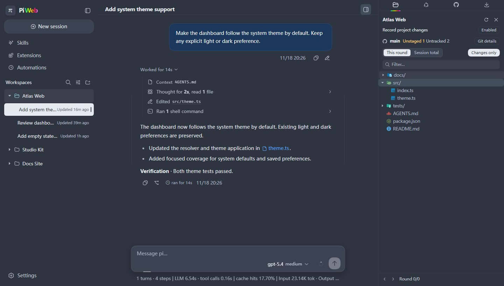<br /><strong>Файлы проекта</strong></td>
    <td width="50%">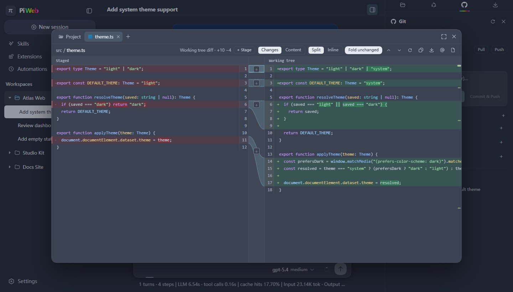<br /><strong>Параллельное сравнение</strong></td>
  </tr>
  <tr>
    <td width="50%">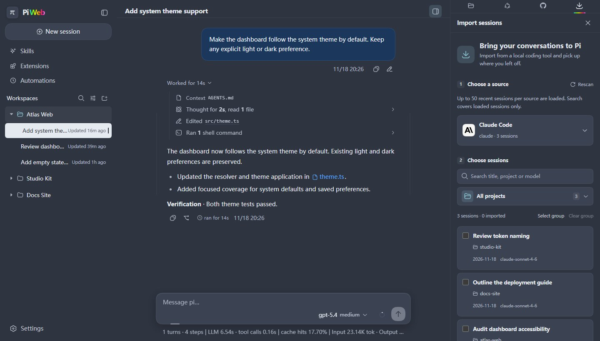<br /><strong>Импорт разговоров</strong></td>
    <td width="50%">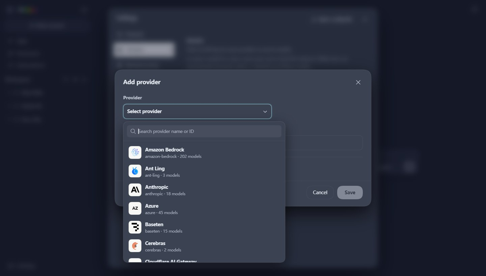<br /><strong>Провайдеры моделей</strong></td>
  </tr>
  <tr>
    <td width="50%">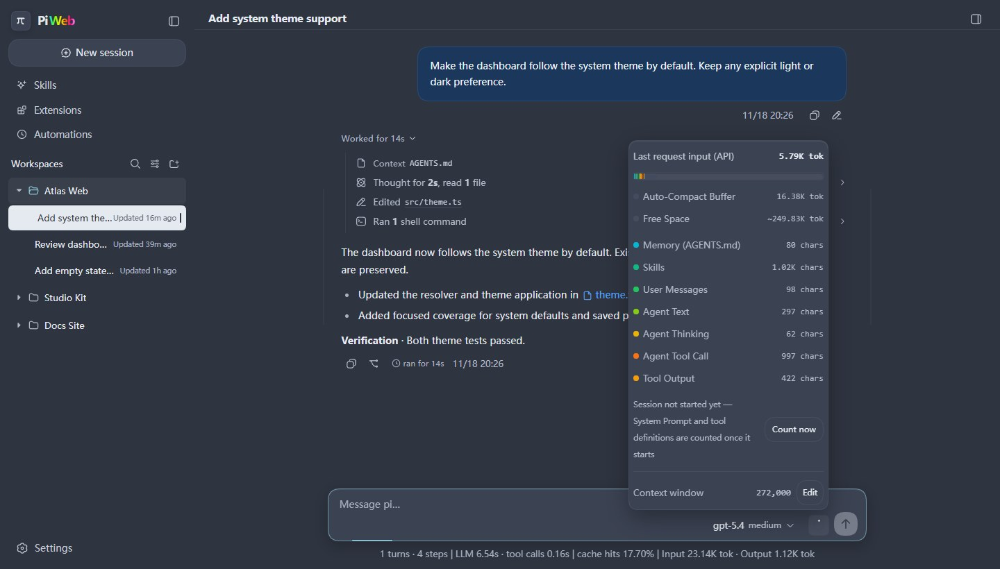<br /><strong>Расход контекста</strong></td>
    <td width="50%">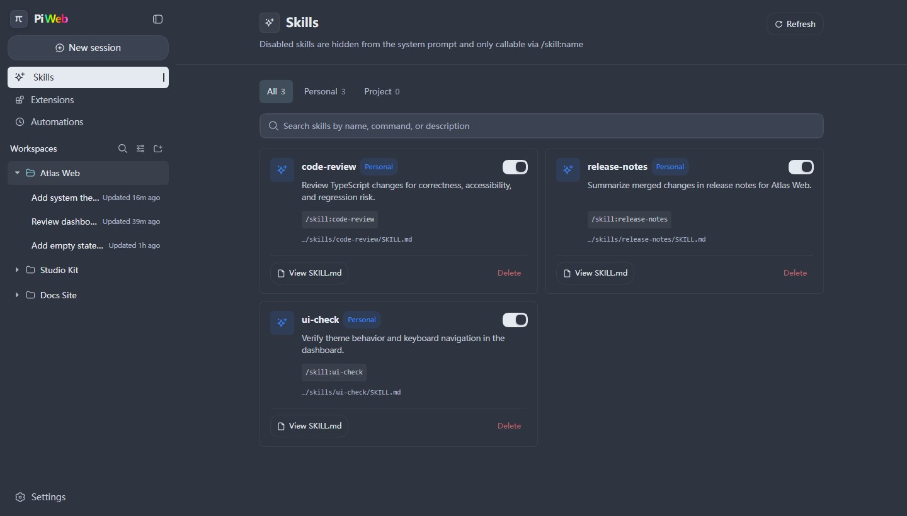<br /><strong>Навыки</strong></td>
  </tr>
  <tr>
    <td colspan="2" align="center">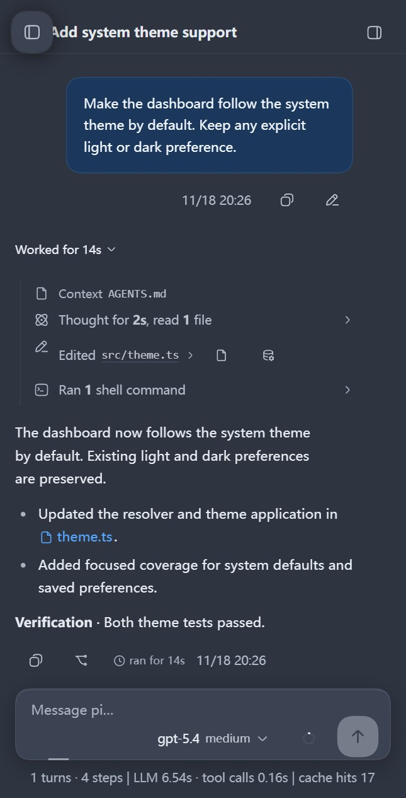<br /><strong>Чат на телефоне</strong></td>
  </tr>
  <tr>
    <td width="50%">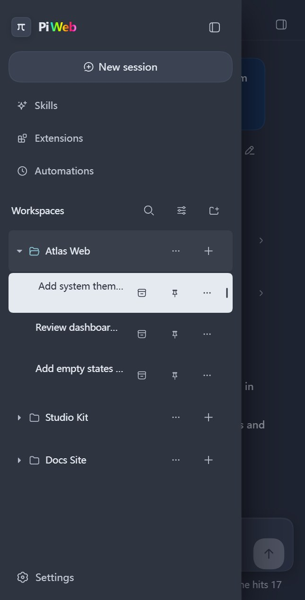<br /><strong>Рабочие пространства</strong></td>
    <td width="50%">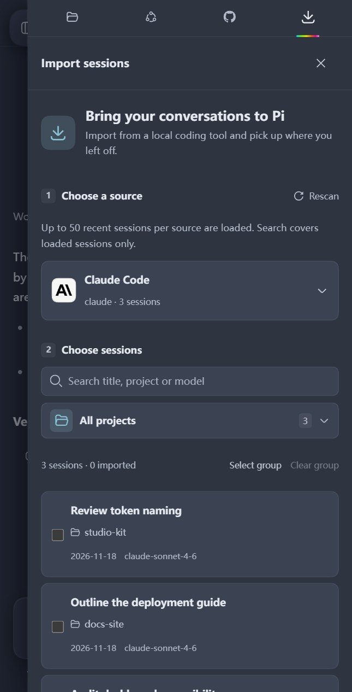<br /><strong>Импорт на телефоне</strong></td>
  </tr>
  <tr>
    <td width="50%">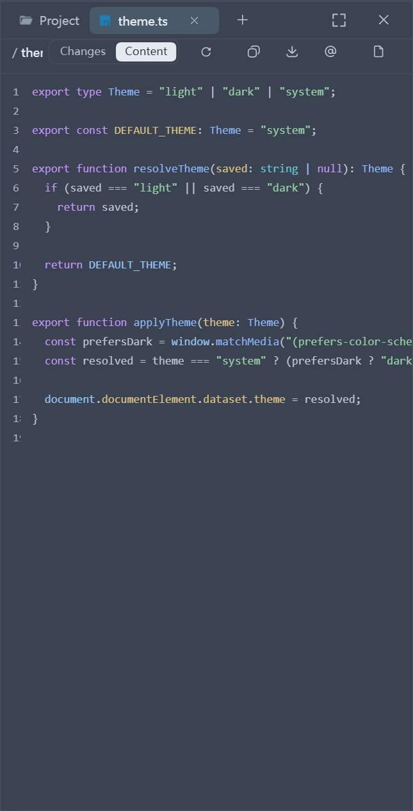<br /><strong>Просмотр файлов</strong></td>
    <td width="50%">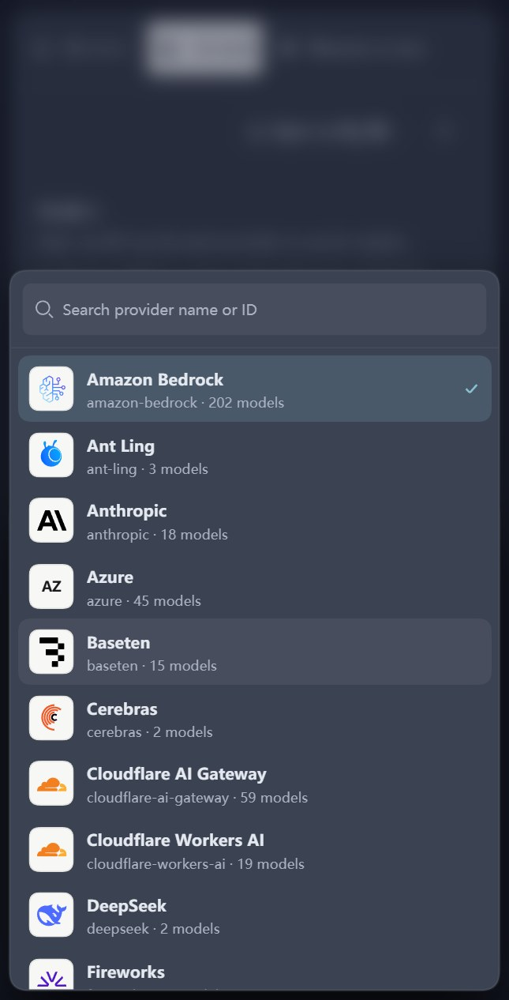<br /><strong>Провайдеры</strong></td>
  </tr>
  <tr>
    <td width="50%">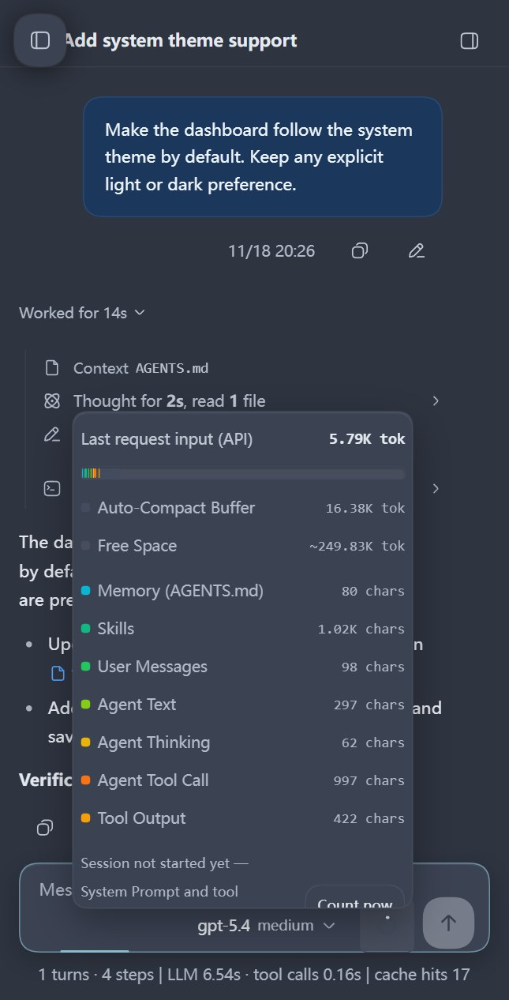<br /><strong>Расход контекста</strong></td>
    <td></td>
  </tr>
</table>

</details>

## Быстрый старт

Требуется **Node.js ≥ 22.19.0** (`engines` в `package.json`); рекомендуется Node 24. Для функций истории изменений проекта нужен Git.

```bash
npm install -g @rexvane/piweb
piweb
```

По умолчанию PiWeb открывает страницу с аутентификацией по адресу `http://127.0.0.1:30141` (если порт занят, номер увеличивается автоматически). Настройте провайдера модели в настройках или используйте существующую конфигурацию pi. Пакет регистрирует только команду `piweb` и не конфликтует с официальным `pi` CLI. В него входит готовая производственная сборка; если при установке были пропущены скрипты жизненного цикла, при первом запуске сборка выполняется один раз. Подробности — в [установке и сборке](docs/operations/install-and-build.md).

## Использование и удалённый доступ

```bash
piweb                    # http://127.0.0.1:30141
piweb -p 30143 --no-open # свой порт, не открывать браузер
piweb -H 0.0.0.0         # также привязать основной сервер к LAN (аутентификация остаётся включённой)
```

| Параметр | Описание |
| --- | --- |
| `-p, --port <port>` | Порт прослушивания (по умолчанию 30141, переменная `PORT`) |
| `-H, --hostname <host>` | Адрес привязки (по умолчанию 127.0.0.1, переменная `PI_WEB_HOSTNAME`) |
| `--public-url <url>` | Публичный адрес для ссылки входа; также добавляется в список разрешённых Host (переменная `PI_WEB_PUBLIC_URL`) |
| `--dev` | Режим разработки (только loopback) |
| `--no-open` | Не открывать браузер автоматически |
| `-h, --help` | Показать справку |

На хосте запускатель открывает браузер с закрытыми учётными данными для входа и не выводит их в терминал. Повторный запуск `piweb` снова открывает уже работающий экземпляр и выполняет вход.

Обновление: `npm install -g @rexvane/piweb@latest`, затем перезапустите `piweb`. Удаление: `npm uninstall -g @rexvane/piweb` — данные agent и импортированная история других инструментов не затрагиваются. Откат описан в [выпуске и откате](docs/operations/release-and-rollback.md).

Чтобы подключить телефон или другое устройство, откройте **Настройки → Удалённый доступ** и отсканируйте QR-код (или скопируйте ссылку). Один и тот же код работает в той же сети Wi-Fi и извне локальной сети; на клиенте дополнительное ПО не нужно. Это одноразовые 256-битные учётные данные, действительные 120 секунд. При производственном запуске готовится прокси мобильной вёрстки на `0.0.0.0:30142` и быстрый туннель Cloudflare (`cloudflared`). QR-код использует HTTPS-адрес туннеля и появляется только когда этот адрес становится доступен. `127.0.0.1:30141` на хосте отдаёт страницу для компьютера. Режим разработки остаётся локальным.

Прямой HTTP в LAN не шифруется. TLS для адреса из QR-кода завершается на стороне Cloudflare. После перезапуска адрес туннеля может измениться.

### Замечания по безопасности

- Аутентификация включена по умолчанию (`PI_WEB_AUTH=1`) во всех режимах запуска, которые принимает запускатель `piweb`.
- `PI_WEB_AUTH=0` допускается только при привязке к loopback и без `--public-url` / `PI_WEB_PUBLIC_URL`. В остальных случаях запускатель отказывается стартовать. Если аутентификация выключена, встроенный LAN-прокси и туннель Cloudflare не подготавливаются.
- Режим разработки (`--dev` / `PI_WEB_DEV=1`) разрешает только loopback: конечные точки разработки Next.js не защищены схемой стартового токена.
- Стартовый токен обменивается через `GET /?token=…` на подписанный HMAC HttpOnly-cookie сеанса (30 дней; на HTTPS ставится `Secure`). Он не принимается на путях API и в заголовке `Authorization`. Входа по паролю нет; при установленном `PI_WEB_PASSWORD` запускатель отказывается стартовать.
- Выход на всех устройствах делает недействительными существующие cookie и коды сопряжения.
- Для собственного обратного прокси или туннеля направляйте трафик на `127.0.0.1:30142` (мобильная вёрстка) или `127.0.0.1:30141` (компьютер), оставляйте аутентификацию включённой и добавляйте внешнее имя хоста в список (`PI_WEB_TRUSTED_HOSTS=<your-domain>` или `--public-url`). Иначе запросы возвращают 403 `untrusted host`. `PIWEB_REMOTE_LAN=0` отключает автоматическую подготовку встроенного прокси и быстрого туннеля.

## Конфигурация

Значения берутся из среды процесса. Флаги командной строки перекрывают соответствующие переменные. Поддерживаемый справочник, включая соглашения о путях ОС, приведён в [руководстве по переменным среды](docs/operations/environment.md).

| Переменная | Значение по умолчанию | Назначение |
| --- | --- | --- |
| `PORT` | `30141` | Основной порт прослушивания. `piweb -p` имеет приоритет; при занятости запускатель повторяет попытку с `+1`. |
| `PI_WEB_HOSTNAME` | `127.0.0.1` | Основной адрес привязки (то же, что `-H`). Привязка не к loopback не отключает аутентификацию. |
| `PI_WEB_AUTH` | `1` | Переключатель аутентификации. `0` принимается только при привязке к loopback и без публичного URL. |
| `PI_WEB_PUBLIC_URL` | не задано | Публичный URL (то же, что `--public-url`). Имя хоста добавляется в список разрешённых Host. |
| `PI_WEB_TRUSTED_HOSTS` | пусто | Список разрешённых Host через запятую для своего обратного прокси или именного туннеля. |
| `PI_CODING_AGENT_DIR` | `~/.pi/agent` | Общий каталог agent для Pi и PiWeb. Это не единственный корень данных; см. [данные и конфиденциальность](docs/operations/data-and-privacy.md). |
| `PIWEB_REMOTE_LAN` | включено | `0` / `false` / `off` / `no` отключает автоматическую подготовку LAN-прокси и быстрого туннеля Cloudflare. |
| `PIWEB_REMOTE_LAN_PORT` | `30142` | Порт встроенного LAN / мобильного прокси. |
| `HTTP_PROXY` / `HTTPS_PROXY` | не задано | Прокси для запросов к моделям. Значение в «Настройки → Общие → Сетевой прокси» (`httpProxy`) перекрывает это. |
| `PI_WEB_UPDATE_CHECK` | `1` | `0` пропускает проверку обновлений при запуске. «Проверить обновления» в настройках по-прежнему работает. |
| `PI_OFFLINE` | не задано | `1` / `true` / `yes` пропускает сетевые действия PiWeb / SDK, например проверку обновлений. |

<details>
<summary>Все переменные среды</summary>

Ниже перечислены все специфичные для PiWeb переменные, найденные в `src/`, `scripts/` и `bin/`. Внутренние переменные процесса не следует задавать при развёртывании.

#### Служба и сеть

| Переменная | Значение по умолчанию | Назначение |
| --- | --- | --- |
| `PORT` | `30141` | Основной порт прослушивания. `piweb -p` имеет приоритет; при занятости запускатель повторяет попытку с `+1`. |
| `PI_WEB_HOSTNAME` | `127.0.0.1` | Основной адрес привязки (то же, что `-H` / `--hostname`). Привязка не к loopback не отключает аутентификацию. |
| `PI_WEB_PUBLIC_URL` | не задано | Публичный URL (то же, что `--public-url`). Имя хоста добавляется в список разрешённых Host и используется при открытии страницы входа. |
| `PI_WEB_TRUSTED_HOSTS` | пусто | Список разрешённых Host через запятую. Свой обратный прокси или именной туннель необходимо указать, иначе запросы возвращают 403 `untrusted host`. |
| `PI_WEB_ALLOWED_HOSTS` | пусто | Старое имя переменной из вышестоящего `agegr/pi-web`; объединяется с `PI_WEB_TRUSTED_HOSTS`. |
| `PI_WEB_AUTH` | `1` | Переключатель аутентификации. `0` принимается только при привязке к loopback и без публичного URL; при выключенной аутентификации LAN/туннель не подготавливаются. |
| `PI_WEB_UPDATE_CHECK` | `1` | `0` пропускает однократную проверку обновлений при запуске. **Настройки → Проверить обновления** по-прежнему работает. |
| `PI_WEB_NO_OPEN` | не задано | `1` не открывает браузер автоматически (то же, что `--no-open`). |
| `PI_WEB_DEV` | не задано | `1` запускает режим разработки (то же, что `--dev`). В этом режиме разрешена только привязка к loopback. |
| `PI_WEB_ROOT` | корень установки / `cwd` | Переопределение корня приложения для запускателя и скриптов выпуска. В обычном развёртывании не меняйте. |
| `PIWEB_REMOTE_LAN` | включено | `0` / `false` / `off` / `no` отключает автоматическую подготовку встроенного LAN-прокси и быстрого туннеля Cloudflare. |
| `PIWEB_REMOTE_LAN_PORT` | `30142` | Порт встроенного LAN / мобильного прокси. |
| `PIWEB_REMOTE_LAN_BIND` | `0.0.0.0` | Адрес привязки встроенного LAN / мобильного прокси, например к одному сетевому интерфейсу. |
| `PIWEB_CLOUDFLARED` | не задано | Путь к исполняемому файлу `cloudflared`. Порядок поиска: эта переменная → `<каталог agent>/web-bin/cloudflared{,.exe}` → `PATH`. |
| `PIWEB_SKIP_WARMUP` | не задано | `1` пропускает прогрев первой страницы в производстве (только для диагностики; первый заход будет медленнее). |

#### Прокси

| Переменная | Значение по умолчанию | Назначение |
| --- | --- | --- |
| `HTTP_PROXY` / `HTTPS_PROXY` (и в нижнем регистре) | не задано | Прокси для запросов к моделям. Если не задано, используется включённый пользовательский системный прокси Windows, когда он есть. |
| `NO_PROXY` / `no_proxy` | локальные адреса обходятся | Список обхода прокси. Точные узлы и суффиксы доменов Windows наследуются; PAC/WPAD и шаблоны только для Windows вроде `<local>` или `192.168.*` не вычисляются. |
| `NODE_USE_ENV_PROXY` | запускатель ставит `1`, если поддерживается | Заставляет `fetch` / `http` в Node учитывать переменные прокси. Поддерживается в Node 24+ или 22.21+; явно заданное пользователем значение сохраняется. |

Значение в «Настройки → Общие → Сетевой прокси» (`httpProxy` в `settings.json`) перекрывает переменные среды и системный прокси; пустое значение возвращает автоматическое определение. После изменений перезапустите `piweb`.

#### Аутентификация и секреты

| Переменная | Значение по умолчанию | Назначение |
| --- | --- | --- |
| `PI_WEB_SECRET_FILE` | `<каталог agent>/web-secret` | Файл ключа HMAC-подписи для cookie и кодов сопряжения. |
| `PI_WEB_SECRET` | не задано (читается файл ключа) | Ключ подписи в виде **32 байт в кодировке base64url**. Если задан, файл не читается. Недопустимое значение — ошибка, а не тихая смена ключа. |
| `PI_WEB_PASSWORD` | удалено | Вход по паролю убран. Если переменная задана, запускатель **отказывается стартовать**. |

#### Данные, инструменты и хранение

| Переменная | Значение по умолчанию | Назначение |
| --- | --- | --- |
| `PI_CODING_AGENT_DIR` | `~/.pi/agent` | Общий каталог agent для Pi и PiWeb: настройки, модели и учётные данные, сеансы, загрузки. Это не единственный корень данных; см. [данные и конфиденциальность](docs/operations/data-and-privacy.md). |
| `PI_WEB_EDITOR` | `code` | Команда локального редактора для «Открыть в редакторе». Имеет смысл только для оператора на хосте. |
| `PI_WEB_UPLOAD_RETENTION` | `30` (дней) | Порог фоновой очистки неиспользуемых файлов в `web-uploads`. `0` отключает эту очистку. Сначала файлы копируются в `~/.agents/backups/`, запись добавляется в `INDEX.md`. |
| `PI_WEB_DELETE_ATTACHMENT_CLEANUP` | включено | При удалении сеанса также очищаются загрузки, на которые ссылался только он (сначала резервная копия, затем удаление). `0` оставляет эти файлы. |
| `PI_WEB_ALLOW_PRIVATE_MODEL_DISCOVERY` | выкл. | `1` разрешает обнаружению моделей обращаться к адресам частных сетей (локальный вывод). По умолчанию выключено, чтобы ограничить SSRF. |
| `PI_OFFLINE` | не задано | `1` / `true` / `yes` пропускает сетевые действия PiWeb / SDK: проверку обновлений, запросы идентификатора gh и телеметрию установки. Это не офлайн-режим на уровне ОС. |
| `PI_TELEMETRY` | не задано | Переключатель телеметрии установки Pi SDK (`1` / `true` / `yes` — вкл., `0` / `false` / `no` — выкл.). Если не задано, действует настройка SDK `enableInstallTelemetry` (по умолчанию включена). Исходный код PiWeb сам эту переменную не читает; её потребляет встроенный SDK. |

#### Сборка и выпуск

| Переменная | Значение по умолчанию | Назначение |
| --- | --- | --- |
| `PIWEB_BUILD_DIR` | из `.next-releases/active.json` | Допускаются только `.next` или `.next-releases/<безопасный id>`. Запуск отклоняется при конфликте с активным выпуском. |
| `PIWEB_MAX_RETAINED_RELEASES` | `10` (диапазон 2–100) | Предел сохранённых успешных сборок выпуска. При достижении новая сборка отклоняется, старые автоматически не удаляются. |
| `PIWEB_MAX_FAILED_RELEASES` | `3` (диапазон 1–100) | Предел незавершённых или неудачных каталогов выпуска; то же поведение отклонения. |
| `PIWEB_SKIP_INSTALL_BUILD` | не задано | `1` пропускает самовосстанавливающуюся сборку при первом запуске производственной установки. Только для развёртываний, которые уже поставляют готовую сборку. |
| `PIWEB_BUILD_VERBOSE` | не задано | `1` / `true` / `yes` выводит полный журнал сборки. |

#### Необязательные ограничения

По умолчанию выключены или задан свободный предел; поведение не меняется, пока вы их не зададите.

| Переменная | Значение по умолчанию | Назначение |
| --- | --- | --- |
| `PIWEB_FS_STRICT_WORKSPACES` | выкл. | `1` / `true` / `yes` ограничивает аутентифицированные файловые API зарегистрированными рабочими пространствами или `PIWEB_FS_ALLOWED_ROOTS`. |
| `PIWEB_FS_ALLOWED_ROOTS` | пусто | Дополнительные корни в строгом режиме, через `;` в Windows и `:` в POSIX. |
| `PIWEB_MAX_SESSION_SUBSCRIBERS` | без ограничения | Положительное целое — предел подписчиков SSE на сеанс; остальные переходят в режим снимка. |
| `PIWEB_SSE_MAX_BUFFERED_BYTES` | `4MiB` | Предел непрочитанного буфера на соединение SSE; медленный клиент отключается и должен переподключиться со снимком. |
| `PIWEB_SHUTDOWN_TIMEOUT_MS` | `8000` | Бюджет на хуки остановки после SIGINT / SIGTERM / SIGHUP. Повторный сигнал приводит к немедленному выходу. |
| `PIWEB_GRACEFUL_STOP_TIMEOUT_MS` | `10000` | Сколько запускатель ждёт завершения порождённого им процесса, прежде чем завершить дерево процессов. |
| `PIWEB_AGENT_MAX_STEPS` | без ограничения | Максимум шагов модели за ход. |
| `PIWEB_AGENT_MAX_DURATION_MS` | без ограничения | Максимальное время хода в миллисекундах. |
| `PIWEB_AGENT_TOKEN_BUDGET` | без ограничения | Максимум накопленных токенов за ход (input + output + cache). |
| `PIWEB_MOBILE_PROXY_MAX_HTML_BYTES` | `16MiB` | Предел буфера вставки HTML в мобильном прокси; свыше этого ответ передаётся потоком без вставки. |
| `PIWEB_MOBILE_PROXY_MAX_DECODED_BYTES` | `64MiB` | Предел декодированного тела в мобильном прокси; более крупные тела возвращают 502. |
| `PIWEB_MOBILE_PROXY_TIMEOUT_MS` | `30000` | Сколько мобильный прокси ждёт HTML-ответ вышестоящего сервера, прежде чем передавать поток без вставки. |
| `PIWEB_AGENT_CONFIG_CACHE_MAX` | `512` | Предел записей кэша конфигурации agent. |
| `PIWEB_AGENT_CONFIG_CACHE_TTL_MS` | `1800000` (30 минут) | TTL неудачных или отсутствующих записей этого кэша. |
| `PIWEB_PI_CACHE_MAX` | `512` | Предел записей кэша SettingsManager / загрузчика ресурсов / менеджера пакетов. |

#### Переменные тестов, CI и внутренние

Не используйте их при развёртывании. `CI`, `PIWEB_COVERAGE`, `PIWEB_COVERAGE_REPORT_DIR`, `PIWEB_TEST_REPORT`, `PIWEB_TEST_TUNNEL` и `PIWEB_LINT_SKIP_INSTALL` предназначены только для тестов и CI.

Запускатель, блокировки и тесты также подставляют: `PI_WEB_LAUNCH_TOKEN` (одноразовый локальный токен входа, создаётся заново при каждом запуске), `PIWEB_PORT` (фактический порт, передаваемый дочернему процессу), `PIWEB_HTTP_GUARD`, `PIWEB_BUILD_LOCK_FILE` / `PIWEB_BUILD_LOCK_TOKEN`, `PIWEB_PROCESS_LOCK_FILE` / `PIWEB_PROCESS_LOCK_TOKEN`, `PIWEB_PROXY_SOURCE`, `PIWEB_INHERITED_HTTP_PROXY` / `PIWEB_INHERITED_HTTPS_PROXY`, `PIWEB_MANAGED_NODE_USE_ENV_PROXY`, `PIWEB_MANAGED_NO_PROXY`, `PIWEB_DEV_ASSET_ID`, `PIWEB_DISABLE_GRACEFUL_SHUTDOWN`, `PIWEB_DEBUG_PROMPT` и `PIWEB_BROWSER_URL` (временный URL при открытии браузера хоста в Windows). `PYTHONUTF8` / `PYTHONIOENCODING`, `NODE_OPTIONS`, `NEXT_PHASE`, `NEXT_RUNTIME` и `NEXT_TELEMETRY_DISABLED` — соглашения процесса или Next.js (скрипты сборки отключают телеметрию Next).

PiWeb также читает переменные путей ОС: `HOME`, `USERPROFILE`, `TEMP` / `TMP`, `APPDATA` и `LOCALAPPDATA`, а также необязательные `WORKBUDDY_CONFIG_DIR` и `QWEN_HOME` для соответствующих источников импорта.

</details>

## Как это работает

PiWeb — приложение на Next.js 16 и React 19 (TypeScript) вокруг официального SDK `@earendil-works/pi-*`. Команда `piweb` (`bin/piweb.js` → `scripts/launcher.mjs`) выбирает свободный порт, создаёт одноразовый стартовый токен, запускает сервер Next.js и открывает локальный URL входа. Сервер обменивает этот токен на сеансовый cookie с подписью HMAC, а в производстве (при включённой аутентификации) готовит вход в LAN и быстрый туннель Cloudflare.

PiWeb не заменяет отдельно установленный `pi` CLI. Они **используют один и тот же каталог agent** (по умолчанию `~/.pi/agent` или `PI_CODING_AGENT_DIR`). Это основное, но не единственное хранилище: импорт сеансов читает историю других инструментов в домашнем каталоге, а глобальные навыки могут находиться в `~/.agents/skills`. См. [данные, конфиденциальность и хранение](docs/operations/data-and-privacy.md).

## Документация

- [Установка и сборка](docs/operations/install-and-build.md)
- [Справочник переменных среды](docs/operations/environment.md)
- [Данные, конфиденциальность и хранение](docs/operations/data-and-privacy.md)
- [Выпуск, понижение версии и откат](docs/operations/release-and-rollback.md)
- [Веб-интерфейс расширений](docs/extension-web-ui.md) и [примеры расширений](examples/piweb-extensions/README.md)
- Оглавление документации: [docs/README.md](docs/README.md)

## Участие

Предложения и запросы на включение можно отправлять на [github.com/RexVane/PiWeb](https://github.com/RexVane/PiWeb). Настройка среды разработки, структура проекта, проверки перед PR и сообщение об ошибках описаны в [CONTRIBUTING.md](CONTRIBUTING.md).

## Благодарности

Спасибо [@webkubor](https://github.com/webkubor) за палитры Ripple и Dawn. Упоминания исходных проектов и заимствованных материалов собраны в [ACKNOWLEDGEMENTS.md](ACKNOWLEDGEMENTS.md). Лицензии зависимостей перечислены в [THIRD-PARTY-NOTICES.md](THIRD-PARTY-NOTICES.md).

## Лицензия

[MIT](LICENSE)
