# PiWeb — Pi Coding Agent 網頁介面與 AI 程式設計助手

<p align="center">
  <strong>可自行部署的 AI 程式設計智慧體 Web 介面，支援桌面與手機瀏覽器。</strong>
</p>

<p align="center">
  <a href="README.md">English</a> | <a href="README_zh.md">简体中文</a> | <strong>繁體中文</strong> | <a href="README_ja.md">日本語</a> | <a href="README_ru.md">Русский</a>
</p>

**PiWeb** 是面向 [Pi Coding Agent（Pi 程式設計智慧體）](https://github.com/earendil-works/pi) 的開源、自架 Web UI。將 AI 程式設計助手執行在自己的電腦或伺服器上，透過桌面和手機瀏覽器管理專案工作區、檢視程式碼差異與工具呼叫，也能在手機上繼續程式設計任務。

PiWeb 基於官方 Pi SDK，沿用既有的 pi 設定、模型供應商、擴充功能、技能和 **MCP（Model Context Protocol）伺服器**。支援匯入 **Claude Code、Codex 和 OpenCode** 的對話歷史，並透過內建自動化任務定時執行提示詞。

[快速開始](#快速開始) · [特色功能](#特色功能) · [介面預覽](#介面預覽) · [安裝與部署](#使用方式) · [文件導覽](docs/README.md)

<p align="center">
  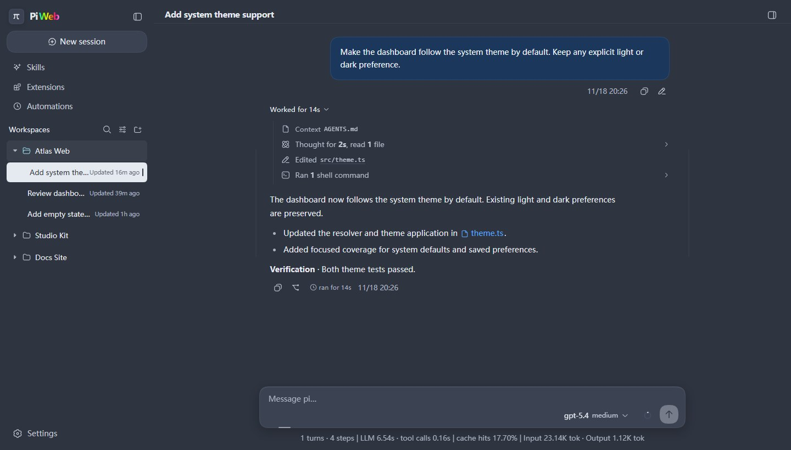
</p>

## 快速開始

需要 **Node.js ≥ 22.19.0**，建議使用 Node 24。安裝並啟動：

```bash
npm install -g @rexvane/piweb
piweb
```

PiWeb 預設開啟需要驗證的 `http://127.0.0.1:30141` 瀏覽器頁面（連接埠被占用時自動遞增）。在設定中配置模型供應商，或沿用既有的 pi 設定。使用手機版 Web 介面時，在 **設定 → 遠端連線** 中掃描連線 QR Code。

環境需求和部署行為詳見[安裝說明](#安裝)、[連接其他裝置](#連接其他裝置)及[資料與隱私說明](docs/operations/data-and-privacy.md)。

## 特色功能

- **對話與導覽**：串流顯示 Markdown、思考過程和工具呼叫；對話大綱支援跳轉，執行時可插話或排隊傳送。輸入框旁的上下文圓環顯示用量及組成。
- **工作區與對話**：依專案資料夾整理對話，支援重新命名、分支、封存、草稿還原，以及 JSONL / HTML 匯出。
- **匯入對話**：從 Claude Code、Codex、OpenCode、Grok、ZCode 和 dsh 瀏覽並匯入本機歷史，支援搜尋和跨來源選取；已封存的匯入對話可還原，來源資料保持不變。
- **檢視變更**：查看工具呼叫軌跡、檔案差異和專案成長樹，包含擴充功能訊息、使用者命令及指令碼工具（codemode）內部發起的巢狀呼叫；檔案檢視器支援內容、變更和 Markdown 顯示，也可引用選取的內容。同一瀏覽器中，各對話的檔案分頁在切換或重新整理後保留；關閉檢視視窗會清空其中的全部分頁。
- **模型、MCP 與擴充功能**：在設定中配置模型供應商，並使用 pi 設定中的 MCP 工具和資源；側欄的擴充功能工作區依所選工作區管理 npm 套件，分別標示個人／專案作用域與本機／套件來源。自動化任務有獨立的工作區檢視。技能與提示詞仍從共用的 pi 資源載入，但目前介面沒有獨立入口。
- **自動化任務**：依間隔、每日、每週或 cron 定時執行提示詞，指定工作區、模型和權限等級，並查看每次執行的對話。排程執行需要 PiWeb 保持執行。
- **權限控制**：選擇唯讀、工作區內修改或完整權限；對具體遭拒的操作可申請一次授權。各平台邊界見[權限說明](docs/workspace-isolation.md)。
- **多裝置存取**：自動準備遠端連線，同一 Wi-Fi 或外部網路掃描同一個動態 QR Code。
- **介面語言**：支援英文、簡體中文、繁體中文、日文和俄文。

## 與 pi 的關係

PiWeb 是內建官方 pi SDK 的網頁介面，不更動另外安裝的 pi CLI。兩者**共用同一個 agent 目錄**（預設 `~/.pi/agent`，可用 `PI_CODING_AGENT_DIR` 指定），其中儲存設定、模型與憑證、對話、技能和套件。內建 pi 核心隨 PiWeb 發行版本升級。啟動時只自動檢查 PiWeb 更新；設定中保留 pi 版本和手動更新入口。

agent 目錄是主要資料儲存位置，但**不是唯一資料根目錄**：對話匯入會讀取家目錄下其他工具的對話歷史，全域技能可能位於 `~/.agents/skills`。完整資料清單與部署隔離方式見[資料目錄、隱私與保留](docs/operations/data-and-privacy.md)。

擴充功能的對話方塊、通知、狀態文字、文字顯示區和插入訊息會顯示在網頁上；擴充功能命令也能新增、分支和切換對話。擴充功能可透過 [JSON UI 橋接](docs/extension-web-ui.md) 提供可互動的網頁面板。相容的終端元件會退回唯讀文字顯示；不重現終端鍵盤互動及自訂頁首、頁尾、編輯器。

## 介面預覽

### 桌面版

<table>
  <tr>
    <td width="50%"><br /><strong>對話工作區</strong><br />集中查看串流對話、工具呼叫與專案對話。</td>
    <td width="50%">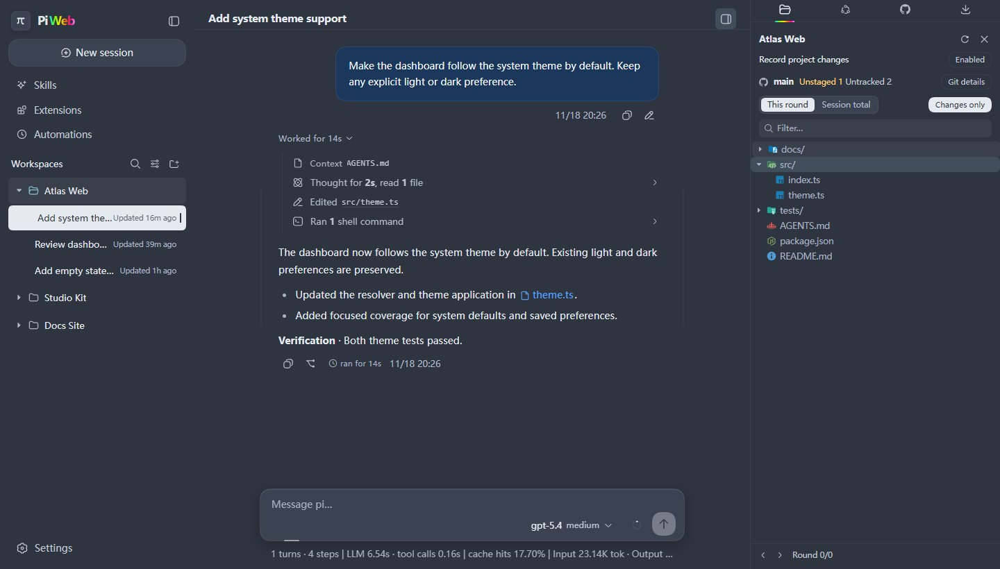<br /><strong>專案檔案</strong><br />在側欄瀏覽專案結構與每輪變更。</td>
  </tr>
  <tr>
    <td width="50%">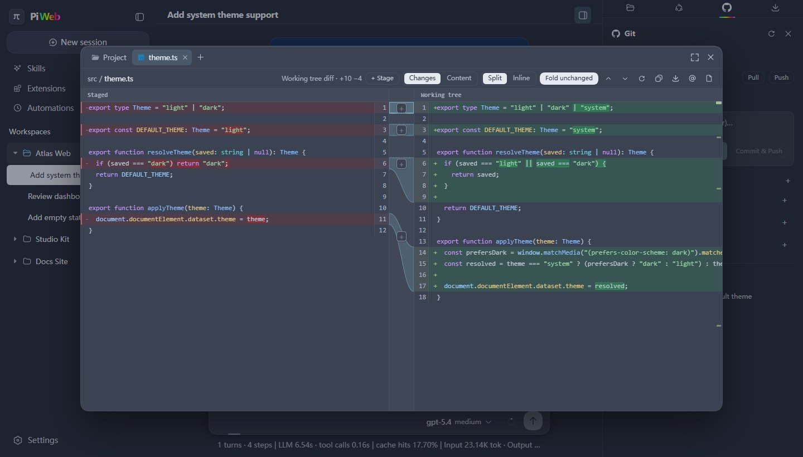<br /><strong>檔案檢視器</strong><br />查看程式碼、檔案內容和變更。</td>
    <td width="50%">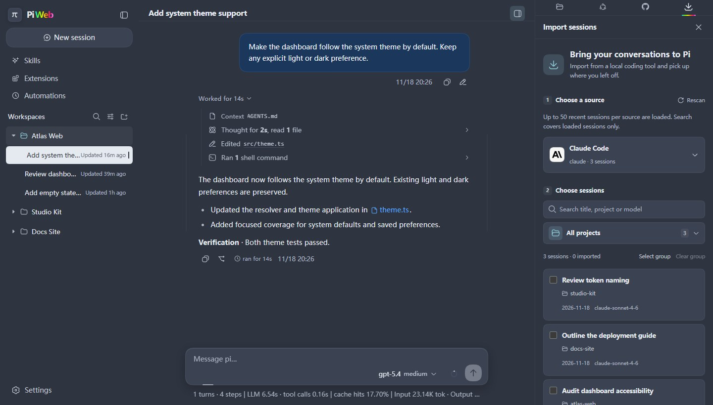<br /><strong>匯入對話</strong><br />選取其他程式設計工具的歷史對話。</td>
  </tr>
  <tr>
    <td width="50%">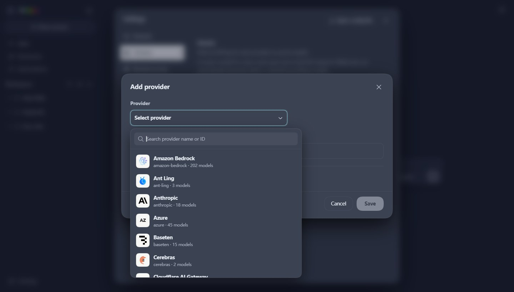<br /><strong>模型供應商</strong><br />搜尋並配置模型供應商。</td>
    <td width="50%">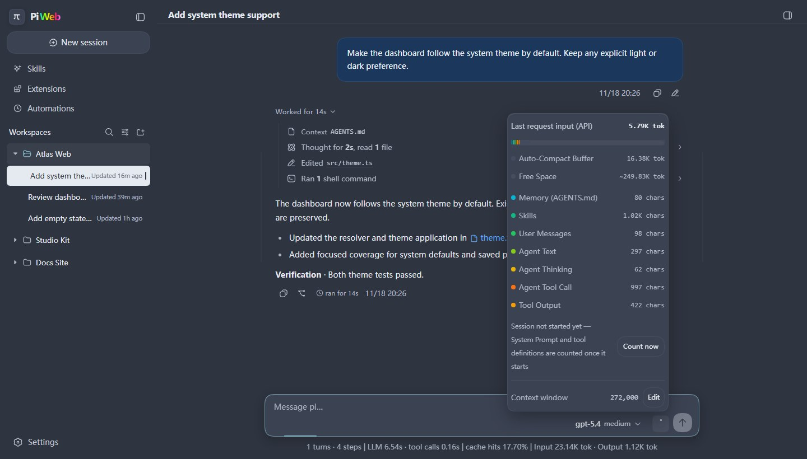<br /><strong>上下文用量</strong><br />查看上下文視窗與用量組成。</td>
  </tr>
</table>

### 手機版

<table>
  <tr>
    <td width="33%">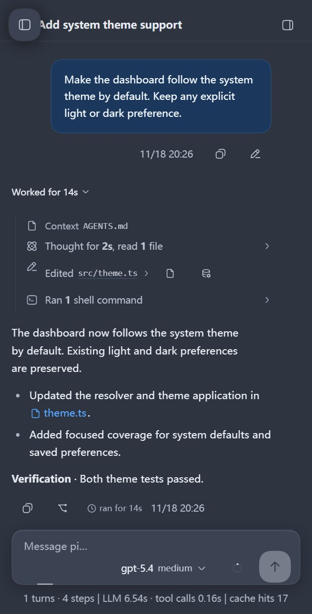<br /><strong>隨時對話</strong><br />在手機上繼續工作。</td>
    <td width="33%">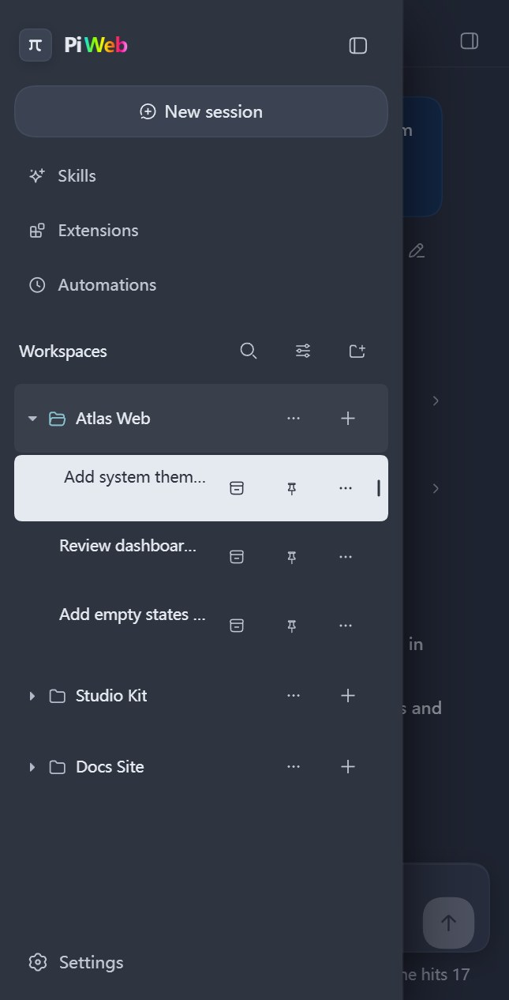<br /><strong>工作區</strong><br />切換專案和對話。</td>
    <td width="33%">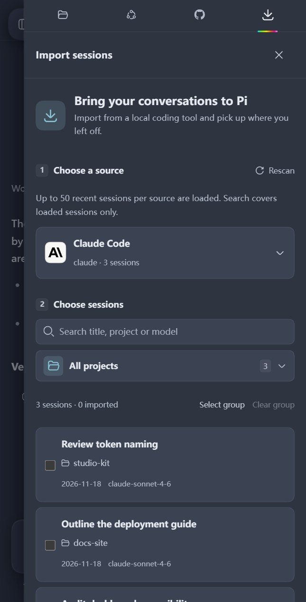<br /><strong>對話匯入</strong><br />選取並匯入既有對話。</td>
  </tr>
  <tr>
    <td width="33%">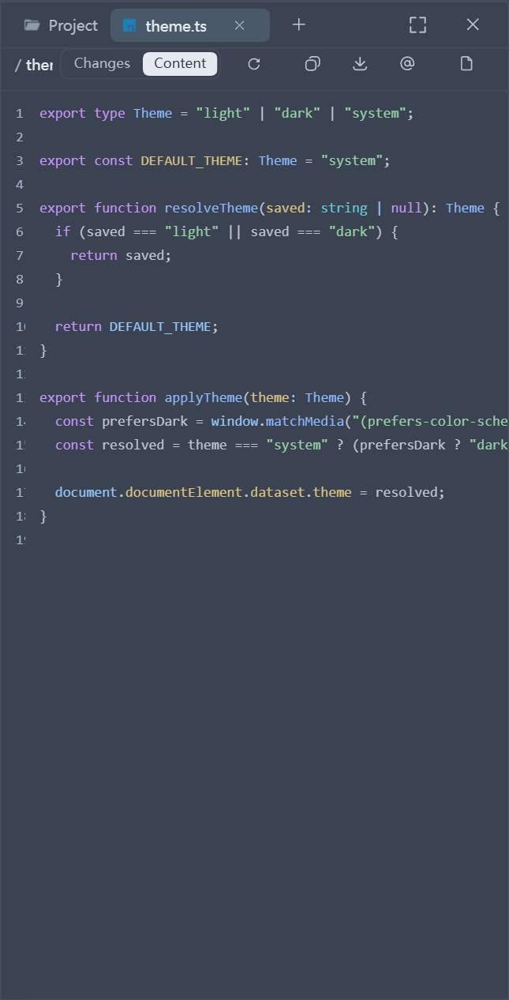<br /><strong>檔案檢視</strong><br />直接瀏覽專案程式碼。</td>
    <td width="33%">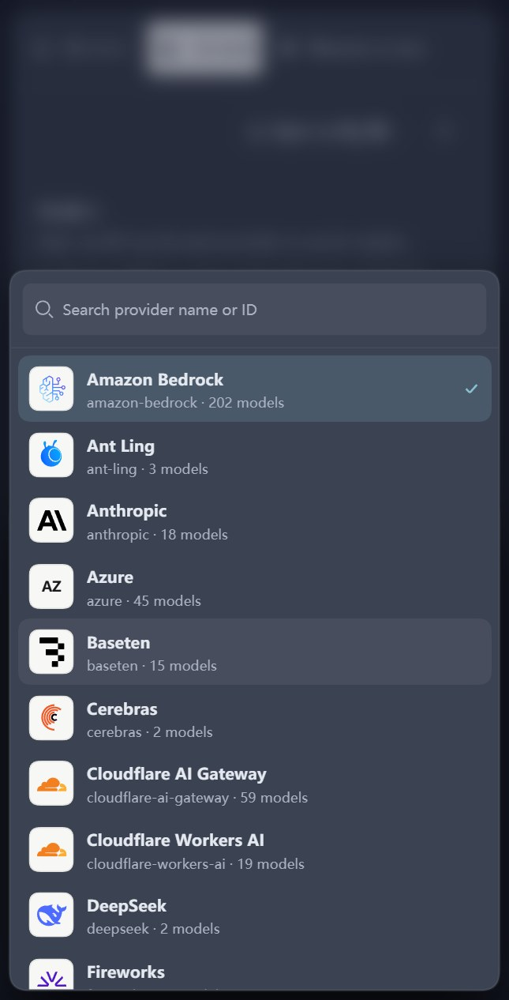<br /><strong>模型設定</strong><br />搜尋與配置供應商。</td>
    <td width="33%">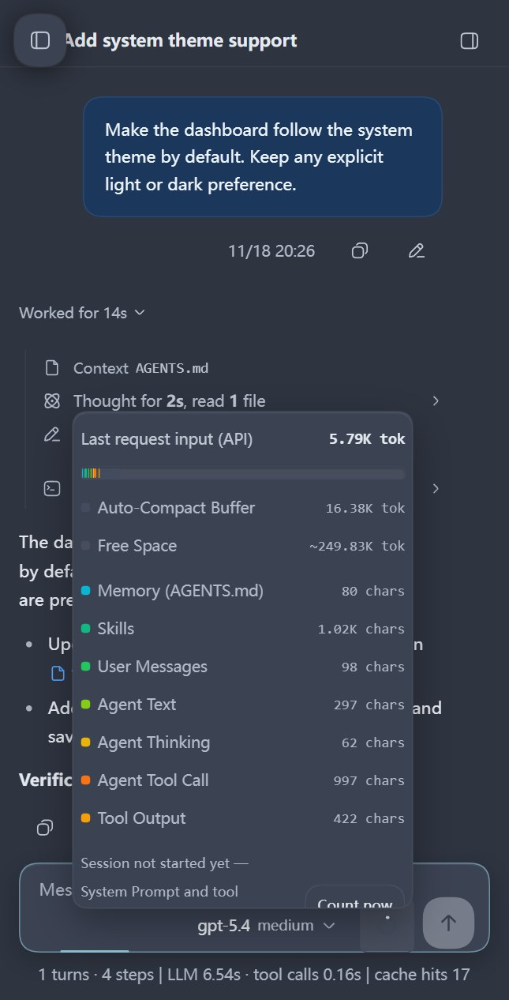<br /><strong>上下文用量</strong><br />查看可用空間和用量。</td>
  </tr>
</table>

### 封存與資料

封存對話會一直保留，可從側欄查看、還原或手動刪除。點選封存會立即生效，不再二次確認；手動刪除仍需確認，而且會**永久刪除對話檔案，不保留還原副本**。對話不會自動刪除。刪除對話時會一併清理僅由它引用的上傳附件：先將還原副本保留至 `~/.agents/backups` 並在 `backups/INDEX.md` 記錄，再移除（`PI_WEB_DELETE_ATTACHMENT_CLEANUP=0` 可關閉此功能）。沒有對話引用的附件，會在超過 30 天後，由之後的新上傳觸發清理。需要保留的資料請自行備份；全部資料位置見[資料目錄、隱私與保留](docs/operations/data-and-privacy.md)。

專案成長樹預設記錄，無需確認對話方塊。每輪檔案變更儲存為工作區 Git 儲存庫中 `refs/piweb/rounds/…` 下的提交，不改變分支和暫存區；需要時自動初始化本機儲存庫。累計歷史筆數和容量不設上限，可以在專案面板隨時關閉或重新啟用記錄，先前手動關閉的工作區會維持關閉。停止記錄會保留既有歷史；單一檔案、單次快照及預覽的大小保護仍然生效。

### 擴充功能與自動化任務

側欄工作區與設定分開。擴充功能工作區依所選工作區管理 npm 套件，分別標示個人／專案作用域與本機／套件來源。個人資源通常位於 `<agent 目錄>/skills` 和 `<agent 目錄>/extensions`；受信任的專案可提供 `.pi/skills`、`.pi/extensions`、`.agents/skills` 及明確設定的資源路徑。技能和提示詞仍從這些位置載入並由引擎使用，但目前介面沒有獨立的技能／提示詞工作區入口（資源市集頁面已移除）。

npm 套件的安裝、更新和移除會先在獨立目錄準備，再切換正式安裝與設定。準備失敗會保留原安裝，提交中斷會在載入資源前還原；舊安裝版本及還原索引會保留。不執行 npm 生命週期指令碼，但載入後的擴充功能本身仍是執行在宿主處理程序中的受信任程式碼。

自動化任務和執行記錄儲存在 `<agent 目錄>/web-automations.json`。排程使用編輯器顯示的伺服器時區，最多同時執行四項任務；每次使用獨立對話及儲存的權限等級。無人值守執行無法批准互動式權限請求。停機期間超過寬限期的排程會記為略過，不會在啟動後集中補跑。

## 使用方式

### 安裝

```bash
npm install -g @rexvane/piweb
piweb
```

套件只註冊 `piweb` 一個命令，與官方 `pi` CLI 互不衝突。需要 Node.js **≥ 22.19.0**（`engines` 下限）；CI 涵蓋 22.19.0、22.22.2 與 24，建議使用 Node 24。自動代理需要 Node 24 或 22.21 以上（較舊版本只能讓外部工具繼承代理變數，模型請求仍直接連線，見[代理](#代理)）。成長樹功能需要安裝 Git。

發行套件內含已封存的正式環境建置，一般全域安裝不需要在本機編譯。`postinstall` 只會為**僅安裝正式環境依賴的安裝方式**準備建置，在原始碼檢出目錄中不會執行任何動作；若安裝時略過生命週期指令碼，第一次啟動 `piweb` 會在獨立暫存目錄建置一次再提供服務（一次性操作，目前硬體約需 6–15 分鐘）。建置／修復細節和逾時設定見[安裝與建置機制](docs/operations/install-and-build.md)。

### 更新

```bash
npm install -g @rexvane/piweb@latest
```

npm 會就地替換已安裝的版本，不用先移除。`latest` 是 npm 的預設標籤，因此直接使用 `npm install -g @rexvane/piweb` 效果相同。如果使用的鏡像站同步有延遲，可加上 `--registry=https://registry.npmjs.org` 直接取得新版本。安裝後重新啟動 `piweb` 即可。

安裝指定版本時，將 `latest` 換成對應版本號。若某個版本有問題，[發行、降版與還原](docs/operations/release-and-rollback.md)提供精確降版、處理 `latest` 標籤及還原資料的步驟。

**從介面更新**：每次啟動 PiWeb 都會在背景檢查 PiWeb 是否有新版本，有的話會在終端輸出一行 `[更新] 有新版本：…`，並在頁面右下角顯示提示（每次啟動只提示一次）。點選提示或設定 → 一般中的「更新」即可就地安裝；完成後依提示重新啟動 `piweb`，處理程序不會自行重新啟動。

- PiWeb 發行版本包含經過驗證的 pi 核心。pi 不再自動顯示更新通知，設定中仍可手動檢查。
- Windows 上正在執行的 npm 安裝無法替換自身（檔案被鎖定），PiWeb 更新入口會提供命令和複製按鈕：先停止 `piweb`，再執行上述命令。
- 不想連線檢查時，在啟動前設定 `PI_WEB_UPDATE_CHECK=0`；仍可在設定中手動點選「檢查更新」。

### 移除

```bash
npm uninstall -g @rexvane/piweb
```

這只會移除 PiWeb 本身。pi 資料位於 agent 目錄（預設 `~/.pi/agent/`，或由 `PI_CODING_AGENT_DIR` 指定），會保持不變。PiWeb 從家目錄匯入的其他工具對話歷史也不會被修改，見[資料目錄、隱私與保留](docs/operations/data-and-privacy.md)。

### 啟動

```bash
piweb                    # http://127.0.0.1:30141（連接埠占用時自動遞增）
piweb -p 30143 --no-open # 自訂連接埠，不自動開啟瀏覽器
piweb -H 0.0.0.0         # 主伺服器也綁定區域網路位址（仍保持驗證）
```

| 參數 | 說明 |
| --- | --- |
| `-p, --port <port>` | 監聽連接埠（預設 30141，環境變數 `PORT`） |
| `-H, --hostname <host>` | 綁定位址（預設 127.0.0.1，環境變數 `PI_WEB_HOSTNAME`） |
| `--dev` | 開發模式 |
| `--no-open` | 不自動開啟瀏覽器 |
| `--public-url <url>` | 對外位址，用來產生登入連結並自動加入 Host 允許清單（環境變數 `PI_WEB_PUBLIC_URL`） |

所有啟動方式都預設啟用驗證（`PI_WEB_AUTH=1`）。在執行 PiWeb 的電腦上，啟動器會帶私有登入憑證開啟瀏覽器，終端不會輸出憑證。再次執行 `piweb` 可重新開啟既有執行個體並登入；其他裝置掃描自動更新的連線 QR Code。兩種方式都會將憑證換成有效期 30 天、經簽署的 HttpOnly Cookie。「登出所有裝置」會使既有 Cookie 和配對碼失效。`PI_WEB_PASSWORD` 已移除，設定它會使啟動器拒絕啟動。

已取得授權啟動憑證的指令碼，先透過 `GET /?token=…` 換取工作階段 Cookie，之後每個 API 請求都攜帶該 Cookie。API URL 和 `Authorization` 標頭不接受啟動令牌，也沒有 Basic Auth 備援方式。

### 代理

PiWeb 自動使用 `HTTP_PROXY` / `HTTPS_PROXY`；未設定時會讀取目前使用者啟用的 Windows HTTP(S) 系統代理。設定 → 一般 → 網路代理（或 agent 目錄中 `settings.json` 的 `httpProxy`）可覆寫這兩種來源，留空則恢復自動偵測；未設定代理時直接連線。本機位址預設直接連線（可透過 `NO_PROXY` 覆寫）；也會繼承 Windows 的精確主機名稱與網域後綴例外。不解析 PAC/WPAD 指令碼或 `<local>`、`192.168.*` 等 Windows 專用模式，這些情況請改用代理 URL 或 `NO_PROXY`。變更後重新啟動 PiWeb。需要 Node.js 24 或 22.21 以上；較舊版本會忽略此選項，啟動器也會明確提示（`bash` 工具中的 curl / git 仍會繼承代理變數）。

### 連接其他裝置

開啟 **設定 → 遠端連線**，掃描唯一的連線 QR Code。同一 Wi-Fi 與外部網路都使用同一個碼，無需手動啟用連線或選擇網路，其他裝置也不需要額外軟體。QR Code 和可複製連結使用同一份 256 位元隨機憑證，有效期 120 秒，僅可使用一次。面板會在過期或使用後自動更新；重新開啟面板會沿用仍有效的碼。

正式環境啟動時，會自動準備本機代理（`0.0.0.0:30142`）與 Cloudflare 快速通道（`cloudflared`）。QR Code 使用通道的 HTTPS 位址，確認可連線後才顯示，不會悄悄切換為僅限區域網路的位址。短暫中斷會保留原位址，持續無法連線時自動重建通道；開發模式保持在本機執行。

本機代理提供手機版面配置，主機上的 `127.0.0.1:30141` 仍提供桌面版。通道有以下限制：

- 重新啟動或重建通道後，位址可能改變；DNS 與連線檢查完成後 QR Code 才會就緒。
- QR Code 位址使用 HTTPS，TLS 在 Cloudflare 端終止。直接使用區域網路 HTTP 仍未加密；在同一 Wi-Fi 掃描此碼也需要公網通道可連線。

內建區域網路代理預設監聽 `0.0.0.0:30142`。部署覆寫選項：`PIWEB_REMOTE_LAN=0` 關閉代理與通道的自動準備，`PIWEB_REMOTE_LAN_PORT` 變更代理連接埠，`PIWEB_REMOTE_LAN_BIND` 變更綁定位址（例如只綁定一張網路卡），`-H 0.0.0.0` 則讓主伺服器也監聽區域網路。HTML 插入有上限：超過 `PIWEB_MOBILE_PROXY_MAX_HTML_BYTES`（預設 16 MiB）或 `PIWEB_MOBILE_PROXY_TIMEOUT_MS`（預設 30 秒）後，頁面會改為不插入內容的串流傳遞；解碼後超過 `PIWEB_MOBILE_PROXY_MAX_DECODED_BYTES`（預設 64 MiB）的內容則會被拒絕。完整清單見[環境變數參考](docs/operations/environment.md)。

`cloudflared` 的尋找順序為：`PIWEB_CLOUDFLARED` → `<agent 目錄>/web-bin/cloudflared{,.exe}`（由 PiWeb 管理）→ `PATH`。找不到時，面板會明確提示。

> 遠端連線需要驗證，且驗證預設啟用。PiWeb 會在通道就緒後將其主機名稱加入 Host 允許清單，通道停止後移除。API 路徑和 `Authorization` 標頭一律不接受啟動令牌。

### 自訂反向代理或通道

也可以自行設定入口（Caddy、nginx、Cloudflare 具名通道或 VPN）。此時請注意：

- 將代理指向 **`127.0.0.1:30142`**（區域網路入口）以取得手機版面；只需要桌面版時則指向 `127.0.0.1:30141`。
- 維持預設啟用的驗證。`PI_WEB_AUTH=0` 會停用自動遠端存取，而且僅允許綁定回環位址且未設定公開 URL 的情況。
- 反向代理會將外部主機名稱原樣傳給後端，因此必須加入允許清單，否則會回傳 403 `untrusted host`：

  ```bash
  PI_WEB_TRUSTED_HOSTS=<your-domain> piweb
  ```

- 使用 `--public-url https://your-address/` 告知 PiWeb 對外位址；主機名稱會自動加入允許清單，啟動器開啟登入頁時也會使用此位址。日誌不會輸出登入憑證。

> 自行管理網路入口時，可設定 `PIWEB_REMOTE_LAN=0` 停用內建區域網路代理與快速通道的自動準備。這是部署設定，不是連線面板中的網路切換選項。

## 開發與驗證

請在獨立檢出或暫存目錄中驗證；`npm run build` 會寫入 `.next`，不要對正在提供服務的執行個體目錄執行。先用 `npm ci` 安裝開發依賴，再執行：

```bash
npm run typecheck
npm run lint
npm run test
npm run build
npm run verify:package
```

`verify:package` 會封裝正式建置、安裝至空目錄，再使用臨時資料啟動安裝後的副本。CI 也會執行鎖定的 lint 工具鏈、在 Linux/Node 24 上稽核高風險依賴、準備 SDK 搜尋工具、檢查非預期略過項目，並透過 `PIWEB_COVERAGE=1` 啟用覆蓋率；真實公網通道另以明確的測試開關啟用。正式建置在稽核機器上實測約需 6–7 分鐘（`next build --webpack` 在並行負載下為 370 秒），建議建置逾時至少 15 分鐘，完整 `check` 工作至少預留 30–45 分鐘。`npm run check` 會分別回報原始碼測試、安裝套件與瀏覽器檢查。更多文件見[文件導覽](docs/README.md)，建置細節與逾時基準見[安裝與建置機制](docs/operations/install-and-build.md)。

## 維運與部署

- [安裝與建置機制](docs/operations/install-and-build.md)：安裝配置、`postinstall`、首次啟動的自動修復建置、建置時間及逾時。
- [環境變數參考](docs/operations/environment.md)：部署變數、2026-11-15 強化作業新增的選用限制開關，以及內部處理程序變數。
- [資料目錄、隱私與保留](docs/operations/data-and-privacy.md)：全部資料根目錄、部署隔離、遙測開關、刪除與還原副本行為。
- [發行、降版與還原](docs/operations/release-and-rollback.md)：精確版本降版、應用程式內更新失敗處理、`.next-releases` 回退及資料相容性。

## 致謝

感謝 [@webkubor](https://github.com/webkubor) 提供 Ripple 與 Dawn 配色。

## 授權條款

[MIT](LICENSE)
