# PiWeb

<p align="center">
  <strong>为 Pi 编程智能体打造的现代 Web 界面。</strong>
</p>

<p align="center">
  <a href="README.md">English</a> | <strong>简体中文</strong>
</p>

<p align="center">
  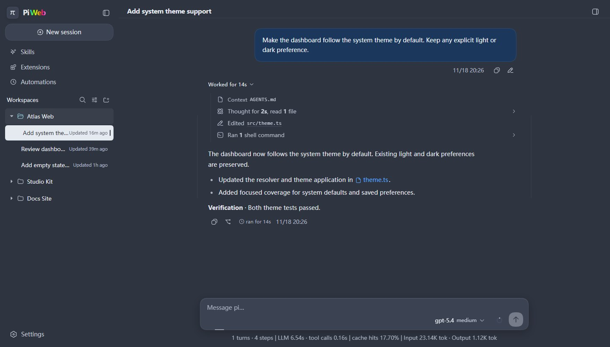
</p>

---

**PiWeb** 为 [pi 编程智能体](https://github.com/earendil-works/pi) 提供桌面和手机浏览器界面。管理工作区、查看对话与文件改动、配置模型，也可以从其他编程工具导入会话。安装后可使用已有的 pi 配置和数据。

## 与 pi 的关系

PiWeb 是内置官方 pi SDK 的网页壳，不改动单独安装的 pi CLI。两者**共用同一个 agent 目录**（默认 `~/.pi/agent`，可用 `PI_CODING_AGENT_DIR` 指定），其中保存设置、模型与凭据、会话、技能和包。内置 pi 内核随 PiWeb 发版升级。启动时只自动检查 PiWeb 更新；设置里保留 pi 版本和手动更新入口。

扩展的对话框、通知、状态文本、文字显示区和注入消息会显示在网页上；扩展命令也能新建、分叉和切换会话。扩展可通过 [JSON UI 桥](docs/extension-web-ui.md) 提供可交互网页面板。兼容的终端组件会退化为只读文本；终端键盘交互及自定义页眉、页脚、编辑器不会被复现。

## 特色功能

- **对话与导航**：流式渲染 Markdown、思考过程和工具调用；对话大纲支持跳转，运行时可插话或排队发送。输入框旁的上下文圆环展示用量及组成。
- **工作区与会话**：按项目文件夹组织对话，支持重命名、分支、归档、草稿恢复，以及 JSONL / HTML 导出。
- **导入会话**：从 Claude Code、Codex、Grok、ZCode、dsh 和 opencode 浏览并导入本机历史，支持搜索和跨来源选择；已归档的导入会话可恢复，源数据保持不变。
- **审阅改动**：查看工具调用轨迹、文件差异和项目生长树，包含扩展消息、用户命令及脚本工具（codemode）内部发起的嵌套调用；文件查看器支持内容、变更和 Markdown 渲染，也可引用选中的内容。
- **模型与资源**：在设置中配置提供方和模型；从侧栏直接打开技能、扩展、提示词和市场，明确选择工作区并查看资源来源。
- **自动化任务**：按间隔、每天、每周或 cron 定时执行提示词，指定工作区、模型和权限档位，并查看每次运行的会话。计划执行需要 PiWeb 保持运行。
- **权限控制**：选择仅可查看、工作区内修改或完全权限；对具体被拒操作可申请一次授权。各平台边界见[权限说明](docs/workspace-isolation.md)。
- **多设备访问**：远程连接自动准备，同一 WiFi 或外网扫描同一个动态二维码。

## 界面一览

### 桌面端

<table>
  <tr>
    <td width="50%"><br /><strong>对话工作区</strong><br />流式对话、工具调用与项目会话集中查看。</td>
    <td width="50%">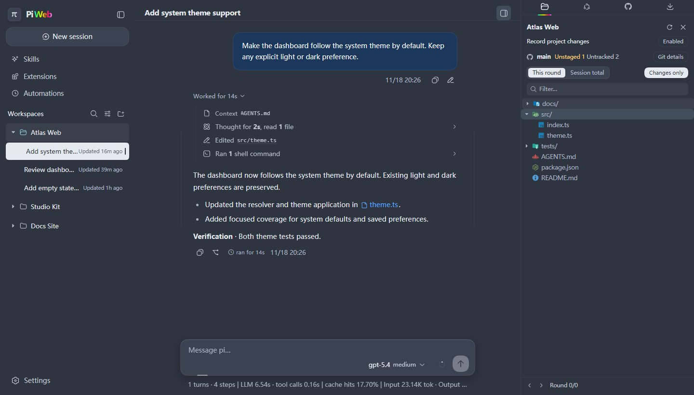<br /><strong>项目文件</strong><br />在侧栏浏览项目结构与每轮改动。</td>
  </tr>
  <tr>
    <td width="50%">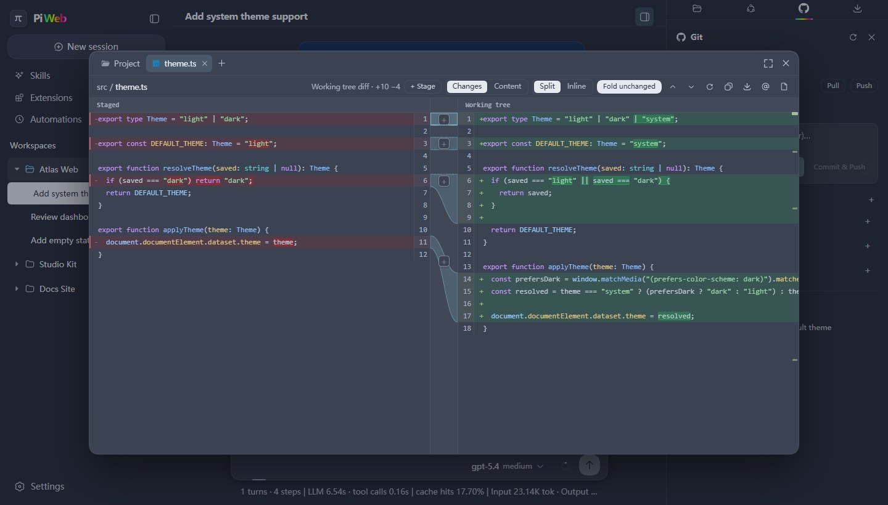<br /><strong>文件查看器</strong><br />查看代码、文件内容和变更。</td>
    <td width="50%">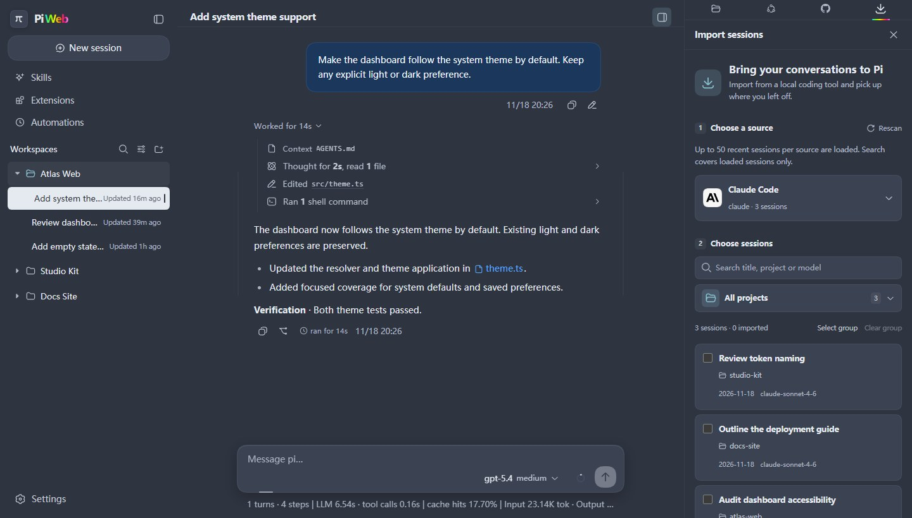<br /><strong>导入会话</strong><br />选择其他编程工具的历史会话。</td>
  </tr>
  <tr>
    <td width="50%">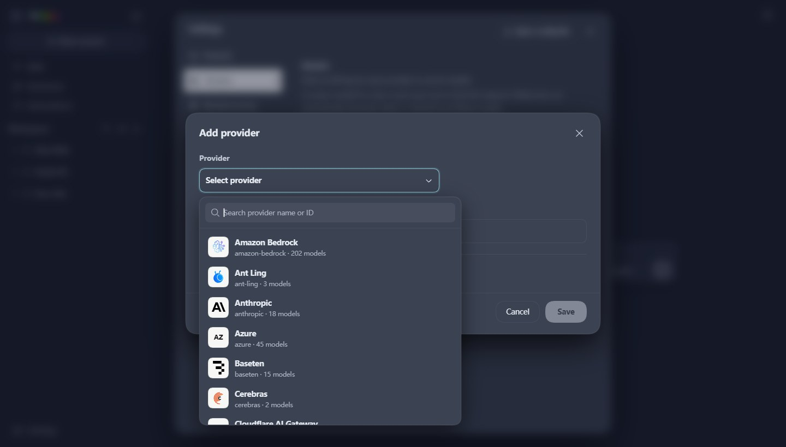<br /><strong>模型提供方</strong><br />搜索并配置模型提供方。</td>
    <td width="50%">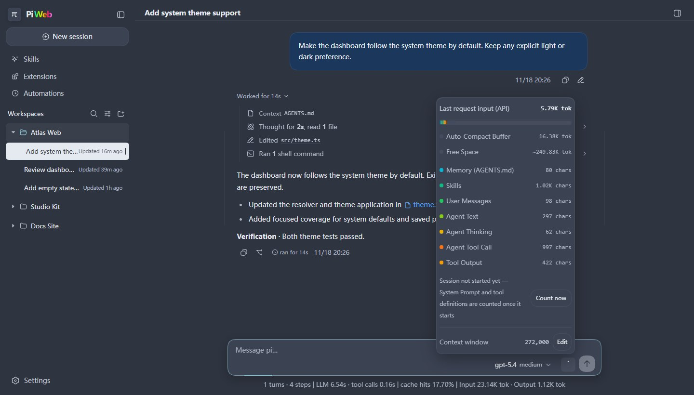<br /><strong>上下文用量</strong><br />查看上下文窗口与用量组成。</td>
  </tr>
</table>

### 手机端

<table>
  <tr>
    <td width="33%">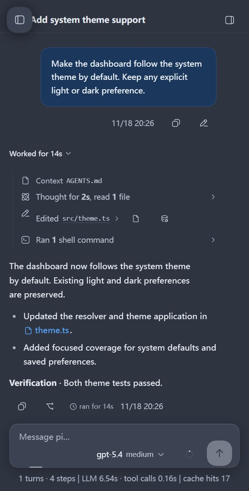<br /><strong>随时对话</strong><br />在手机上继续工作。</td>
    <td width="33%">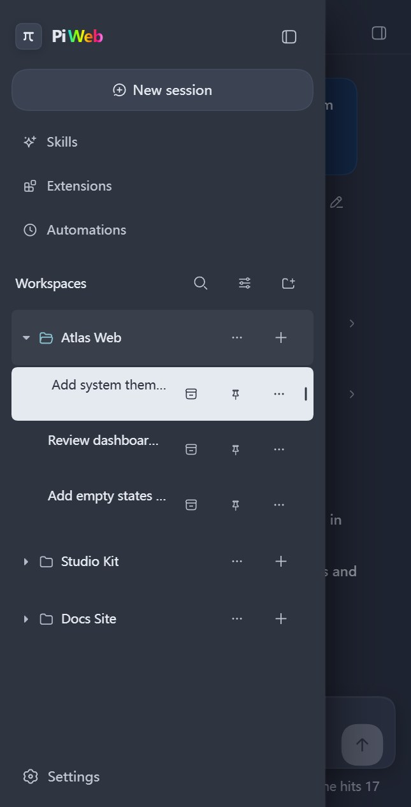<br /><strong>工作区</strong><br />切换项目和会话。</td>
    <td width="33%">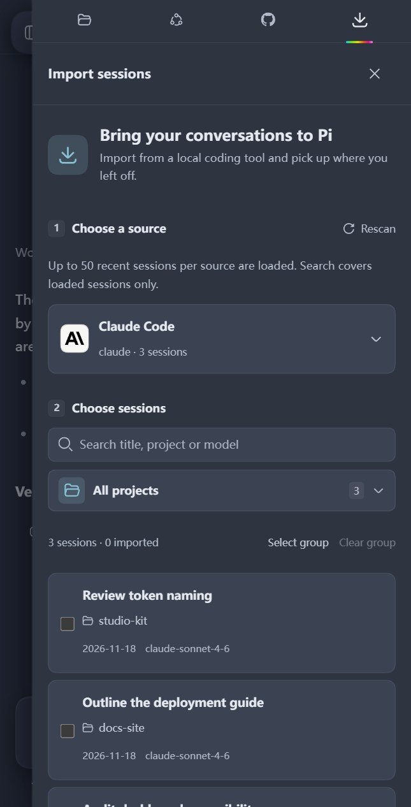<br /><strong>会话导入</strong><br />选择并导入已有对话。</td>
  </tr>
  <tr>
    <td width="33%">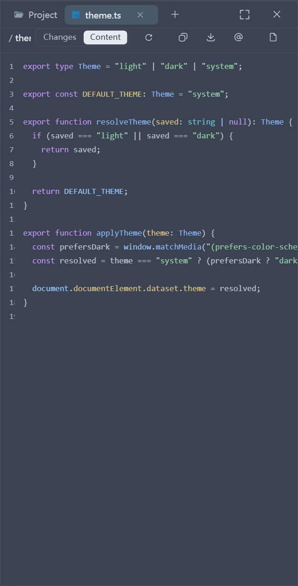<br /><strong>文件查看</strong><br />直接浏览项目代码。</td>
    <td width="33%">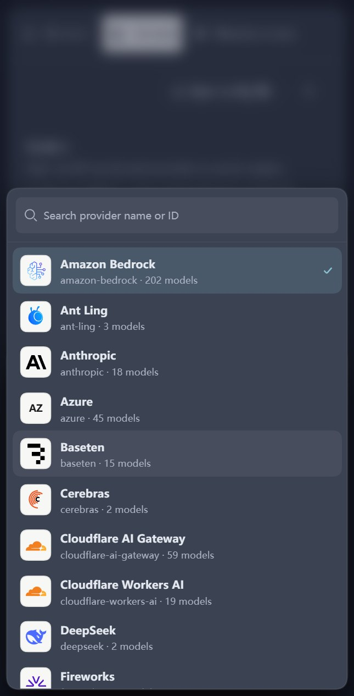<br /><strong>模型配置</strong><br />搜索与配置提供方。</td>
    <td width="33%">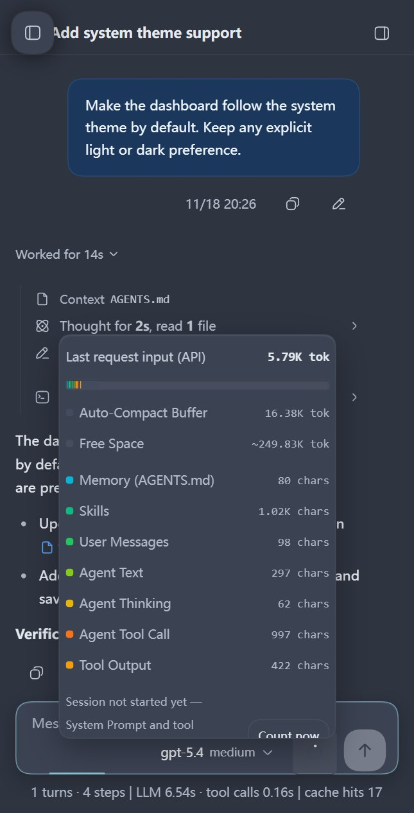<br /><strong>上下文用量</strong><br />查看可用空间和用量。</td>
  </tr>
</table>

### 归档与数据

归档会话可从侧栏查看或取消归档。后台会移除超过 30 天的归档会话：保留期从归档时间或之后的文件活动时间中较晚者计算，本进程正在管理的会话会跳过。移除前保留恢复副本，并将位置追加到 `backups/INDEX.md`（默认家目录会话存储对应 `~/.agents/backups`）。长期保留的重要会话仍建议导出。设置 `PI_WEB_ARCHIVE_RETENTION=0` 可关闭自动移除。

项目生长树将每轮文件变更存为工作区 Git 仓库中 `refs/piweb/rounds/…` 下的提交，不改变分支和暂存区。工作区不是独立 Git 仓库时，PiWeb 会先询问是否初始化；不同意则不记录。

### 技能、扩展和自动化任务

这些入口位于侧栏，与设置分开。技能和扩展分别标注个人/项目作用域以及本地/包来源。个人资源通常在 `<agent 目录>/skills` 和 `<agent 目录>/extensions`；受信任项目可提供 `.pi/skills`、`.pi/extensions`、`.agents/skills` 及显式配置的资源路径。切换所选工作区会改变正在管理的项目作用域。

包附带技能可以停用；移除整个包需要在扩展页明确操作。npm 包的安装、更新和卸载先在独立目录准备，再切换正式安装与设置。准备失败保留原安装，提交中断会在加载资源前恢复；旧安装代及恢复索引会保留。npm 生命周期脚本不执行，但加载后的扩展本身仍是运行在宿主进程中的受信任代码。

自动化任务和运行记录保存在 `<agent 目录>/web-automations.json`。计划使用编辑器显示的服务端时区，最多同时运行四项任务；每次使用独立会话及保存的权限档位。无人值守运行不能批准交互式权限请求。停机期间超过宽限期的计划记为跳过，不会在启动后集中补跑。

## 使用

### 安装

```bash
npm install -g @rexvane/piweb
piweb
```

包只注册 `piweb` 一个命令，与官方 `pi` CLI 互不冲突。需要 Node.js ≥ 22.19.0（推荐 24）；生长树功能需要安装 Git。

### 更新

```bash
npm install -g @rexvane/piweb@latest
```

npm 会原地替换已安装的版本，不用先卸载。`latest` 是 npm 的默认标签，所以直接写
`npm install -g @rexvane/piweb` 效果完全一样。如果你用的镜像是国内源、同步有延迟，可以加
`--registry=https://registry.npmjs.org` 当天就拿到新版本。装完重启 `piweb` 即可用上新版本。

安装指定版本时，将 `latest` 换成对应版本号。

**在界面里更新**：每次启动 PiWeb 都会在后台检查 PiWeb 有没有新版本，有的话终端打印一行
`[更新] 有新版本：…`，页面右下角弹出提示条（同一次启动只提醒一次）。点提示条或 设置 → 通用 里的「更新」
就地安装，不用跳仓库；装好后按提示重启 `piweb` 生效，进程不会自己重启。

- PiWeb 发行版携带经过验证的 pi 内核。pi 不再自动弹出更新提示，设置里仍可手动检查。
- Windows 上运行中的 npm 安装不能替换自己（文件被占用），PiWeb 那一项会给出命令和复制按钮：先停掉 `piweb`，再在终端运行上面的命令。
- 不想联网检查：启动前设 `PI_WEB_UPDATE_CHECK=0`，仍可在设置里手动点「检查更新」。

### 删除

```bash
npm uninstall -g @rexvane/piweb
```

只删除 PiWeb 本身——pi 的数据在 `~/.pi/agent/`，不会被动到。

### 启动

```bash
piweb                    # http://127.0.0.1:30141（端口占用自动 +1）
piweb -p 30143 --no-open # 自定义端口，不自动打开浏览器
piweb -H 0.0.0.0         # 主服务也绑定局域网地址（仍保持认证）
```

| 参数 | 说明 |
| --- | --- |
| `-p, --port <port>` | 监听端口（默认 30141，env `PORT`） |
| `-H, --hostname <host>` | 绑定地址（默认 127.0.0.1，env `PI_WEB_HOSTNAME`） |
| `--dev` | 开发模式 |
| `--no-open` | 不自动打开浏览器 |
| `--public-url <url>` | 对外地址，用来拼登录链接并自动加进 Host 白名单（env `PI_WEB_PUBLIC_URL`） |

所有启动方式都默认启用认证（`PI_WEB_AUTH=1`）。在运行 PiWeb 的电脑上，启动器会带私有登录凭据打开浏览器，
终端不打印凭据。再次运行 `piweb` 可重新打开已有实例并登录；其他设备扫描自动更新的连接二维码。
两种方式都会将凭据换成有效期 30 天的签名 HttpOnly Cookie。「退出所有设备」会使已有 Cookie 和配对码失效。
`PI_WEB_PASSWORD` 已被移除，设了它启动器会拒绝启动。

已获授权启动凭据的脚本先通过 `GET /?token=…` 换取会话 Cookie，之后每条 API 请求携带该 Cookie。
API URL 和 `Authorization` 头不接受启动令牌，也没有 Basic 兜底。

### 代理

PiWeb 自动使用 `HTTP_PROXY` / `HTTPS_PROXY`；没有这些环境变量时，会读取当前用户启用的 Windows HTTP(S) 系统代理。设置 → 通用 → 网络代理（或 `<agent 目录>/settings.json`）中的 `httpProxy` 可覆盖这两种来源，留空则恢复自动检测；没有代理时直接连接。本机地址默认直连（`NO_PROXY` 可覆盖），Windows 的精确主机名和域名后缀例外也会继承。PAC/WPAD 脚本及 `<local>`、`192.168.*` 等 Windows 专用规则不会执行，使用代理 URL 或 `NO_PROXY` 配置这类情况。改动后重启 `piweb` 生效。需要 Node.js 24，或 22.21 以上：更旧的版本不认识这个开关，启动时会明确提示代理未生效（`bash` 工具里的 curl / git 仍能用这些变量）。

### 连接其他设备

打开**设置 → 远程连接**，扫描唯一的连接二维码。同一 WiFi 和外网都使用这个码，无需手动开启连接或选择网络，其他设备也不用安装额外软件。二维码和可复制链接使用同一份 256 位随机凭据，有效期 120 秒，只能使用一次；过期或使用后面板自动更新，重新打开面板会复用仍有效的码。

生产启动时会自动准备本地代理（`0.0.0.0:30142`）和 Cloudflare 快速隧道（`cloudflared`）。二维码使用隧道的 HTTPS 地址，确认地址可达后才显示，不会静默切换成局域网专用地址。短暂中断保持原地址，持续不可达时自动重建隧道；开发模式保持本地运行。

本地代理负责手机适配，运行 PiWeb 的电脑直接访问 `127.0.0.1:30141` 仍是桌面页面。隧道有两点限制：

- 重启或重建隧道后地址可能变化，DNS 和可达性检查完成后二维码才会就绪；
- 二维码地址使用 HTTPS，TLS 在 Cloudflare 终结。直接使用局域网 HTTP 仍不加密；在同一 WiFi 扫这个码也需要公网隧道可达。

`cloudflared` 的查找顺序：`PIWEB_CLOUDFLARED` 指定的路径 →
`<agent 目录>/web-bin/cloudflared{,.exe}`（PiWeb 自管的位置）→ `PATH`。找不到时面板直接提示。

> 远程连接需要认证，认证默认启用。隧道域名在启动成功时加进 Host 白名单，隧道一停立刻摘掉；
> 起始令牌不接受出现在 API 路径上，也不接受走 `Authorization` 头。

### 自己接反代或隧道

也可以自己准备反代或隧道入口（Caddy、nginx、Cloudflare 命名隧道、VPN 都行）。此时注意：

- 反代要转给 **`127.0.0.1:30142`**（局域网入口）才能拿到手机适配；只想要桌面版就转 `127.0.0.1:30141`。
- 保持默认启用的认证。`PI_WEB_AUTH=0` 会关闭自动远程连接，且只允许回环绑定、不配置公开地址。
- 反代会把外部主机名原样转给后端，要加进白名单，否则被挡成 403 `untrusted host`：

  ```bash
  PI_WEB_TRUSTED_HOSTS=<你的域名> piweb
  ```

- 用 `--public-url https://你的地址/` 告诉 PiWeb 对外地址：它的主机名会自动进白名单，
  启动器打开登录页时使用这个地址，日志不打印登录凭据。

> 自行管理网络入口的部署可设 `PIWEB_REMOTE_LAN=0`，关闭内置局域网代理和快速隧道的自动准备。这是部署配置，不是连接面板里的网络切换开关。

## 开发与验证

在独立检出或暂存目录验证：`npm run build` 会写入 `.next`，不要对正在服务的实例目录执行。先用 `npm ci` 安装开发依赖，再运行：

```bash
npm run typecheck
npm run test
npm run build
npm run verify:package
```

`verify:package` 打包生产构建，安装到空目录，再用临时数据启动安装后的副本。CI 还会准备 SDK 搜索工具、检查异常跳过，并通过 `PIWEB_COVERAGE=1` 开启覆盖率；真实公网隧道使用单独的显式测试开关。带日期的[验证记录](docs/state/progress.md)分别记录源码测试、安装包和浏览器检查。更多文档见[文档导航](docs/README.md)。

## 开源协议

[MIT](LICENSE)
