# PiWeb

<p align="center">
  <strong>为 Pi 编程智能体打造的现代 Web 界面。</strong>
</p>

<p align="center">
  <a href="README.md">English</a> | <strong>简体中文</strong>
</p>

<p align="center">
  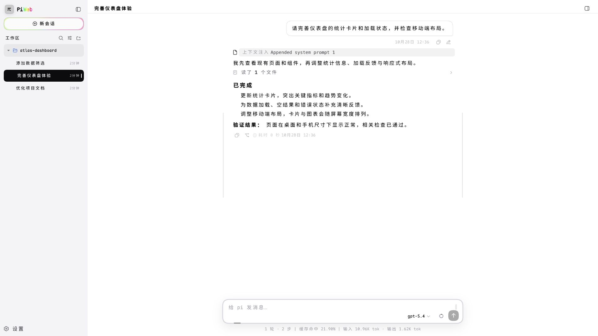
</p>

---

**PiWeb** 为 [pi 编程智能体](https://github.com/earendil-works/pi) 提供桌面和手机浏览器界面。管理工作区、查看对话与文件改动、配置模型，也可以从其他编程工具导入会话。安装后可使用已有的 pi 配置和数据。

## 与 pi 的关系

PiWeb 和 pi 是两个独立的程序，PiWeb 也不是 pi 的另一个版本：它是网页壳，内置官方 pi SDK，不改动单独安装的 pi CLI。两者**共用同一套配置**——同一个 agent 目录（`~/.pi/agent`）里放着设置、模型与凭据、会话、技能和包，所以在 pi CLI 里开的对话，网页里立刻能看到，反过来也一样。内置 pi 内核随 PiWeb 发版升级。启动时只自动检查 PiWeb 更新；设置里保留 pi 版本和手动更新入口。底层跑的就是原生 pi，插件在网页端的兼容（尤其是交互类插件）还没做完，目前以安装、卸载、启停为准。

## 特色功能

- **对话与导航**：流式渲染 Markdown、思考过程和工具调用；对话大纲支持跳转，运行时可插话或排队发送。输入框旁的上下文圆环展示用量及组成。
- **工作区与会话**：按项目文件夹组织对话，支持重命名、分支、归档、草稿恢复，以及 JSONL / HTML 导出。
- **导入会话**：从 Claude Code、Codex、Grok、ZCode、dsh 和 opencode 浏览并导入本机历史，支持搜索和跨来源选择；已归档的导入会话可恢复，源数据保持不变。
- **审阅改动**：查看工具调用轨迹、文件差异和项目生长树；文件查看器支持内容、变更和 Markdown 渲染，也可引用选中的内容。
- **模型与扩展**：管理内置或自定义提供商、模型、pi 包和技能；查看提示词来源，并使用只读、工作区写入或完全访问预设管理工具权限。
- **多设备访问**：桌面和手机浏览器均可使用；可通过内置局域网入口或 Cloudflare 快速隧道远程连接。

## 界面一览

### 桌面端

<table>
  <tr>
    <td width="50%"><br /><strong>对话工作区</strong><br />流式对话、工具调用与项目会话集中查看。</td>
    <td width="50%">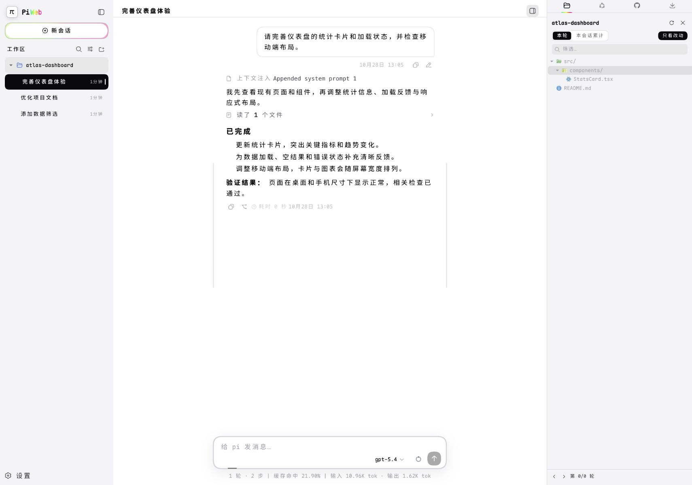<br /><strong>项目文件</strong><br />在侧栏浏览项目结构与每轮改动。</td>
  </tr>
  <tr>
    <td width="50%">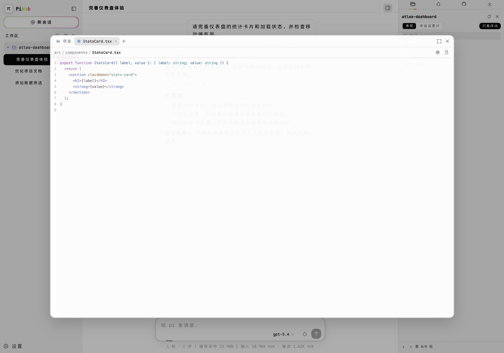<br /><strong>文件查看器</strong><br />查看代码、文件内容和变更。</td>
    <td width="50%">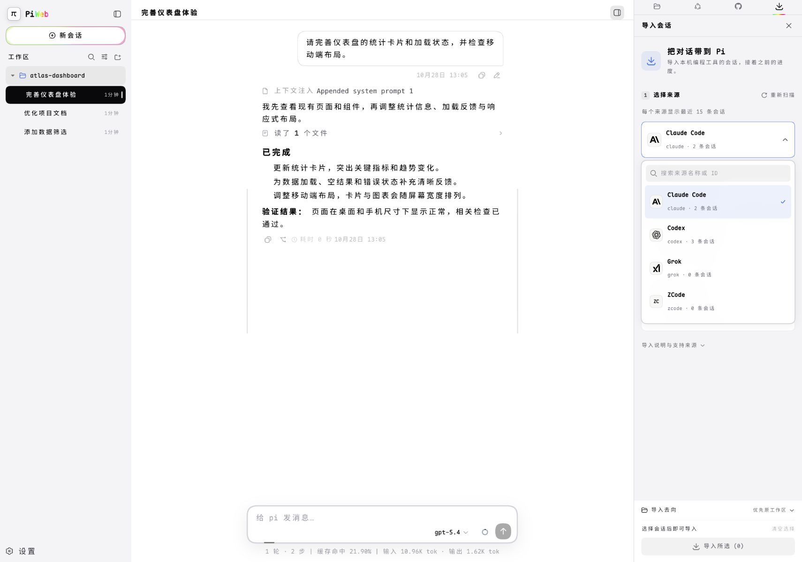<br /><strong>导入会话</strong><br />选择其他编程工具的历史会话。</td>
  </tr>
  <tr>
    <td width="50%">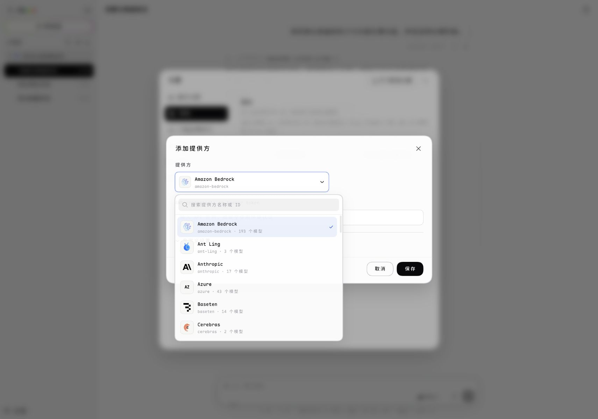<br /><strong>模型提供方</strong><br />搜索并配置模型提供方。</td>
    <td width="50%">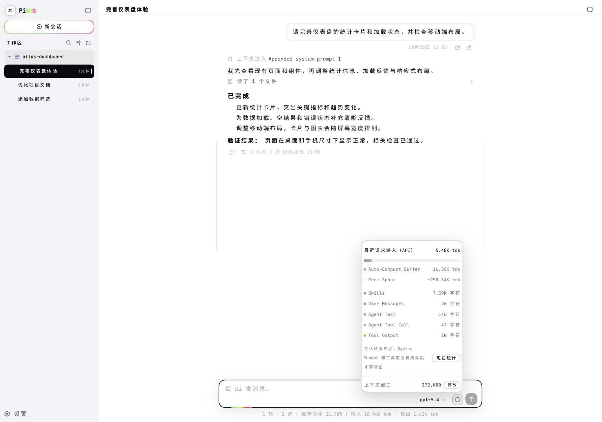<br /><strong>上下文用量</strong><br />查看上下文窗口与用量组成。</td>
  </tr>
</table>

### 手机端

<table>
  <tr>
    <td width="33%">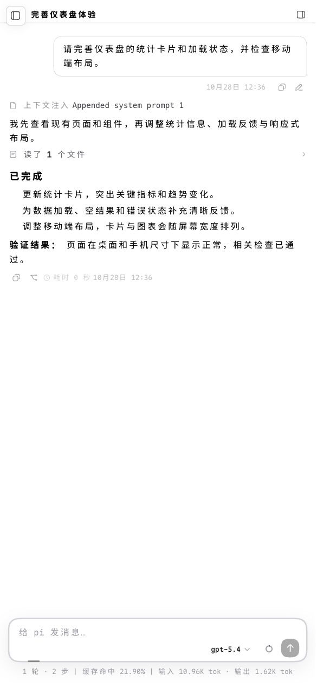<br /><strong>随时对话</strong><br />在手机上继续工作。</td>
    <td width="33%">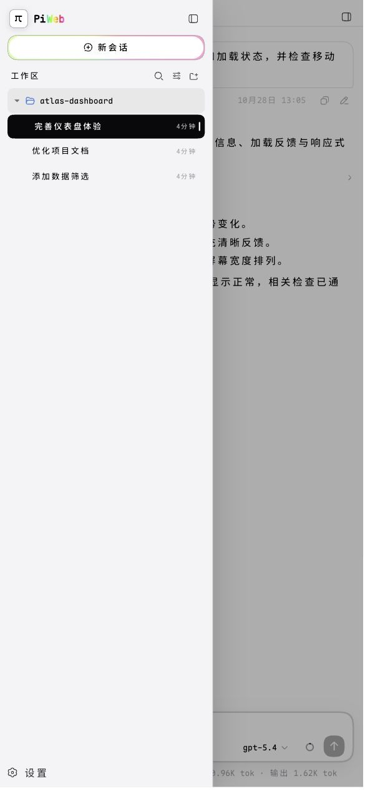<br /><strong>工作区</strong><br />切换项目和会话。</td>
    <td width="33%">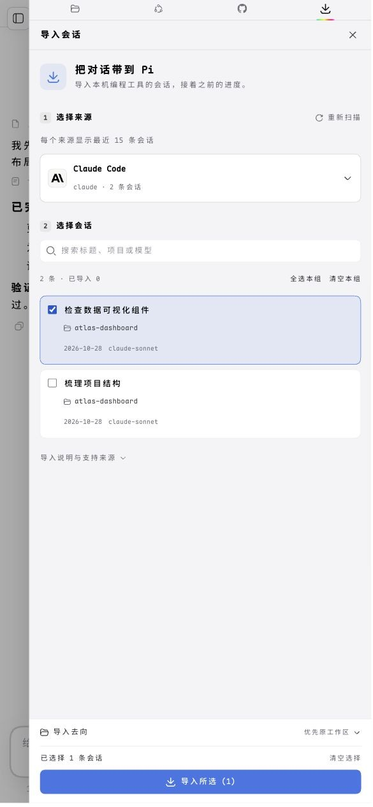<br /><strong>会话导入</strong><br />选择并导入已有对话。</td>
  </tr>
  <tr>
    <td width="33%">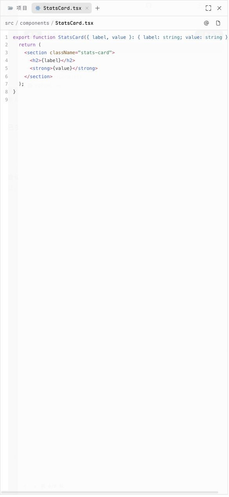<br /><strong>文件查看</strong><br />直接浏览项目代码。</td>
    <td width="33%">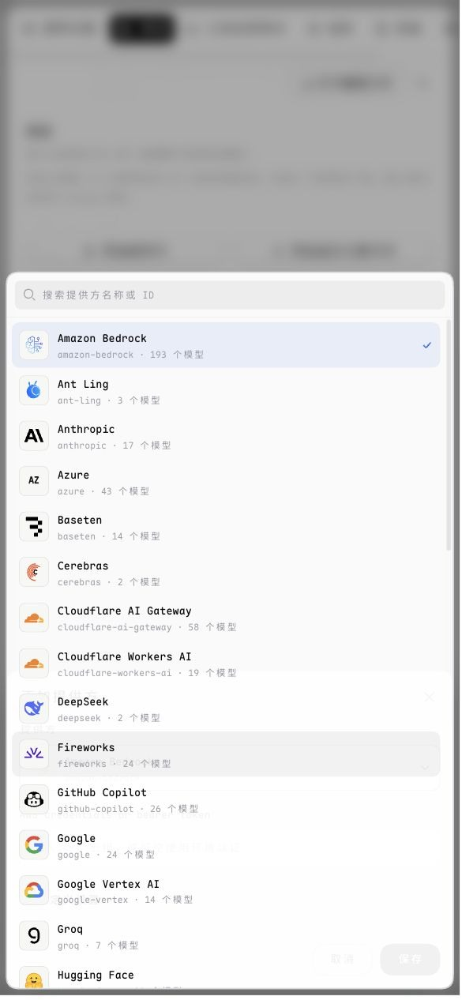<br /><strong>模型配置</strong><br />搜索与配置提供方。</td>
    <td width="33%">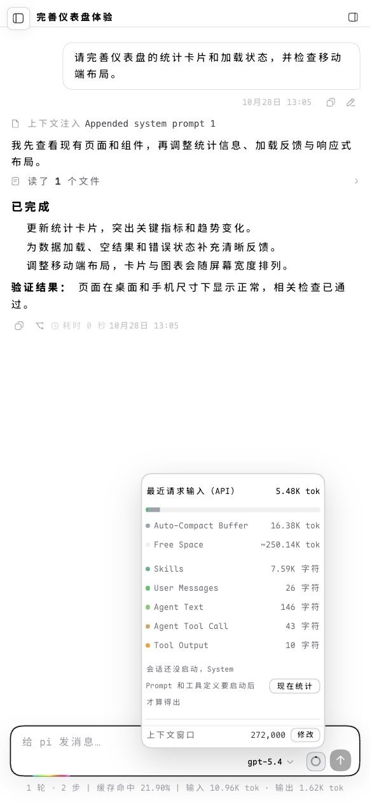<br /><strong>上下文用量</strong><br />查看可用空间和用量。</td>
  </tr>
</table>

### 归档与数据

归档会话可从侧栏查看或取消归档。后台会删除超过 30 天的归档会话：保留期从归档时间或之后的最后一次活动时间中较晚者计算，正在使用的会话会跳过。删除会移除会话文件，请提前导出需要保留的内容。

项目生长树将每轮文件变更存为工作区 Git 仓库中 `refs/piweb/rounds/…` 下的提交，不改变分支和暂存区。工作区不是独立 Git 仓库时，PiWeb 会先询问是否初始化；不同意则不记录。

## 使用

### 安装

```bash
npm install -g @rexvane/piweb
piweb
```

包只注册 `piweb` 一个命令，与官方 `pi` CLI 互不冲突。需要 Node.js ≥ 22.19.0（推荐 24）；生长树功能需要安装 Git。

### 更新

```bash
npm install -g @rexvane/piweb@latest
```

npm 会原地替换已安装的版本，不用先卸载。`latest` 是 npm 的默认标签，所以直接写
`npm install -g @rexvane/piweb` 效果完全一样。如果你用的镜像是国内源、同步有延迟，可以加
`--registry=https://registry.npmjs.org` 当天就拿到新版本。装完重启 `piweb` 即可用上新版本。

也可以装指定版本：`npm install -g @rexvane/piweb@0.3.29`。

**在界面里更新**：每次启动 PiWeb 都会在后台检查 PiWeb 有没有新版本，有的话终端打印一行
`[更新] 有新版本：…`，页面右下角弹出提示条（同一次启动只提醒一次）。点提示条或 设置 → 通用 里的「更新」
就地安装，不用跳仓库；装好后按提示重启 `piweb` 生效，进程不会自己重启。

- PiWeb 发行版携带经过验证的 pi 内核。pi 不再自动弹出更新提示，设置里仍可手动检查。
- Windows 上运行中的 npm 安装不能替换自己（文件被占用），PiWeb 那一项会给出命令和复制按钮：先停掉 `piweb`，再在终端运行上面的命令。
- 不想联网检查：启动前设 `PI_WEB_UPDATE_CHECK=0`，仍可在设置里手动点「检查更新」。

### 删除

```bash
npm uninstall -g @rexvane/piweb
```

只删除 PiWeb 本身——pi 的数据在 `~/.pi/agent/`，不会被动到。

### 启动

```bash
piweb                    # http://127.0.0.1:30141（端口占用自动 +1）
piweb -p 30143 --no-open # 自定义端口，不自动打开浏览器
piweb -H 0.0.0.0         # 局域网访问（会自动打开启动令牌登录）
```

| 参数 | 说明 |
| --- | --- |
| `-p, --port <port>` | 监听端口（默认 30141，env `PORT`） |
| `-H, --hostname <host>` | 绑定地址（默认 127.0.0.1，env `PI_WEB_HOSTNAME`） |
| `--dev` | 开发模式 |
| `--no-open` | 不自动打开浏览器 |
| `--public-url <url>` | 对外地址，用来拼登录链接并自动加进 Host 白名单（env `PI_WEB_PUBLIC_URL`） |

认证由 `PI_WEB_AUTH=1` 打开（只要这台机器可能被本机以外访问，启动器默认就会开）。登录只剩**启动令牌**一条路：
打开启动时打印的 `…/?token=…` 链接，令牌换一张签名 Cookie，之后浏览器不再需要令牌。
`PI_WEB_PASSWORD` 已被移除 —— 设了它启动器会直接拒绝启动。远程访问不要用裸 HTTP。

脚本认证走同样两步：先用 `GET /?token=…` 换到会话 Cookie，之后每条 API 请求都带上这张 Cookie；
没有 Basic 兜底。

### 手机上用：内置的「远程连接」插件

PiWeb 自带一个内置插件负责这件事，在**设置 → 远程连接**里开关，客户端不用装任何东西。

它有两层入口：

**局域网入口（默认开启）** —— 一个只做手机适配的反向代理，绑 `0.0.0.0:30142`。
同一个 WiFi 下的设备直接打开面板里列出的地址即可，拿到的是适配过手机的页面；
本机直连 `127.0.0.1:30141` 仍是原样的桌面页面（回环 Host 不注入）。

**公网入口（默认关闭）** —— 打开后 PiWeb 会拉起一条 Cloudflare 快速隧道（`cloudflared`），
Cloudflare 分配一个 `https://<随机名>.trycloudflare.com` 地址，任何浏览器直接打开即可，
**不需要在每台设备上装客户端**。代价两条：

- 地址每次启动都会变，而且拿到之后还要十几秒才在全球 DNS 生效（面板会显示「生效中」）；
- TLS 在 Cloudflare 终结，那一跳能看到明文。要端到端加密就用可信 VPN。

`cloudflared` 的查找顺序：`PIWEB_CLOUDFLARED` 指定的路径 →
`<agent 目录>/web-bin/cloudflared{,.exe}`（PiWeb 自管的位置）→ `PATH`。找不到时面板直接提示。

> 公网入口一开，认证就是强制的。隧道域名由插件在启动成功时加进 Host 白名单，隧道一停立刻摘掉；
> 起始令牌不接受出现在 API 路径上，也不接受走 `Authorization` 头。

### 自己接反代或隧道

不想用内置插件，也可以自己准备入口（Caddy、nginx、Cloudflare 命名隧道、VPN 都行）。此时注意：

- 反代要转给 **`127.0.0.1:30142`**（局域网入口）才能拿到手机适配；只想要桌面版就转 `127.0.0.1:30141`。
- 必须设 `PI_WEB_AUTH=1`。绑回环时 PiWeb 判断不出「是否暴露」，需要你显式打开认证。
- 反代会把外部主机名原样转给后端，要加进白名单，否则被挡成 403 `untrusted host`：

  ```bash
  PI_WEB_TRUSTED_HOSTS=<你的域名> piweb
  ```

- 用 `--public-url https://你的地址/` 告诉 PiWeb 对外地址：它的主机名会自动进白名单，
  启动日志里打印的登录链接也会用这个地址而不是回环地址。

> 关掉局域网入口用 `PIWEB_REMOTE_LAN=0`；整个认证关掉用 `PI_WEB_AUTH=0`（后者只在纯本机使用时才安全）。

## 开源协议

[MIT](LICENSE)
